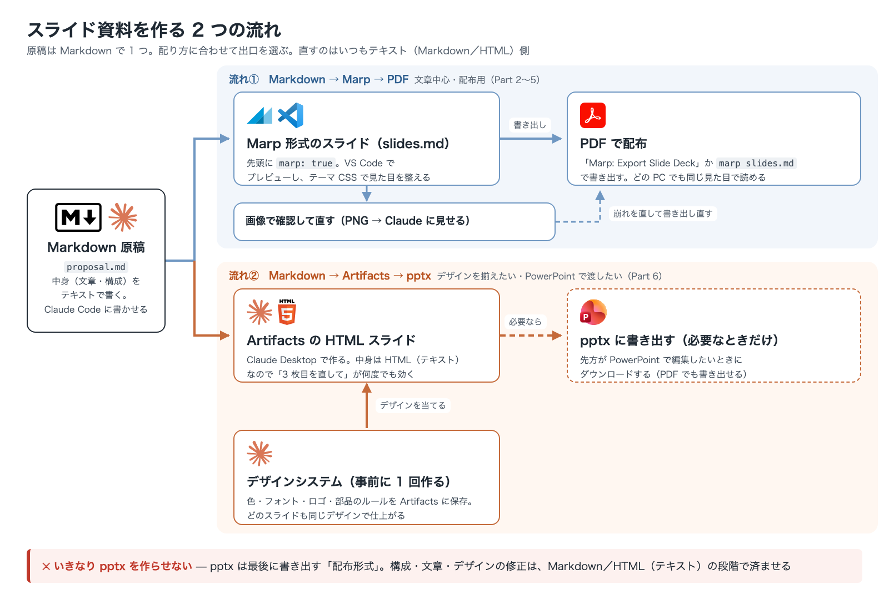

# Claude Code 中級者研修 Marp でスライドを作る

## 概要

| 項目 | 内容 |
|---|---|
| 研修名 | Marp でスライドを作る — Markdown 原稿から PDF／pptx まで仕上げる |
| 形式 | 座学 + ハンズオン |
| 所要時間 | 6 時間 |
| 定員 | 最大 4 名 |
| 対象 OS | Windows / macOS 共通（コマンドは両方を併記） |

## 対象者

- Claude Code の基本操作（起動・プランモード・ファイルの読み書き依頼）を一通り経験している人
- クライアント向けの提案スライドを日常的に作っている人
- PowerPoint での作り直しに時間を取られていると感じている人

## 前提条件

- Claude Code のインストールとログインが済んでいること
- VS Code が使えること
- Claude Desktop（Claude のデスクトップアプリ）が使えること（Part 6 の Artifacts で使う）
- 有料サブスクリプション（Pro 以上）を利用していること

### この研修のゴール

- **資料作成の 2 つの流れを使い分けられるようにする** — 原稿は Markdown で 1 つにまとめ、「Markdown → Marp → PDF」と「Markdown → Artifacts → pptx」のどちらで仕上げるかを、配り方に合わせて選べるようになる
- **スライドを「作り直さない」状態にする** — 修正依頼を出せばその 1 枚だけが直り、PDF や pptx を書き出し直すだけで済む作り方を身につける
- **見た目を自分で制御できるようにする** — Marp ではテーマ CSS、Artifacts ではデザインシステムを使って、色・文字量・図の配置を AI に指示して整えられるようになる
- **崩れを AI に検出させる** — 出来上がったスライドを画像にして Claude Code に見せ、レイアウト崩れを自分で直させるループを回せるようになる

## 目次

- [Part 1 座学：資料作成の 2 つの流れ](#part-1-座学資料作成の-2-つの流れ)
- **流れ①　Markdown → Marp → PDF**
  - [Part 2 Marp のセットアップ：2 つの手段](#part-2-marp-のセットアップ2-つの手段)
  - [Part 3 ハンズオン：提案書を Marp スライドにして PDF にする](#part-3-ハンズオン提案書を-marp-スライドにして-pdf-にする)
  - [Part 4 Marp の見た目を仕上げる](#part-4-marp-の見た目を仕上げる)
  - [Part 5 レビューのループ](#part-5-レビューのループ)
- **流れ②　Markdown → Artifacts → pptx**
  - [Part 6 ハンズオン：Artifacts で HTML スライドを作り、必要なら pptx に書き出す](#part-6-ハンズオンartifacts-で-html-スライドを作り必要なら-pptx-に書き出す)
- [Part 7 ふりかえり・宿題](#part-7-ふりかえり宿題)
- [付録 A：Marp 記法チートシート](#付録-amarp-記法チートシート)
- [付録 B：よくあるエラーと対処](#付録-bよくあるエラーと対処)
- [付録 C：Windows / macOS コマンド対応表](#付録-cwindows--macos-コマンド対応表)

---

# Part 1 座学：資料作成の 2 つの流れ

## 1-1. いきなり pptx を作らせない

PowerPoint ファイル（`.pptx`）は、見た目のとおりのテキストが入っているわけではない。中身は圧縮された XML の集まりで、**AI が開いて読み直し、部分的に直すのが苦手な形式**である。

このため、Claude Code にいきなり pptx を作らせると次のことが起きる。

- 「3 枚目の表現を変えて」と頼むと、**全部を作り直す**ことになる
- 作り直すたびに、前回こだわって直した箇所が元に戻る
- どこが変わったのかを差分で確認できない
- 毎回ゼロから作るので、色・フォント・レイアウトが資料ごとにぶれる

つまり、pptx は「AI と一緒に何度も磨き上げる」途中の形式には向かない。コンサルの資料作成は、何度も磨き上げる仕事である。

そこでこの研修では、**構成・文章・デザインの修正はテキスト（Markdown や HTML）の段階で済ませ、PDF や pptx は最後に書き出す「配布形式」として扱う**。

## 1-2. 原稿は Markdown で 1 つ

スライドの中身（構成・文章・数字）は、まず **Markdown の原稿**（例：`proposal.md`）にまとめる。原稿も Claude Code に書かせてよい。

中身がテキストなので、次のことが成り立つ。

- **1 か所だけ直せる** — 「3 章の表を 2 列にして」と頼めば、その部分の行だけが書き換わる
- **差分が見える** — 修正前と修正後の違いが行単位で分かる
- **AI が読み直せる** — Claude Code が自分で読んで、表記ゆれや数字の不整合を検出できる
- **出口を選べる** — 同じ原稿から、Marp のスライドにも、Artifacts のスライドにも仕立てられる

## 1-3. 2 つの流れ

原稿ができたら、配り方に合わせて次の 2 つの流れから出口を選ぶ。

- **流れ①　Markdown → Marp → PDF** — 原稿を Marp 形式のスライドにして、VS Code やコマンドで PDF に書き出す（Part 2〜5）
- **流れ②　Markdown → Artifacts → pptx** — Claude の Artifacts（アーティファクト）で、事前に作っておいた**デザインシステム**を当てた HTML スライドにする。PowerPoint で渡す必要があるときだけ pptx に書き出す（Part 6）


*原稿は Markdown で 1 つ。流れ①は Marp で PDF に、流れ②は Artifacts のデザインシステムを当てた HTML スライドから、必要なときだけ pptx に書き出す（元データは `refs/marp-artifacts-slide-flows.html`）*

| | 流れ① Markdown → Marp → PDF | 流れ② Markdown → Artifacts → pptx |
|---|---|---|
| 向いている資料 | 文章中心の資料・配布用（報告書、提案書、研修資料） | デザインを揃えたい資料、PowerPoint で渡したい資料 |
| スライドを作る場所 | VS Code（`slides.md` を Marp でプレビュー） | Claude Desktop の Artifacts |
| デザイン | Marp のテーマ（CSS ファイル） | 事前に作った**デザインシステム** |
| 直し方 | 「3 枚目を直して」で Markdown が書き換わる | 「3 枚目を直して」で HTML スライドが書き換わる |
| 最後の形式 | PDF | pptx（PDF も可） |
| 必要な準備 | VS Code ＋ Marp 拡張、または marp-cli（Part 2） | デザインシステムを 1 回作る（Part 6） |

## 1-4. 使い分け

| 状況 | 選ぶ流れ |
|---|---|
| クライアントに提出・配布する | **流れ①**（Marp → PDF） |
| 社内で何度も内容を練る | **原稿の Markdown のまま**。スライドにするのは最後だけ |
| 会社のデザインで統一したい | **流れ②**（デザインシステムを当てた Artifacts のスライド） |
| 先方が PowerPoint で中身を編集して使い回す | **流れ②**で作り、最後に pptx に書き出す |
| Google スライドに取り込みたい | **流れ②**で pptx に書き出してから取り込む |

迷ったら **流れ①**から始める。準備が最も少なく、PDF はどの PC でも同じ見た目で読める。

> **注意** — pptx が必要な場面はある。ただしその場合も、pptx を最初から作らせるのではなく、**Artifacts のスライドを仕上げてから書き出す**。分かれ目は「先方に PowerPoint で編集させる必要があるかどうか」である。

---

# Part 2 Marp のセットアップ：2 つの手段

> ここから Part 5 までは **流れ①　Markdown → Marp → PDF** を扱う。

**Marp（マープ）** は、Markdown からスライドを作る仕組みである。ファイルの先頭に `marp: true` と書き、`---`（ハイフン 3 つ）で区切るだけで、区切りごとに 1 枚のスライドになる。

```markdown
---
marp: true
---

# 1 枚目のタイトル

本文をここに書く

---

# 2 枚目のタイトル
```

> **TIPS** — Marp は「スライド専用の Markdown」ではなく、**普通の Markdown に数行の指定を足しただけ**のもの。表・箇条書き・リンクの書き方は、原稿の `.md` ファイルとまったく同じである。

書き出した PDF は、**相手の環境で崩れない**（フォントもレイアウトも埋め込まれる）、**どの端末でも開ける**（PowerPoint が無くても、スマートフォンでも開ける）、**勝手に編集されない**（提出物としての体裁が保たれる）という点で、配布に向いている。

Marp から PDF を作る手段は 2 つある。どちらか一方でよい。

| 手段 | 向いている人 | Node.js |
|---|---|---|
| **VS Code の Marp 拡張機能** | まず試したい人。月に数回スライドを作る人 | 不要 |
| **marp-cli（コマンド）** | 同じ資料を何度も作り直す人。自動化したい人 | 必要 |

## 2-1. VS Code の Marp 拡張（Node.js 不要）

1. VS Code の拡張機能アイコンをクリックし、検索欄に「`Marp`」と入力
2. 「Marp for VS Code」（発行元: Marp team）をインストール
3. `marp: true` を含む `.md` ファイルを開き、`Ctrl + Shift + V`（Mac は `Cmd + Shift + V`）でスライドとしてプレビュー
4. `Ctrl + Shift + P`（Mac は `Cmd + Shift + P`）でコマンドパレットを開き、「`Marp: Export Slide Deck`」と入力して Enter
5. 保存先を選ぶ画面で、ファイルの種類が **PDF** になっていることを確認して保存

書き出しには Chrome または Edge が使われる。Windows には Edge が標準で入っているため追加インストールは不要である。

**入れておくべき設定が 2 つある。** 設定画面（`Ctrl + ,` / `Cmd + ,`）で検索してチェックを入れる。

| 設定キー | 何のため |
|---|---|
| `markdown.marp.enableHtml` | スライド内に書いた HTML（`<div>` 等）を有効にする。**初期状態は無効**なので、Claude Code が凝ったレイアウトを作ると表示されない |
| `markdown.marp.diagnostics.slideContentOverflow` | **文字がスライドからはみ出しているページに警告を出す。** 初期状態は無効。プレビューを開いている間だけ働く |

> **TIPS** — `slideContentOverflow` は Marp 拡張の隠れた便利機能である。1 枚に詰め込みすぎたページを、書き出す前に見つけられる。詰め込みすぎは Claude Code が作るスライドで最も起きやすい崩れなので、必ず有効にしておくこと。

## 2-2. marp-cli（Node.js 必要）

コマンド 1 行で PDF を作る方式。ファイルを保存するたび自動で作り直すこともできる。

**Node.js（JavaScript というプログラムを動かすための実行環境）** が必要である。[nodejs.org](https://nodejs.org/ja) から LTS 版（長期サポート版）を入れる。Mac で Homebrew を使っているなら `brew install node` でもよい。

入ったら、次の 1 行で marp-cli を入れる。

```
npm i -g @marp-team/marp-cli
```

`-g` は「グローバル（どのフォルダからでも使えるように）」の意味。1 回入れれば以後は不要である。

```
marp --version
```

でバージョンが表示されれば成功。実行は次の 1 行。

```
marp slides.md
```

> **注意** — `npx @marp-team/marp-cli@latest slides.md` という書き方でもインストールなしに実行できるが、**毎回 1〜2 分かかる**。実行のたびに部品を取りに行き、展開し直すためである。グローバルに入れておけば同じ資料が **3 秒台**で書き出せる。何度も作り直す前提なら、必ず入れておくこと。

## 2-3. `.marprc.yml` でオプションを外出しする

`marp slides.md` は、そのままだと **PDF ではなく HTML** を作る。PDF にするには `--pdf` を付ける必要があるが、毎回打つのは面倒である。

さらに、手元の画像を貼っている場合は `--allow-local-files`、独自デザインを当てるなら `--theme-set themes/` も要る。コマンドがどんどん長くなる。

```
marp --theme-set themes/ --pdf --allow-local-files slides.md
```

これらは **設定ファイルに書いておける**。スライドと同じフォルダに `.marprc.yml` という名前のファイルを作る。

```yaml
# このフォルダで marp コマンドを実行したときの既定の動作
allowLocalFiles: true   # スライドに貼った手元の画像を読み込む
themeSet: ./themes      # themes フォルダの CSS をテーマとして読み込む
pdf: true               # HTML ではなく PDF を書き出す
```

これで、次の 1 行だけで同じ結果になる。

```
marp slides.md
```

保存するたびに自動で作り直したい場合は `-w`（watch＝見張る）を付ける。修正を頼みながら PDF を開きっぱなしにしておける。

```
marp -w slides.md
```

## 2-4. 設定ファイルの落とし穴

`.marprc.yml` には、知らないと必ずはまる仕様がある。**設定ファイルは、コマンドを実行したフォルダにあるものしか読まれない。**

実際に確認した挙動が次のとおりである。

| 実行した場所 | 結果 |
|---|---|
| 設定ファイルと同じフォルダ | PDF になる |
| その **1 つ下**のフォルダ（親に設定ファイルがある） | **HTML になる**（親をさかのぼって探さない） |
| まったく無関係なフォルダ | HTML になる |
| `--config` で設定ファイルの場所を指定 | **どこからでも PDF になる** |

つまり、ホームフォルダに `.marprc.yml` を置いても「全体の既定値」にはならない。案件フォルダごとに置くか、`--config` を使うかの二択である。

**どこからでも同じ設定を使いたい場合**は、共通の設定ファイルを 1 つ作って `--config` で指す。

`~/.config/marp/marprc.yml`（Windows は `C:\Users\あなたの名前\.config\marp\marprc.yml`）を作る。

```yaml
allowLocalFiles: true
pdf: true
```

`themeSet` は入れない。設定ファイルからの相対パスとして解釈されるため、案件ごとのテーマフォルダを指せないからである。テーマはプロジェクト側で指定する。

毎回 `--config` を打つのは長いので、短縮名を登録しておく。

**macOS（zsh）** — `~/.zshrc` の末尾に次の 1 行を足し、`source ~/.zshrc` を実行する。

```
alias marp-pdf='marp --config ~/.config/marp/marprc.yml'
```

**Windows（PowerShell）** — `notepad $PROFILE` でプロファイル（起動時に読み込まれる設定ファイル）を開き、末尾に次を足して PowerShell を開き直す。

```powershell
function marp-pdf { marp --config $HOME\.config\marp\marprc.yml @args }
```

以後、どのフォルダでも `marp-pdf slides.md` で PDF ができる。

> **TIPS** — 案件フォルダに `.marprc.yml` がある場合は、そちらが優先される。プロジェクト固有のテーマを当てたいときは案件フォルダの設定、それ以外は `marp-pdf`、という使い分けになる。

---

# Part 3 ハンズオン：提案書を Marp スライドにして PDF にする

## 3-1. 素材の準備

素材は、コンサルタント向け研修（Windows 版）の第 4 部で使った **`hearing-memo.md`（散らかったヒアリングメモ）** と **`data.csv`（月別の実績データ）** を流用する。まだ手元に無い場合は、そちらの資料からコピーして用意する。

作業フォルダは `workspace/` の下に新しくフォルダを作り、その中に 2 つのファイルを置く。VS Code でそのフォルダを開き、統合ターミナルから `claude` を起動する。

## 3-2. プロンプト

**ステップ 1：Markdown 原稿を作る**

**Shift + Tab を 2 回**押してプランモードに切り替えてから、次を送る。計画が出たら内容を確認し、承認する。

```
hearing-memo.md と data.csv を読んで、経営層向けの提案書の原稿を proposal.md（Markdown）として作成してください。

- 構成は「現状の課題 → 原因分析 → 改善施策（優先順位付き）→ 期待効果（数値試算）→ 導入スケジュール」
- 数値試算は data.csv の実績を根拠にする
```

出来上がった `proposal.md` を読み、構成や数字の直しはこの段階で済ませる。この原稿は Part 6（流れ②）でもそのまま使う。

**ステップ 2：原稿を Marp のスライドにする**

```
proposal.md の内容を Marp 形式のスライド（slides.md）にしてください。

- 先頭に marp: true を書くこと
- 10 枚以内
- 1 枚あたりの文字数は抑え、表と箇条書きを中心にする
```

## 3-3. プレビューで確認

出来上がった `slides.md` を VS Code の左パネルでクリックして開き、`Ctrl + Shift + V` を押す。スライドとして表示される。

`markdown.marp.diagnostics.slideContentOverflow` を有効にしていれば、文字がはみ出しているページに波線が出る。

## 3-4. PDF 出力

`Ctrl + Shift + P` →「`Marp: Export Slide Deck`」→ PDF で保存する。marp-cli を入れた人は `marp slides.md` でもよい。

#### 何が起きているか（解説）

いきなり pptx を作らせたときとの違いは、**原稿もスライドもテキストのまま残る**ことにある。

- Claude Code は `slides.md` を**自分で読み返せる**。「数字が本文と表で食い違っていないか確認して」と頼めば、実際に読んで照合できる
- 修正依頼は「該当する行の置き換え」として実行される。他のページには影響しない
- PDF は `slides.md` から毎回作り直される**派生物**である。PDF 自体を直すのではなく、元の Markdown を直して書き出し直す

この「**元データは Markdown、配布物は PDF**」という関係を押さえておくと、以降の作業がすべて同じ形になる。流れ②でも「元データは HTML スライド、配布物は pptx」という同じ関係になる。

---

# Part 4 Marp の見た目を仕上げる

ここからが中級者向けの本題である。Claude Code が作った素の Marp スライドは、そのままでは既定のデザインで、1 ページの情報量も揃っていない。

## 4-1. テーマ CSS を作る

Marp のデザインは **CSS ファイル**で決まる。案件フォルダに `themes/` を作り、その中に CSS を置いて `.marprc.yml` の `themeSet: ./themes` で読み込ませる。

CSS の 1 行目に `/* @theme テーマ名 */` を書くと、そのテーマ名がスライドから指定できるようになる。

```css
/* @theme consulting */

section {
  padding: 60px 70px;
  font-size: 21px;
}
section h1 {
  font-size: 32px;
  border-bottom: 3px solid #1B3A6D;
  padding-bottom: 12px;
}
section table th {
  background: #1B3A6D;
  color: #fff;
}
```

スライド側は先頭で指定する。

```markdown
---
marp: true
theme: consulting
paginate: true
size: 16:9
---
```

**色だけを変えたい場合**は、既存のテーマを読み込んで色の指定だけを上書きする形にすると管理が楽になる。

```css
/* @theme consulting-tech */
@import 'consulting';

:root {
  --primary: #0F4C5C;   /* 見出し・表ヘッダー */
  --accent:  #E36414;   /* 強調 */
}
```

こうしておくと、案件ごとに色違いのテーマを 10 行程度で作れる。

> **TIPS** — VS Code のプレビューでも独自テーマを効かせるには、設定の `markdown.marp.themes` に CSS のパスを登録する必要がある。登録していないとプレビューだけ既定デザインのままになり、PDF と見た目が食い違う。

**Claude Code への頼み方**

```
themes/consulting.css を作ってください。
- コンサル資料らしい配色（濃紺 + 差し色のゴールド）
- 見出しの下に罫線、表のヘッダーは濃紺の地に白文字
- 本文 21px、見出し 32px
slides.md の先頭で theme: consulting を指定し、.marprc.yml に themeSet を追加してください。
```

## 4-2. ページ単位で調整する

すべてのページを同じ設定にすると、情報量の多いページだけ収まらなくなる。Marp には**ページ単位で見た目を変える仕組み**が 2 つある。

**その 1：スライド全体に効くスタイルを定義する**

Markdown の中に `<style>` を書くと、その中の CSS がスライド全体に適用される。よく使う「詰めたい版」のクラスを 1 つ用意しておくとよい。

```html
<style>
/* 情報量の多いページ用：文字と余白を詰めて 1 枚に収める */
section.dense { font-size: 18px; }
section.dense h1 { font-size: 27px; margin-bottom: 14px; }
section.dense table { font-size: 13.5px; }
section.dense table td { padding: 5px 9px; }
</style>
```

**その 2：ページごとにクラスを当てる**

詰めたいページの先頭に次のコメントを書く。

```html
<!-- _class: dense -->
```

先頭のアンダースコア（`_`）は「**このページだけ**」という意味である。アンダースコアを付けずに `<!-- class: dense -->` と書くと、そのページ以降すべてに適用されてしまう。

## 4-3. 文字がページからはみ出すときの直し方

Claude Code が作るスライドで最も起きやすい崩れである。対処は上から順に試す。

| 順番 | 対処 | 具体的に |
|---|---|---|
| 1 | **内容を減らす** | 「このページの表を 5 行に絞って」と頼む。これが本来の正解 |
| 2 | **ページを分ける** | 「このページを 2 枚に分けて」と頼む |
| 3 | **文字を詰める** | `<!-- _class: dense -->` を当てる |
| 4 | **列幅を調整する** | 表の 1 列目が不自然に折り返す場合は `white-space: nowrap` を当てる |

4 の例を挙げる。短い語（「顧客登録」など）が縦に割れてしまうときに使う。

```html
<style>
section.nw table td:first-child { white-space: nowrap; }
</style>
```

> **注意** — 1 と 2 を飛ばして 3 ばかり使うと、文字が小さいだけの読みにくいスライドになる。**まず内容を削れないか**を Claude Code に相談すること。「1 スライド 1 メッセージ」を守れているかを聞くとよい。

## 4-4. 図を貼る

スケジュール図や構成図は、テキストの表よりも図の方が伝わる。**draw.io 形式で図を作り、PNG に書き出してスライドに貼る**のが扱いやすい。

流れは 3 段階である。

1. Claude Code に `.drawio` ファイルを作らせる（編集可能な図として手元に残る）
2. PNG に書き出す
3. スライドに貼る

貼り方は普通の Markdown の画像記法に、`w:` で幅を指定するだけ。

```markdown

```

`w:` はピクセル指定である。16:9 のスライドは横 1280px なので、左右の余白を考えると **1150 前後**がほぼ最大幅になる。

**Claude Code への頼み方**

```
開発スケジュールのガントチャートを draw.io 形式で作ってください。
- 4 ヶ月を 16 週として横軸に取る
- 作業の帯を重ねて、並行して進む部分が分かるようにする
- 2 ヶ月目末と 3 ヶ月目末に「中間レビュー」、4 ヶ月目末に「最終リリース判定」のマイルストーンを入れる
- diagrams/schedule.drawio として保存し、PNG も書き出して slides.md に貼ってください
```

> **TIPS** — `.drawio` を残しておくと、後から [app.diagrams.net](https://app.diagrams.net/) や VS Code の Draw.io 拡張機能で手直しできる。PNG だけだと直せないので、**必ず両方を残す**よう指示すること。

---

# Part 5 レビューのループ

ここが、この研修で最も持ち帰ってほしい部分である。

Claude Code はテキストを読めるが、**出来上がったスライドの見た目は分からない**。「文字がはみ出しているか」「表が窮屈か」「図が小さすぎないか」は、テキストを読むだけでは判断できない。

そこで、**スライドを画像にして Claude Code に見せる**。

## 5-1. 1 ページずつ画像に書き出す

marp-cli で次の 1 行を実行する。

```
marp --images png slides.md -o out/slide.png
```

`out` フォルダに `slide.001.png`、`slide.002.png`… と 1 ページ 1 枚で並ぶ。

> **注意** — `.marprc.yml` に `pdf: true` を書いていると PDF が優先される。画像を出すときは上のように `--images png` を明示的に付ける。

## 5-2. Claude に画像を見せて直させる

```
out フォルダの画像を 1 枚ずつ確認して、次の問題があるページを直してください。
- 文字がスライドの下端から切れている
- 表の列幅が偏って、短い語が縦に折り返している
- 図が小さすぎて文字が読めない
直したら PDF を作り直して、もう一度画像で確認してください。
```

#### 何が起きているか（解説）

Claude Code は PNG 画像を**実際に見て**判断している。これは「テキストとして正しいか」ではなく「**人が見てどう見えるか**」の検証であり、レイアウト崩れを潰すにはこの経路しかない。

このループが回るようになると、作業の形が変わる。

| これまで | このループを回すと |
|---|---|
| 自分が PDF を開いて崩れを探す | AI が画像を見て崩れを見つける |
| 崩れを見つけて指示を出す | 見つけた崩れを AI がそのまま直す |
| 直ったか自分で確認する | AI が画像を作り直して自分で確認する |

自分の役割は「**どう見えていてほしいか**を伝えること」だけになる。

> **TIPS** — ページ数が多い資料で全ページを見せると時間がかかる。「17 ページ以降だけ確認して」のように範囲を絞ると速い。

---

# Part 6 ハンズオン：Artifacts で HTML スライドを作り、必要なら pptx に書き出す

> この Part では **流れ②　Markdown → Artifacts → pptx** を扱う。原稿は Part 3 で作った `proposal.md` をそのまま使う。

## 6-1. Artifacts とデザインシステム

**Artifacts（アーティファクト）** は、Claude が作った成果物（スライド・資料・簡易アプリなど）を保存しておく場所で、Claude Desktop のサイドバーから開ける。Artifacts では、次の 2 つを作って組み合わせる。

| 作るもの | 中身 | 作る頻度 |
|---|---|---|
| **デザインシステム** | 色・フォント・文字サイズ・余白・表やグラフの見た目・ロゴなど、「デザインの決まりごと」をまとめたもの | **最初に 1 回**（会社・ブランドごと） |
| **スライド** | デザインシステムを当てて作る 16:9 のスライド。中身は HTML（Web ページと同じテキスト形式） | 資料ごと |

Marp の「テーマ CSS」に当たるのがデザインシステムである。違いは、**会社のロゴや既存の資料を見せるだけで Claude がデザインの決まりごとを起こしてくれる**点にある。

## 6-2. デザインシステムを作る（最初の 1 回だけ）

Claude Desktop で、会社のロゴや既存の提案書（PDF や pptx）を添付して、次のように頼む。

```
自社のデザインシステムを Artifacts で作ってください。
- 参考：会社の Web サイト https://example.co.jp/ と、添付したロゴ・既存の提案書
- 色（メインカラー・アクセントカラー）、フォント、見出しと本文の文字サイズ、余白、表やグラフの見た目を決める
- スライド資料で使うことを前提に、表紙・本文・まとめページの見本も入れる
```

できあがったデザインシステムを見て、「メインカラーをもう少し濃くして」「見出しは明朝体にして」のように直していく。一度作れば、次の資料からは「**このデザインシステムで**」と言うだけで同じデザインになる。

> **TIPS** — 既存の pptx を「デザインの見本」として添付するのはよい使い方である。pptx を**作らせる**のではなく、**参考として読ませる**だけなら、pptx の弱点は問題にならない。

## 6-3. Markdown 原稿から HTML スライドを作る

`proposal.md` を添付して、次のように頼む。

```
proposal.md の内容を、さきほど作ったデザインシステムを使って Artifacts のスライド（16:9）にしてください。
- 経営層向けの説明用。10 枚以内
- 1 枚 1 メッセージ。文字を詰め込みすぎない
- 数値は表かグラフで見せる
```

## 6-4. スライドを直す

スライドの中身は HTML（テキスト）なので、修正は会話で頼めばその場で反映される。直したいページだけを指定すればよい。

```
3 枚目の箇条書きを、3 列の比較表にしてください。
```

> **注意** — 構成や数字そのものを変えたいときは、スライドではなく**原稿の `proposal.md` を直してから**スライドに反映させる。原稿とスライドの中身が食い違うと、流れ①の PDF と流れ②の pptx で数字が違う、という事故が起きる。

## 6-5. 必要なときだけ pptx に書き出す

先方が PowerPoint で編集したいときは、スライドの画面のダウンロード（エクスポート）メニューから **PowerPoint（.pptx）** を選んで書き出す。PDF で渡すなら、同じメニューから PDF も選べる。

> **注意** — 書き出した pptx を PowerPoint 側で直しても、Artifacts のスライドには戻らない。大きな直しは Artifacts 側で行い、pptx は書き出し直すのが基本である。なお、別の PC で開くとフォントが置き換わることがある。

> **TIPS** — Artifacts の画面やメニューの名前は更新が速い。見つからないときは、Claude に「このスライドを pptx でダウンロードするにはどうすればいいですか？」と聞けばよい。

#### 何が起きているか（解説）

流れ②でも、流れ①と同じく**元データはテキスト**である。

- デザインは**デザインシステムに 1 回だけ決めて**おく。スライドごとにデザインを指示しないので、資料ごとに見た目がぶれない
- スライドは HTML（テキスト）なので、「3 枚目だけ直して」が何度でも効く
- pptx は HTML スライドから毎回作り直される**派生物**である。pptx 自体を直すのではなく、元の HTML スライドを直して書き出し直す

流れ①の「元データは Markdown、配布物は PDF」と、流れ②の「元データは HTML スライド、配布物は pptx」は同じ形をしている。**どちらも、直すのはテキスト側、配布形式は最後に書き出す**。

---

# Part 7 ふりかえり・宿題

## この研修で身についたこと

- スライドの中身は、まず **Markdown の原稿**にまとめる。いきなり pptx は作らせない
- 配り方に合わせて出口を選ぶ — 配布用は **流れ①（Markdown → Marp → PDF）**、デザイン統一や PowerPoint での受け渡しが必要なら **流れ②（Markdown → Artifacts → pptx）**
- 流れ①の見た目はテーマ CSS で決め、収まらないページだけ `<!-- _class: dense -->` で調整する
- 流れ②の見た目はデザインシステムで決め、pptx は必要なときだけ最後に書き出す
- 崩れは自分の目ではなく、**画像にして AI に見せて**直させる

## 宿題

直近で作った提案資料を 1 つ選び、次を試す。

1. その資料の中身を Markdown の原稿にまとめさせる
2. **流れ①** — 原稿を Marp スライドに変換させ、自社の配色でテーマ CSS を当てて PDF まで書き出す
3. `--images png` で画像化し、Claude Code に崩れを直させる
4. **流れ②** — 自社のデザインシステムを Artifacts で作り、同じ原稿から HTML スライドを作って pptx に書き出す
5. 出来上がったテーマ CSS（`themes/` フォルダごと）とデザインシステムを、次の案件でも使い回せるように保管する

> **TIPS** — ここまで回せると、次回以降は「素材を渡して原稿を作る → 流れを選ぶ → テーマ（デザインシステム）を指定する」の 3 手で提案スライドが出来上がる状態になる。テーマ CSS もデザインシステムも一度作れば資産になるので、案件ごとに作り直さないこと。

---

# 付録 A：Marp 記法チートシート

## A-1. ファイル先頭の設定

```markdown
---
marp: true          # この 1 行が無いとスライドにならない
theme: consulting   # themes フォルダの CSS の @theme 名
paginate: true      # ページ番号を表示する
size: 16:9          # 画面比率（16:9 / 4:3）
header: 'ヘッダー文字'
footer: 'フッター文字'
---
```

## A-2. よく使う記法

| やりたいこと | 書き方 |
|---|---|
| ページを区切る | 空行を挟んで `---` |
| このページだけ見た目を変える | `<!-- _class: クラス名 -->` |
| このページだけヘッダーを消す | `<!-- _header: '' -->` |
| 画像の幅を指定する | `` |
| 画像の高さを指定する | `` |
| スライド全体に CSS を足す | `<style>` … `</style>` |
| そのページだけに CSS を足す | `<style scoped>` … `</style>` |

## A-3. 覚えておく数字

| 項目 | 値 |
|---|---|
| 16:9 スライドの解像度 | 1280 × 720 px |
| 画像の実用上の最大幅 | `w:1150` 前後 |
| 本文の読みやすい文字サイズ | 20〜22px（詰めるなら 18px） |

---

# 付録 B：よくあるエラーと対処

| 症状 | 原因 | 対処 |
|---|---|---|
| プレビューがスライドにならない | 先頭に `marp: true` が無い | 1 行目から `---` `marp: true` `---` を書く |
| `marp slides.md` で HTML ができる | `.marprc.yml` が読まれていない | 実行フォルダに設定ファイルがあるか確認する。サブフォルダで実行していないか（→[2-4](#2-4-設定ファイルの落とし穴)） |
| `<div>` などが表示されない | HTML が無効 | 設定の `markdown.marp.enableHtml` を有効にする |
| 画像が表示されない（PDF だけ） | 手元ファイルの読み込みが無効 | `.marprc.yml` に `allowLocalFiles: true` を書く。コマンドなら `--allow-local-files` |
| テーマが効かない（プレビューだけ） | VS Code にテーマを登録していない | 設定の `markdown.marp.themes` に CSS のパスを追加する |
| テーマが効かない（コマンドだけ） | テーマフォルダを渡していない | `.marprc.yml` に `themeSet: ./themes` を書く |
| `marp` コマンドが見つからない | marp-cli が未導入、または Node.js が未導入 | `node -v` を確認してから `npm i -g @marp-team/marp-cli` |
| 書き出しが毎回 1〜2 分かかる | `npx` で都度取得している | グローバルに入れて `marp` を直接使う（→[2-2](#2-2-marp-clinodejs-必要)） |
| 文字が下端で切れる | 1 枚の情報量が多い | まず内容を減らす。次に `<!-- _class: dense -->`（→[4-3](#4-3-文字がページからはみ出すときの直し方)） |

---

# 付録 C：Windows / macOS コマンド対応表

| やること | Windows（PowerShell） | macOS（zsh） |
|---|---|---|
| Node.js の確認 | `node -v` | `node -v` |
| marp-cli の導入 | `npm i -g @marp-team/marp-cli` | `npm i -g @marp-team/marp-cli` |
| PDF を作る | `marp slides.md` | `marp slides.md` |
| 保存のたび作り直す | `marp -w slides.md` | `marp -w slides.md` |
| 画像に書き出す | `marp --images png slides.md -o out\slide.png` | `marp --images png slides.md -o out/slide.png` |
| 共通設定の置き場所 | `C:\Users\名前\.config\marp\marprc.yml` | `~/.config/marp/marprc.yml` |
| 短縮名の設定ファイル | `notepad $PROFILE` | `~/.zshrc` |
| 短縮名の書き方 | `function marp-pdf { marp --config $HOME\.config\marp\marprc.yml @args }` | `alias marp-pdf='marp --config ~/.config/marp/marprc.yml'` |
| 設定の再読み込み | PowerShell を開き直す | `source ~/.zshrc` |
| プレビュー | `Ctrl + Shift + V` | `Cmd + Shift + V` |
| コマンドパレット | `Ctrl + Shift + P` | `Cmd + Shift + P` |
| 設定画面 | `Ctrl + ,` | `Cmd + ,` |
