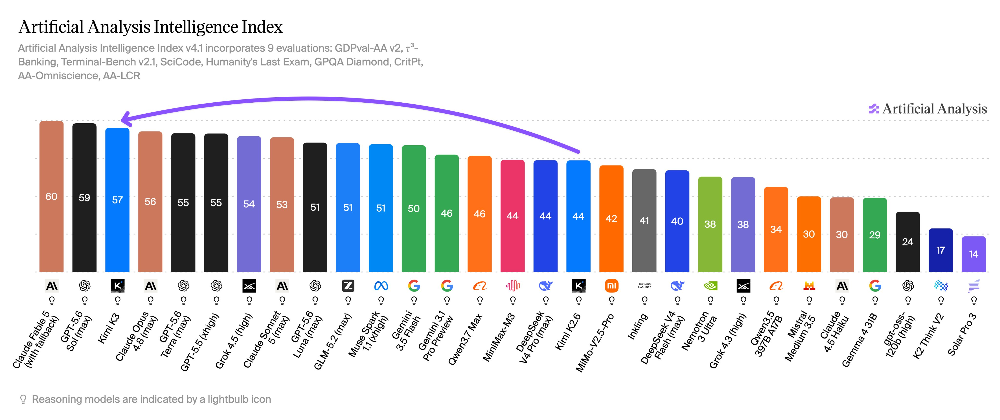
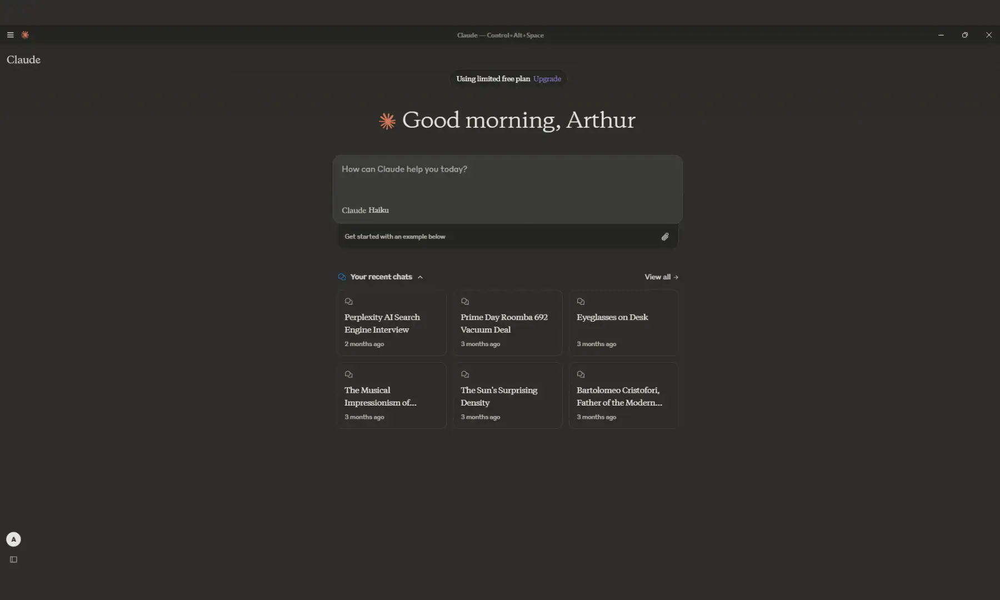
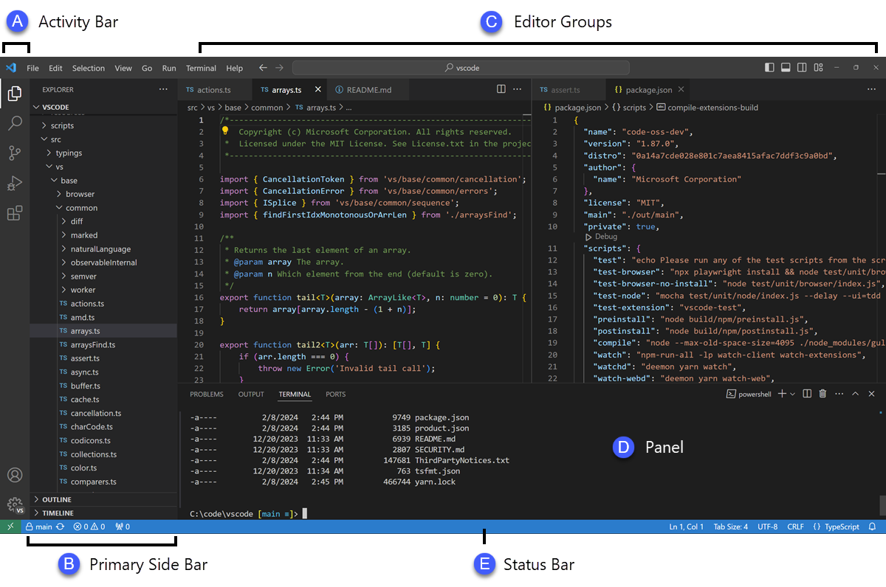
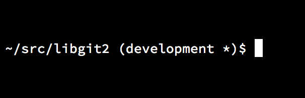
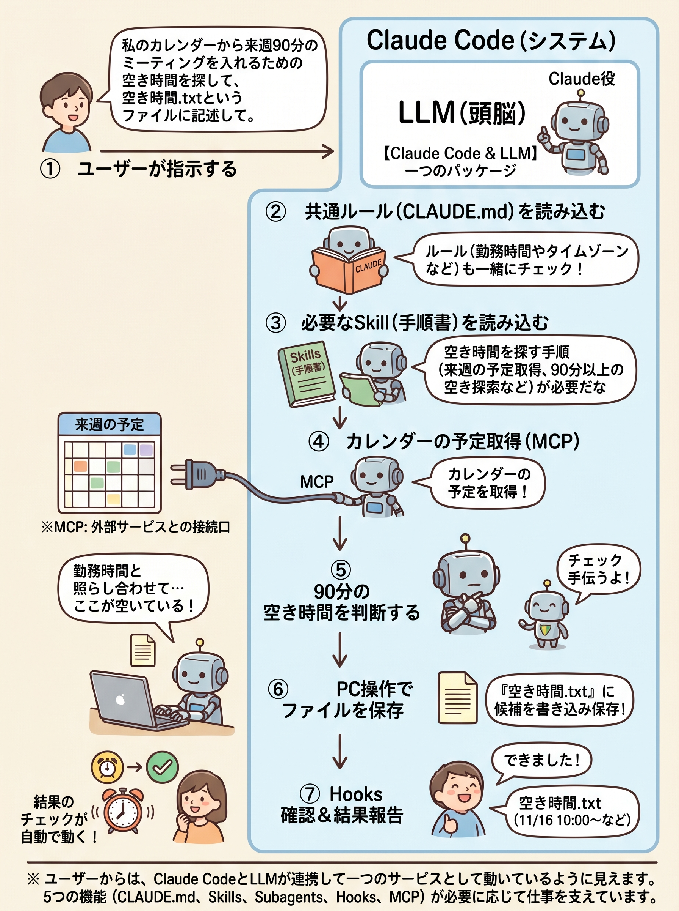
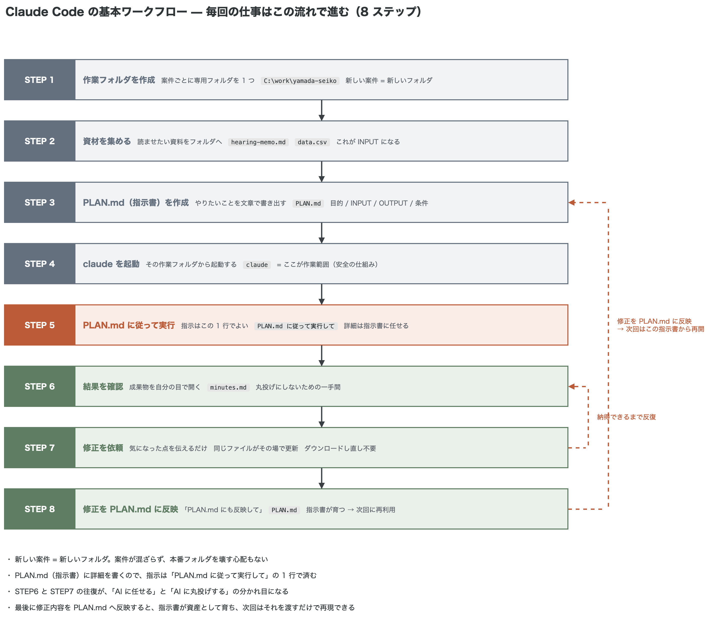
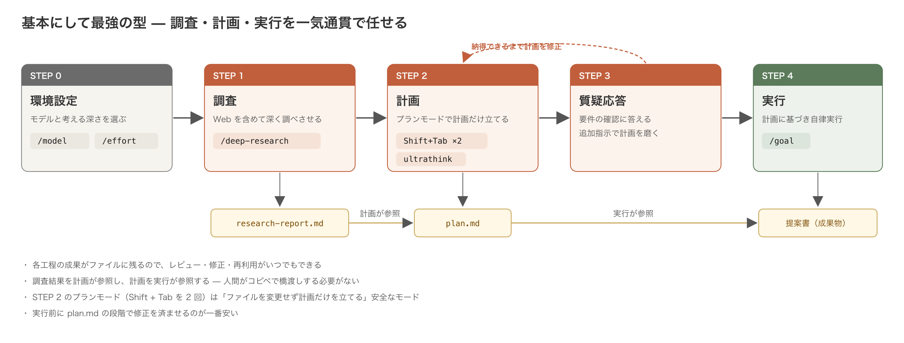
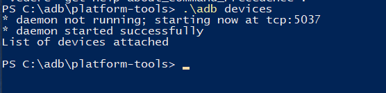
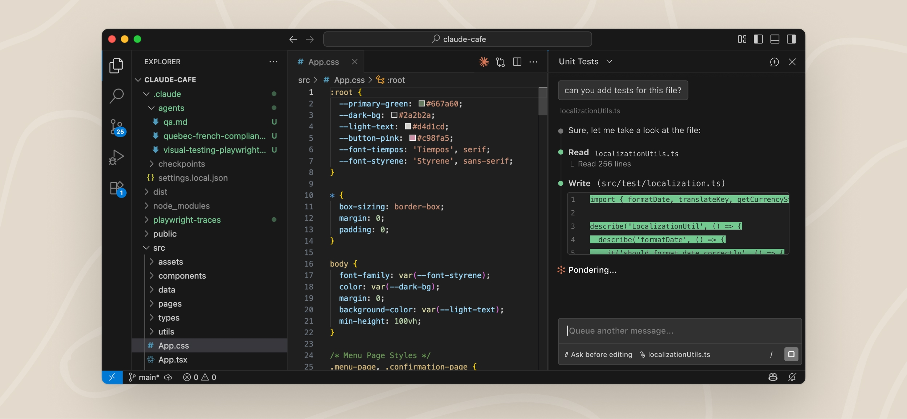

# 超実践：最短でAI業務ハッカーになる（Claude Code編・Windows 版）


*出典: [Anthropic — Claude Code](https://claude.com/product/claude-code)*


*「Clawd」— Claude Code の公式マスコットキャラクター（8ビットピクセルアートのカニ）出典: [Sticker Mule — Claude Code 公式ストア](https://www.stickermule.com/claudecode)*

## 概要

| 項目 | 内容 |
|---|---|
| 研修名 | 超実践：最短でAI業務ハッカーになる（Claude Code編・Windows 版） |
| 形式 | ハンズオン形式（講義3 + 実習7） |
| 所要時間 | 1回: 6時間、全4回 |
| 定員 | 各回最大 4 名程度（ハンズオン形式のため少人数制） |

## 対象者

- Windows ユーザー（Mac 非所持でも受講可能）
- ドキュメント作成や通常業務を行うビジネスユーザー・コンサルタント

## 前提条件

- Windows 10 以降の PC（管理者権限あり）
- Claude の有料サブスクリプション（Claude Code が利用できるプラン。詳細は[料金プラン](#料金プラン一覧)を参照）
- インターネット接続環境

### 研修の目的

Claude はプロの開発者が最も支持しているツールだが、決して難しいツールではない。自然言語（日本語）で指示を出すだけで AI が作業を遂行するため、**コーディング経験は不要**。

プロが使う最先端のツールを、ぜひ皆さんにも使いこなしてほしい — それが本研修の目的である。


## 目次

### はじめに — この研修が目指すもの

- [概要](#概要)
- [対象者](#対象者)
- [前提条件](#前提条件)
- [Claude Code はどこまでできるのか？ どこまで業務効率化を目指すのか？](#claude-code-はどこまでできるのか-どこまで業務効率化を目指すのか)
- [目指すべき姿](#目指すべき姿) — 専門分野を持つコンサルタントにできること
- [Claude Code が向いている作業 — 用途別に他ツールと比べる](#claude-code-が向いている作業--用途別に他ツールと比べる)

### 第1部：座学 — Claude と Claude Code を知る

- [なぜ今 Claude（特に Claude Code）なのか](#なぜ今-claude特に-claude-codeなのか) — 3大AI比較・Anthropic という会社・セキュリティ
- [料金プランと Claude Code の利用条件](#料金プランと-claude-code-の利用条件)
- [2 大 AI コーディングエージェントの比較](#2-大-ai-コーディングエージェントの比較) — Claude Code と Codex の違い・使い分け
- [Claude Code とは](#claude-code-とは) — 4つのインターフェース・チャット AI とエージェント型 AI の違い

### 第2部：セットアップ — 自分の PC でClaude Codeを動かす

- [利用する 3 つのツール](#利用する-3-つのツール) — Claude Desktop・VS Code・Git／Claude アカウントの事前準備を含む
- [前提の確認](#前提の確認) — Claude Desktop・Git・Claude Code・VS Code・GitHub の事前準備確認
- [VS Code で Markdown・Marp を扱う](#vs-code-で-markdownmarp-を扱う) — プレビュー・拡張機能・PDF 書き出し
- [基本操作リファレンス](#基本操作リファレンス) — VS Code の基本画面・エラーが出ても大丈夫

### 第3部：実践 — 実際に動かして違いを体感する

- [Claude Code の全体構成](#claude-code-の全体構成) — LLM＋Claude Code／5つの機能（CLAUDE.md・Skills・Subagents・Hooks・MCP）
- [実践してみよう — 同じ指示を Web 版と Claude Code で試す](#実践してみよう--同じ指示を-web-版と-claude-code-で試す)
- [Claude Code の基本的な使い方：毎回の仕事はこの流れで進む](#claude-code-の基本的な使い方毎回の仕事はこの流れで進む) — 作業フォルダ・資材・起動・INPUT/OUTPUT の指示
- [基本にして最強の使い方：調査・計画・実行を一気通貫で任せる](#基本にして最強の使い方調査計画実行を一気通貫で任せる) — /deep-research・計画のドキュメント化・/goal
- [長く使うときに覚える基本コマンド（スラッシュコマンド）](#長く使うときに覚える基本コマンドスラッシュコマンド) — /clear・/compact・/btw・Esc・Esc 2 回

### 第4部：Claude Code を自分仕様に整える — CLAUDE.md と安全の仕組み

- [最初に用意する CLAUDE.md という指示書](#最初に用意する-claudemd-という指示書) — 適用範囲（プロジェクト／グローバル）・書き方のコツ・サンプル
- [Claude Code の安全の仕組みと設定ファイル](#claude-code-の安全の仕組みと設定ファイル) — 3つの安全の仕組み・Claude Code が読み込む3つのファイル

### 第5部：スキルの使い方・探し方（研修2回目以降にて）

- [スキルを学ぶ](#スキルを学ぶ研修2回目以降にて) — 研修2回目以降の入口
- [スキル（Skills）とは](#スキルskillsとは) — 定義・なぜ生まれたか
- [実際に skill を見てみよう](#実際に-skill-を見てみよう) — /skills で見る
- [ハンズオン 1：スキルを入れてニュースレターを作る](#ハンズオン-1スキルを入れてニュースレターを作る)
- [スラッシュコマンドとスキルの関係](#スラッシュコマンドとスキルの関係)
- [スキルの使い方 Tips](#スキルの使い方-tips) — 発火しないとき・セキュリティ
- [スキルの探し方（できるだけ公式から）](#スキルの探し方できるだけ公式から)

### 第6部：MCP — 外部サービスにつなぐ

- [MCP とは](#mcp-とは) — 電源プラグ規格・スキルとの違い
- [MCP につないでみる](#mcp-につないでみる) — コネクタ／`/mcp` で接続（Gmail・Drive・Calendar）
- [ローカル型 MCP](#ローカル型-mcp) — 自分の PC のブラウザを操作する（Playwright 等）
- [MCP を安全に使う](#mcp-を安全に使う)

### 第7部：重要な拡張機能 — Claude in Chrome

- [Claude in Chrome とは](#claude-in-chrome-とは)
- [Claude in Chrome をインストールする](#claude-in-chrome-をインストールする)
- [Claude in Chrome の使い方](#claude-in-chrome-の使い方)
- [Claude Code／デスクトップから Chrome を操作する](#claude-codeデスクトップから-chrome-を操作する)
- [権限管理と安全](#権限管理と安全)

### 第8部：スキルの作り方

- [スキルの作り方](#スキルの作り方) — 探す→使う の次は作る
- [skill-creator で作る](#skill-creator-で作る)
- [ハンズオン 2：議事録スキルを作る](#ハンズオン-2議事録スキルを作る)
- [スキルの作り方 Tips](#スキルの作り方-tips) — 500 行以下・context:fork

### まとめ・次のステップ

- [まとめ：仕組みの使い分け](#まとめ仕組みの使い分け) — CLAUDE.md に詰め込まない・早見表・誤用
- [コンサルタントにとっての活用シーン](#コンサルタントにとっての活用シーン)
- [デスクトップアプリと Web 版](#デスクトップアプリと-web-版)
- [学習リソース](#学習リソース)

### 付録

- [付録 A：ビジネスユーザー向け CLAUDE.md テンプレート](#付録-aビジネスユーザー向け-claudemd-テンプレート)
- [付録 B：ビジネスユーザー向け settings.json（コマンド許可設定）](#付録-bビジネスユーザー向け-settingsjsonコマンド許可設定)
- [付録 C：エラーメッセージ解説（詳しく知りたい人向け）](#付録-cエラーメッセージ解説詳しく知りたい人向け)
- [付録 D：Claude Code 基本コマンド](#付録-dclaude-code-基本コマンド)
- [付録 E：効果的なプロンプト設計](#付録-e効果的なプロンプト設計)
- [付録 F：サブスクリプション詳細](#付録-fサブスクリプション詳細)
- [付録 G：Marp でスライドを PDF にする（コマンド版）](#付録-gmarp-でスライドを-pdf-にするコマンド版)
- [付録 H：Windows セットアップ手順（インストール）](#付録-hwindows-セットアップ手順インストール)
- [付録 I：PowerShell と Claude Code（CLI）](#付録-ipowershell-と-claude-codecli)
- [付録 J：スキルの仕組みを詳しく知る](#付録-jスキルの仕組みを詳しく知る) — Progressive Disclosure・公式 internal-comms スキルの構造

## Claude Code はどこまでできるのか？ どこまで業務効率化を目指すのか？

税理士が一人でアシスタントゼロ、クライアント 60 社を回している事例がある。Claude Code で記帳・書類作成・顧客対応などの業務をなるべく自動化し、通常なら数名のスタッフが必要な業務量を一人でこなしている。

これは現時点での Claude Code による業務効率化の素晴らしい事例であり、本研修が目指すゴールの先にある姿でもある。

> 詳細は [AI税理士.pdf](refs/AI税理士.pdf) を参照。

## 目指すべき姿

上記の税理士の事例が素晴らしい事例だとすれば、ドキュメント作成や業務コンサルティングを生業とする私たちの場合はどうか。目指すのは単発の作業を速くすることにとどまらない。**いくつかの条件を渡すだけで一連の業務を自動でこなす「AI エージェント」を自分で作り、通常業務で使いこなす**ことが最初のゴールである。たとえば、次のような業務を自作のエージェントに任せられる状態を目指す。

| 自動化したい業務 | 手作業だと | 自作 AI エージェントに任せると |
|---|---|---|
| 契約書の作成 | 案件ごとにテンプレートを探し、条項を手で差し替える | いくつかの条件（相手・金額・期間など）を渡すだけで契約書を自動作成 |
| 契約情報の登録 | 契約書を見ながら Salesforce に手入力 | 契約書を渡すと内容を読み取り、Salesforce へ自動登録（外部サービス連携＝MCP） |
| 日程調整 | 候補日をカレンダーと1つずつ突き合わせて空きを探す | 日程調整専用の Google カレンダーから空き枠を自動抽出 |
| 稼働実績の報告 | カレンダーやメモから稼働時間を集計し、報告書に清書 | 稼働実績をカレンダーから把握して報告書を自動作成 |
| 社内週次資料 | 毎週フォーマットに沿って資料を作成し、手で見直す | 社内週次資料を自動作成、または作成済み資料を自動添削 |

**「条件を渡す → エージェントが一連の業務を片づける」を自分の手で組み立て、日々の業務に組み込む** — これが本研修の最初のゴールである。

> 契約情報の Salesforce 登録やカレンダー連携のように外部サービスとつなぐ自動化は、**MCP（外部サービス連携の仕組み）** と **スキル／サブエージェント** を組み合わせて実現する。仕組みは第5部（スキル）と第6部（MCP）で扱う。

## Claude Code が向いている作業 — 用途別に他ツールと比べる

AI エージェントは Claude Code だけではない。コンサル業務でよく発生する 5 つの作業を取り上げ、各用途で Claude Code と代表的な競合エージェントを並べて向き不向きを整理する。「この作業ならどのツールが向くか」を掴んでおくと、業務ごとに最適な道具を選べるようになる。

> 記号の凡例 — **◎ 特に向いている　○ 向いている　△ 条件次第・限定的**

### 1. スライド資料作成（Marp → PDF）

| ツール | 向き | ひとこと |
|---|---|---|
| Claude Code | ◎ | 構成設計から PDF 出力まで一括。スライドの中身が Markdown（テキスト）なので、何度でも AI に直させられる。スキルで自社テンプレを再利用できる |
| Gamma | ○ | 見栄えのよいスライドを高速生成。細かい編集や社内フォーマット準拠は弱い |
| Microsoft Copilot（PowerPoint） | ○ | 既存の PowerPoint に統合。Office 環境に強いが自由度は限定的 |
| ChatGPT | △ | 構成案・文面は得意だが、PPTX ファイル自体の生成やレイアウト調整は不得手 |

### 2. 調査・リサーチ

| ツール | 向き | ひとこと |
|---|---|---|
| Perplexity | ◎ | 出典付き Web 検索に特化。最新情報の一次調査が速い |
| Genspark | ◎ | 複数エージェントで自動リサーチし、まとめ資料まで生成 |
| Claude Code | ○ | MCP／API で社内データや複数ソースを横断でき正確性が高い。最新 Web 検索は専用ツールに一歩譲る |
| ChatGPT（Deep Research） | ○ | 深掘り調査は得意。出典の裏取りは要確認 |

### 3. 文書作成（議事録・報告書・提案書）

| ツール | 向き | ひとこと |
|---|---|---|
| Claude Code | ◎ | 走り書きメモから複数フォーマットを同時生成。スキルで定型化でき、長文の正確な整形に強い |
| ChatGPT | ○ | 文章生成は得意。ファイル出力や複数文書の一括処理は弱い |
| Microsoft Copilot（Word） | ○ | Word 上での清書・要約に強いが Office 依存 |
| Notion AI | △ | Notion 内メモの整形は便利だが、成果物としての報告書出力は限定的 |

### 4. データ分析・集計レポート

| ツール | 向き | ひとこと |
|---|---|---|
| Claude Code | ◎ | CSV／Excel を渡して集計→グラフ→考察→レポートまで一気通貫。手順をスクリプト化して再現できる |
| ChatGPT（データ分析） | ◎ | アップロードした表の分析・可視化が得意 |
| Microsoft Copilot（Excel） | ○ | Excel 内の関数・ピボットに強いが Office 依存 |
| Gemini（スプレッドシート） | ○ | Google 環境に統合され、シート上の集計に強い |

### 5. 定型業務の自動化・連携（複数ツールをまたぐ繰り返し作業）

| ツール | 向き | ひとこと |
|---|---|---|
| Claude Code | ◎ | スキル・MCP・スケジュール実行で複数業務を連結し、繰り返し作業を丸ごと自動化できる |
| Codex CLI | ○ | 同種の CLI エージェント。業務自動化より開発寄り |
| Gemini CLI | ○ | Google 連携は強いが、業務自動化の実績・安定性で一歩譲る |
| Zapier／Make（＋AI） | ○ | アプリ連携は豊富だが、AI の判断を伴う複雑な処理は苦手 |

> **TIPS** — 万能な 1 ツールは存在しない。最新情報の調査は Perplexity や Genspark、資料の一括生成・複数業務の自動化・正確な文書処理は Claude Code、というように使い分けるのが賢い。Claude Code の強みは、**複数ソースやツールを横断し、繰り返し作業を自動化し、正確に処理する**点にある。

## なぜ今 Claude（特に Claude Code）なのか


*出典: [Anthropic — Claude Code 製品ページ](https://claude.com/product/claude-code)*

AI アシスタントは数多く存在するが、なぜ今 Claude を学ぶのか。まずは主要 3 サービスの位置づけを俯瞰し、Claude が注目されている理由を確認する。

### 3 大 AI サービス全体像

| | ChatGPT | Gemini | Claude |
|---|---|---|---|
| 提供会社 | OpenAI | Google | Anthropic |
| 代表モデル | GPT-6 シリーズ | Gemini 3 シリーズ | Claude Fable 5.1 / Opus 5.5 / Sonnet 5.5 / Haiku 5.5 |
| Web チャット | ChatGPT（chat.openai.com） | Gemini（gemini.google.com） | Claude（claude.ai） |
| デスクトップアプリ | ChatGPT Desktop | Antigravity | Claude Desktop |
| AI エージェント | Operator / Codex | Project Mariner | Claude Code |
| CLI ツール | Codex CLI | Gemini CLI | **Claude Code** |

> **CLI（Command Line Interface）ツール**とは、ターミナル（コマンドライン）から AI を操作するツールのこと。3 社とも CLI を提供しているが、本研修で学ぶ **Claude Code** が最も早く実用化され、開発者からの支持も最も高い。

### 3 大 AI アシスタント比較

| | ChatGPT（OpenAI） | Gemini（Google） | Claude（Anthropic） |
|---|---|---|---|
| 得意分野 | 幅広い汎用タスク・プラグイン連携 | Google サービスとの統合・検索連動 | 長文理解・正確な推論・コーディング |
| ユーザー規模 | 最も早く普及し圧倒的なユーザー数 | Google 製品に統合し急拡大中 | ダウンロード数・売上ともに急成長中 |
| コンテキストウィンドウ | 128K トークン（PDF 約 300 ページ分） | 1M トークン（PDF 約 1,500 ページ分） | 1M トークン（PDF 約 2,500 ページ分） |
| 特徴 | 最も早く普及した先駆者 | Google 検索・Workspace と一体化 | 安全性と正確性を重視した設計 |

**コンテキストウィンドウ**とは、AI が 1 回の会話で読み込める情報量の上限のこと。この数字が大きいほど、長い文書や大量のファイルをまとめて渡しても内容を把握できる。Claude と Gemini はともに 1M トークンだが、同じトークン数でも Claude の方が多くのページを処理できる。さらに Claude は読み込んだ内容の正確な理解と推論の質で高い評価を得ている。

ChatGPT は先行者として圧倒的なユーザー数を持ち、Gemini は Google エコシステムとの統合が強み。一方 Claude は**正確性・安全性・コーディング能力**で急速に支持を拡大している。

> **TIPS** — ChatGPT や Gemini が「使えない」わけではない。用途によって最適な AI は異なる。ただし「正確さ」と「コーディング能力」が求められる業務自動化の文脈では、Claude が現時点で最も高い評価を得ている。普段の調べ物には ChatGPT、業務の自動化には Claude、というように使い分けるのも一つの手。

### Claude が今最も注目されている 4 つの理由

**理由 1：アプリダウンロード数で ChatGPT を抜いて 1 位に**

2026 年 3 月には米国 App Store で Claude が一時 ChatGPT を抜いて無料アプリ 1 位を獲得した。デイリーアクティブユーザーは 1,000 万人規模まで拡大しており、Anthropic は「2026 年初頭から有料契約者は倍増、DAU は 3 倍以上」と公表している（順位は時期により変動する）。

**理由 2：売上成長率で OpenAI を急追**

Anthropic の年間売上ランレート（ARR）は OpenAI に迫る水準まで拡大しており、成長率では OpenAI を大きく上回るペースが続いていると報じられている。

**理由 3：米軍の作戦計画にも採用される信頼性**

Claude は米軍が作戦の情報分析に採用するほど、AI としての信頼性が高く評価されている。安全性を最優先に設計された Anthropic の思想が、最もシビアな現場でも認められている。

**理由 4：最上位モデル「Mythos クラス」の登場 — Claude Fable 5.1 / Mythos 5.1**


*出典: [Anthropic — Models（モデル一覧）](https://www.anthropic.com/news/models)*

Anthropic は、従来の最上位だった Opus をさらに上回る新モデル層「**Mythos クラス**」を展開している。一般提供される **Claude Fable 5.1** と、承認された組織だけが利用できる **Claude Mythos 5.1** は同じ基盤モデルで、ほぼすべてのベンチマークで最先端の性能を記録している。日常業務ではこの下に **Opus 5.5 / Sonnet 5.5 / Haiku 5.5** が揃い、用途に応じて使い分けられる。

- 決済サービス大手 Stripe の検証では、**エンジニアが 2 ヶ月かかる作業を 1 日で完了**
- 数百万トークンにわたる長時間の作業でも推論の質を維持
- 画面のスクリーンショットを見せるだけで Web アプリを再構築できるほどの視覚理解力


*主要ベンチマークでの比較（第三者評価機関による総合知能指数）。作成時点のスナップショットで、Claude の最上位モデルが首位クラスに位置する。順位は頻繁に入れ替わるため、最新は出典サイトで確認。出典: [Artificial Analysis](https://artificialanalysis.ai/)*

「AI がエンジニアの数ヶ月分の仕事を 1 日でこなす」時代が現実になりつつあり、その最先端を走っているのが Claude である。本研修で学ぶ Claude Code からも、この最新モデルをそのまま利用できる。

> **TIPS** — AI 業界の数字は目まぐるしく変わる。最新の状況が気になったら「Claude 最新ニュース」で検索するか、[Anthropic 公式ニュース](https://www.anthropic.com/news)を確認しよう。

### 開発者が選ぶ AI コーディングツール No.1

Claude Code はリリースから短期間で、最も使われている AI コーディングツールの地位を確立した。

- **SWE-bench**（ソフトウェアエンジニアリングベンチマーク）で全 AI ツール中トップクラスのスコアを記録
- 2026 年の開発者調査でも最も使われている AI コーディングツールに（Stack Overflow 2026 調査では利用者の約 66%、JetBrains 調査でも最多）
- 開発者の「最も好きなツール」調査：**Claude Code 46%** vs Cursor 19% vs GitHub Copilot 9%

> **TIPS** — 「プロのエンジニアが最も使いたいツール」と聞くと難しそうに感じるかもしれないが、操作は日本語で指示を出すだけ。エンジニアと同じ道具を、エンジニアでなくても使えるのが Claude Code の魅力。

### Anthropic という会社 — なぜ開発者に信頼されるのか


*Dario Amodei（Anthropic CEO） — Photo: TechCrunch, CC BY 2.0, via [Wikimedia Commons](https://commons.wikimedia.org/wiki/File:Dario_Amodei_at_TechCrunch_Disrupt_2023_01_(cropped).jpg)*

Anthropic は OpenAI の元副社長 Dario Amodei と、同じく OpenAI で安全性研究を率いた Daniela Amodei（姉弟）が設立した会社である。「AI の安全性を最優先にする企業が必要だ」という信念から、OpenAI を離れて創業した。

この出自が、Anthropic の製品思想に深く影響している。

- **Constitutional AI（憲法 AI）** — Claude には「AI がどう振る舞うべきか」の原則が組み込まれている。有害な出力を減らしつつ、有用性を犠牲にしない設計思想
- **安全性へのコミットメント** — 能力を上げることと安全性を高めることを対立させず、両立させるアプローチを貫いている
- **透明性** — モデルの限界や弱点を隠さず公開し、安全性に関する研究論文を積極的に発表している

こうした姿勢が「信頼できる AI を使いたい」と考える開発者・企業から強く支持されている。

### AI 規制をめぐる Anthropic の姿勢

AI 業界では規制に反対する企業が多い中、Anthropic は一貫して**適切な規制は必要だ**という立場を取っている。

カリフォルニア州で AI 規制法案が議論された際、OpenAI や Meta など大手テック企業が反対に回る中、Anthropic は修正案を支持する書簡を公開した。「AI が社会にリスクをもたらす可能性がある以上、業界が自主的に安全基準を設けるべきだ」という主張である。

米政権が AI 規制の撤廃・緩和を進める局面でも、Anthropic は自社の安全基準を下げない方針を明確にしている。政府が規制を緩めても、企業として守るべきラインは守る — この姿勢が、セキュリティを重視する企業や政府機関からの信頼につながっている。

> **TIPS** — 社内の機密データや顧客情報を扱う業務に AI を使うなら、安全性を最優先にしている会社のツールを選ぶのが合理的。Anthropic のこうした姿勢は、クライアントに AI 導入を提案する際の選定理由としても説得力がある。

### Claude Code のセキュリティとデータプライバシー


*出典: [Anthropic](https://www.anthropic.com/news/claude-code-security)*

業務で AI を使うとき、最も気になるのは「入力した情報が AI の学習に使われないか」「社内データやクライアントのデータが外部に漏れないか」という点だろう。Claude Code はこの懸念に対して、他の AI ツールより明確な保証を提供している。

**入力データの学習利用 — プランによって扱いが異なる**

ここは誤解が多いので正確に押さえておきたい。Claude の「学習に使われるかどうか」は**契約しているプランで決まる**。

- **商用プラン（Team / Enterprise / API）** — 入力したプロンプト・読み込ませたファイル・社内データは、**デフォルトでモデルの学習に使われない**。Anthropic の商用利用規約で定められている。**本研修は Team プランを使うため、業務データが学習に使われることはない。**
- **個人向けプラン（Free / Pro / Max）** — 2025 年 8 月の方針変更により、会話やコーディングの内容は**デフォルトで学習に使われる**。使いたくない場合は設定の「Claude の改善に協力（Help improve Claude）」を**オフにしてオプトアウト**する必要がある。オプトアウトすればデータ保持は 30 日、オプトインのままだと最長 5 年保持される。

> **要点** — クライアントの機密データや顧客情報を扱うなら、**商用プラン（Team / Enterprise）を使う**のが基本。これなら入力データはデフォルトで学習対象外になる。個人プランを使う場合は、必ずオプトアウト設定を確認すること。最新の規定は [プライバシー設定](https://claude.ai/settings/data-privacy-controls) と利用規約で確認する。

| | Claude（Anthropic） | ChatGPT（OpenAI） | Gemini（Google） |
|---|---|---|---|
| 商用プランでの学習利用 | **されない**（デフォルト） | されない（商用規約） | されない（有料・企業向け） |
| 個人プランでの学習利用 | デフォルトで使用・オプトアウト可 | 設定でオプトアウトが必要 | 無料版は使用、有料版は除外 |

**データの処理と保存**

- 会話データは処理のために一時的にサーバーに送信されるが、モデルのトレーニングには使用されない
- Team / Enterprise プランでは、会話ログの保持期間やアクセス制御を管理者が設定できる
- Claude Code はローカル（自分の PC）で動作し、ファイルの読み書きも PC 上で完結する。クラウドにファイルがアップロードされるわけではない

**3 大 AI のセキュリティ比較**

| セキュリティ項目 | Claude（Anthropic） | ChatGPT（OpenAI） | Gemini（Google） |
|---|---|---|---|
| データの学習利用 | **商用プランはしない**（個人プランは要オプトアウト） | オプトアウトが必要 | 無料版は利用、有料版は除外 |
| ローカル実行 | **PC 上で動作**（Claude Code） | クラウド処理 | クラウド処理 |
| 権限制御 | ファイル・コマンド単位で許可/拒否を設定可能 | なし | なし |
| 危険な操作のブロック | deny リストで禁止コマンドを指定可能 | なし | なし |

Claude Code は「どのファイルを読んでよいか」「どのコマンドを実行してよいか」を細かく制御できる。ChatGPT や Gemini にはこうした権限制御の仕組みがなく、誤って機密情報を入力してしまうリスクを設定レベルで防ぐことができない。

> **TIPS** — クライアントから「AI に社内データを読ませて大丈夫？」と聞かれたら、次の 3 点を伝えよう。(1) 商用プラン（Team / Enterprise）なら入力データはデフォルトで学習に使われない、(2) ファイルは PC 上で処理されクラウドにアップロードされない、(3) 読み取り・実行の権限を細かく制御できる。

## 料金プランと Claude Code の利用条件


*出典: [Anthropic — Pricing](https://claude.com/pricing)*

Claude Code を使うには**有料サブスクリプションが必須**。無料プランでは Claude Code は利用できない。

### 料金プラン一覧

| プラン | 月額（月払い / 年払い） | Claude Code | 主な用途 |
|---|---|---|---|
| Free | $0 | 利用不可 | Web 版の基本的なチャットのみ |
| Pro | $20 / $17 | 利用可能 | 個人利用・軽めの業務活用 |
| Max (5x) | $100 | 利用可能（大容量） | ヘビーユーザー・長時間の自動化 |
| Max (20x) | $200 | 利用可能（最大容量） | 大規模プロジェクト・並列実行 |
| Team（Standard 席） | $25 / $20 | **利用不可** | チームでの Web チャット利用 |
| **Team（Premium 席）** | **$125 / $100** | **利用可能（Standard 席の 5 倍の利用量）** | **チームで Claude Code を使う場合・本研修で使用** |
| Enterprise | 要問合せ | 利用可能 | 組織全体での導入・SSO・監査ログ |

> **注意** — Team プランは席（シート）の種類によって使える機能が異なる。**Claude Code を使うには Premium 席が必要**で、Standard 席では Web チャットのみとなる。本研修では **Team プランの Premium 席**を使用する。最新の価格・条件は [claude.com/pricing](https://claude.com/pricing) を確認のこと。

Claude Code は 1 つのタスクで AI への問い合わせが数十回〜数百回発生するため、無料プランでは動作を支えきれない。プランごとの性能・利用量の違いは[付録 F](#付録-fサブスクリプション詳細)を参照。

### 定額プラン以外の使い方 — API（従量課金）

上記のサブスクリプション（定額制）のほかに、**API（従量課金）** という使い方もある。API とは、プログラムから Claude の頭脳を直接呼び出す仕組みで、料金は「使った分だけ」発生する（トークン＝AI が処理する文字量の単位ごとの課金）。

| 契約形態 | 料金の考え方 | 向いている使い方 |
|---|---|---|
| サブスクリプション（Pro / Max / Team） | 月額定額。利用量に上限あり | 個人やチームが日常業務で使う（本研修はこちら） |
| API（従量課金） | 使ったトークン量に応じて課金。上限なし | 社内システムへの組み込み・大量の自動処理・クライアント向けサービス開発 |

今後、業務の自動化が進んで「毎晩バッチで 1,000 件のレポートを自動生成する」といった規模になると、定額プランの上限を超えて API の従量課金を組み合わせる場面が出てくる。まずは「定額のサブスクリプションのほかに、使った分だけ払う API という選択肢がある」ことだけ覚えておけばよい。


## 2 大 AI コーディングエージェントの比較

AI コーディングエージェントは、いま **Claude Code（Anthropic）** と **Codex（OpenAI）** の 2 強が市場をリードしている。本研修で扱うのは Claude Code。ここでは両者を公平に比べたうえで、**なぜ本研修で Claude Code を選ぶのか＝Claude Code が優位な点**を整理する。クライアントに説明する際も「なぜ Claude Code なのか」を競合と比べて語れると説得力が増す。

> 両ツールとも更新が速く、モデル名・性能・対応地域は数週間単位で変わる。数値や対応状況は、商談前に公式（[Claude Code](https://claude.com/product/claude-code) / [OpenAI Codex](https://openai.com/codex/)）で最新を確認すること。

### 比較表

| 観点 | Claude Code（Anthropic） | Codex（OpenAI） |
|---|---|---|
| 位置づけ | ターミナル発のコーディングエージェント | ChatGPT に統合されたコーディングエージェント |
| 使えるモデル | Claude（Opus／Sonnet／Haiku） | OpenAI の GPT 系モデル（Codex 向けに最適化） |
| 得意な性格 | **突破力** — 複雑な複数ファイル横断・設計・難所を一気通貫で押し切る | **正確性** — 慎重に手堅く進め、レビューや背景実行で破綻しにくい |
| 進め方 | 手元で対話しながら舵を切る（インタラクティブ） | クラウド／バックグラウンドに任せ、PR で受け取る運用が得意 |
| Computer Use（画面操作） | ブラウザ操作は拡張（Claude in Chrome）で対応。PC 全体を見て操作する用途は限定的 | **Codex が優位** — アプリ／ブラウザを自分で見て・クリックして操作する機能を搭載（対応 OS・地域に制限あり） |
| 提供面 | CLI を中心に、デスクトップアプリ・VS Code 拡張・Web | CLI・IDE 拡張・ChatGPT アプリ・モバイル・Chrome 拡張と幅広い |
| 拡張性 | サブエージェント・ワークフロー・スキル・MCP で深く作り込める | プラグイン・MCP に対応し、ChatGPT 側の資産と連携しやすい |
| 安全の仕組み | 作業フォルダ外は触らない＋実行前の確認＋Git でやり直せる | コマンドを既定でサンドボックス実行 |
| 必要なプラン | Anthropic の Pro／Max／Team／Enterprise（本研修は Team） | ChatGPT の Plus／Pro／Business。CLI 単体は API 従量でも可 |

### 本研修で Claude Code を選ぶ理由（Claude Code が優位な点）

上の表は公平に並べたものだが、本研修のゴール（**自作のエージェントで業務を自動化し、難しい作業を一気に片づける**）に照らすと、次の点で Claude Code が優位になる。

- **難所を押し切る「突破力」** — 仕様が曖昧な課題や、複数ファイルにまたがる大きな改修でも、対話しながら一気に形にできる。本研修の核である「調査 → 計画 → 実行の一気通貫」に最も効く。
- **自作エージェントを深く作り込める拡張性** — サブエージェント・ワークフロー・スキル・MCP が揃い、「[目指すべき姿](#目指すべき姿)」で挙げた“条件を渡すと一連の業務を自動化するエージェント”を自分の手で組み立てられる。
- **手元で舵を切れる対話性** — 途中で方針を変える、確認しながら少しずつ進める、といったコンサル業務の進め方にそのまま馴染む。
- **初心者でも事故りにくい安全設計** — 作業フォルダの外は勝手に触らない＋実行前に必ず確認＋Git でいつでも巻き戻せる。安心して任せられる。
- **追加契約なしで使える** — 本研修の Team プランにそのまま含まれており、すぐ全員で使い始められる。

> Codex が優位な領域（とくに画面操作＝Computer Use）は、必要に応じて二刀流で補えばよい（次項）。「本研修では、まず突破力と作り込みやすさで選べる Claude Code を使いこなす」という方針である。

### 使い分けの勘どころ

- **突破力の Claude Code／正確性の Codex。** 仕様が固まりきらない難題や、複数ファイルにまたがる大きな改修を一気に前へ進めたいときは Claude Code。手堅くレビューしながら、あるいはバックグラウンドで淡々と片づけたいときは Codex、という住み分けが現場感覚に近い。
- **画面操作（Computer Use）は Codex が一歩先。** ブラウザやアプリを AI 自身に操作させる用途は、現時点では Codex のほうが機能として進んでいる。Claude 側で同種のことをするときは、ブラウザ拡張（Claude in Chrome）など別の仕組みを組み合わせる。
- **二刀流という選択肢。** 「Claude Code で一気に書かせ、Codex にレビューさせる（またはその逆）」という併用も実務では珍しくない。ツールは排他ではなく、強みで役割分担できる。

## Claude Code とは


*出典: [GitHub — anthropics/claude-code](https://github.com/anthropics/claude-code)*

### Claude の 4 つのインターフェース

Claude には使い方の異なる 4 つのインターフェースがある。本研修で扱う **Claude Code（CLI）** がなぜ最も強力なのかを理解するために、まず全体像を押さえる。

```
    自由度・できることの幅
    ▲
    │
    │  ★ Claude Code（CLI）
    │    AI が自律的に作業を遂行する
    │    ファイル操作・コマンド実行・Git 管理
    │
    │  ● デスクトップ（Claude Code）
    │    デスクトップアプリ内で Claude Code を実行
    │    ターミナル不要・ファイル操作やコマンド実行も可能
    │
    │  ■ デスクトップ（チャット）
    │    チャット＋ローカルフォルダ操作・コネクタ・定期実行
    │    （2026 年 9 月に旧 Cowork 機能を統合）
    │
    │  ▼ Web 版
    │    ブラウザだけで利用可能
    │    チャット形式の質問応答
    │
    └──────────────────────────► 手軽さ
```

| 比較項目 | Web 版 | デスクトップ（チャット） | デスクトップ（Claude Code） | Claude Code（CLI） |
|---|---|---|---|---|
| 利用方法 | ブラウザで claude.ai にアクセス | 専用アプリのチャット画面 | 専用アプリ内で Claude Code を起動 | ターミナルで `claude` コマンドを実行 |
| セットアップ | 不要 | アプリをインストール | アプリをインストール | インストーラーで CLI を導入 |
| 基本動作 | 1 問 1 答のチャット | チャット + ショートカット呼出 | 指示を出して放置 → 完成物を受取 | AI が自律的に複数ステップを遂行 |
| ファイル操作 | アップロード/ダウンロードのみ | 指定フォルダの読み書き可能（旧 Cowork 機能） | ローカルファイルの読み書き可能 | ローカルファイルの読み書き可能 |
| コマンド実行 | 不可 | 限定的に可能（サンドボックス） | 可能 | あらゆるコマンドを実行可能 |
| Git 連携 | 不可 | 不可 | コミット・ブランチ・PR まで可能 | コミット・ブランチ・PR 作成まで自動 |
| 外部ツール連携 | コネクタ（MCP） | コネクタ（MCP） | MCP 連携（コネクタ＋ローカル MCP） | MCP 連携（コネクタ＋プラグイン） |
| 並列実行 | 不可（タブは可） | 不可 | 複数セッションを同時実行可能 | 複数セッションを同時実行可能 |
| 向いている用途 | 質問・相談・文章添削 | 日常的な AI 活用・資料作成・データ整理 | ターミナルを使わない業務自動化 | 開発・自動化・業務フロー構築 |

> **外部ツール連携（MCP）はどのインターフェースでも使える**：以前は Claude Code が中心だったが、現在は **Web 版（claude.ai）・デスクトップアプリ・Claude Code のすべてで「コネクタ」（MCP 接続）を利用できる**。Gmail や Google Drive などを数クリックでつなげられ、デスクトップ（Claude Code）や CLI ではさらに自分の PC 上で動く「ローカル MCP サーバー」も追加できる。MCP について詳しくは後述。

> **「Cowork」はどこへ？** 以前デスクトップアプリにあった自律作業モード「Cowork」は、**2026 年 9 月に本体のチャットへ統合**された。ローカルフォルダの読み書き・コネクタ・スキル・定期実行といった機能は、今は「デスクトップ（チャット）」からそのまま使える。

#### 「AI モデル」と「AI エージェント」の違い

ニュースで目にする **Claude Fable** や **Claude Sonnet** は「AI モデル」— つまり頭脳にあたる部分である。一方 **Claude Code** は、その頭脳に**手足を与えた AI エージェント**。両者の関係を整理すると次のようになる。

| | AI モデル（Claude Fable / Sonnet 等） | AI エージェント（Claude Code） |
|---|---|---|
| 役割 | 質問に答える・文章を生成する「頭脳」 | 頭脳を使って実際に作業を遂行する「作業者」 |
| できること | テキストの入出力のみ | ファイル操作・コマンド実行・Git 管理まで |
| たとえ | 何でも知っている相談役 | 指示どおりに手を動かしてくれるアシスタント |

つまり、Claude Fable や Sonnet は「賢いけれど手が動かせない」存在で、Claude Code は「その賢さを使って実際に仕事をこなす」存在。本研修では後者の **Claude Code（AI エージェント）** を使って、実務を自動化するスキルを身につける。

### なぜチャット AI ではなくエージェント型 AI なのか

「質問に答える」チャット AI ではなく、**AI が作業者として動く**エージェント型ツール。ローカルのファイル構造・コマンド実行・Git 操作を含めた作業全体に統合される。

### チャット AI とエージェント型 AI の違い

| 比較項目 | 従来のチャット AI | Claude Code |
|---|---|---|
| 動作モデル | 質問に回答する | AI が作業者として動く |
| ファイル操作 | 不可 | ローカルファイルの読み書き可能 |
| コマンド実行 | 不可 | ターミナルコマンドを実行可能 |
| 開発ツール連携 | 不可 | Git, VS Code 等と統合 |
| 作業の自律性 | 1 問 1 答 | 複数ステップを自動で遂行 |

#### なぜ Claude Codeが最も強力なのか

1. **ファイルを直接操作できる** — アップロード・ダウンロードの手間なく、PC 上のファイルをそのまま読み書きする
2. **コマンドを実行できる** — Python スクリプトの実行、データ加工、ファイル変換など、ターミナルでできることはすべて任せられる
3. **Git でやり直しがきく** — すべての変更が履歴に残るため、失敗しても安全に元に戻せる
4. **複数の作業を同時に走らせられる** — 1 つのタスクを実行中に別のセッションで次の作業を開始できる
5. **スキルとして再利用できる** — 一度作ったワークフローを保存し、コマンド 1 つで何度でも再実行できる

#### デスクトップ（Claude Code）と CLI の使い分け

Claude Code は今では**デスクトップアプリ内からも使える**（＝「デスクトップ（Claude Code）」）。ターミナルに馴染みがない人でも、アプリ上で「この資料をまとめて」「このデータを整理して」と指示すれば、AI がファイルを直接操作し、コマンド実行や Git 管理まで含めて成果物を仕上げる。まずは GUI から始め、慣れてきたら CLI に移るのもよい。

ただし GUI（デスクトップ）は画面描画などの UI オーバーヘッドがあり、ターミナルで直接動かす **CLI の方が処理が速い**。体感で差が出ることも珍しくない。CLI は**制約が最も少なく、自由度が最も高い**——複数セッションの並列実行やスキルによる再利用など、業務を本格的に自動化するための機能がすべて揃っている。

| 比較 | デスクトップ（Claude Code） | Claude Code（CLI） |
|---|---|---|
| 操作方法 | GUI（デスクトップアプリ） | CUI（ターミナル） |
| 動作速度 | やや遅い（UI 経由のオーバーヘッド） | 速い（直接実行） |
| 学習コスト | 低い | やや高い（ターミナル操作に慣れる必要あり） |
| ファイル操作・コマンド実行・Git | 可能 | 可能 |
| 並列実行 | 可能 | 可能 |

> 本研修では **デスクトップ（Claude Code）** を使用する。ターミナルの方が速度面では優位ではあるが、画面が存在して扱いやすいため

## 利用する 3 つのツール

本研修では、次の 3 つのツールを組み合わせて使う。それぞれの役割と画面イメージを押さえておこう。

### Claude Desktop — AI の本体（チャットと Claude Code）


*Claude Desktop のホーム画面。出典: [Android Headlines](https://www.androidheadlines.com/2024/11/anthropic-claude-desktop-app.html)*

デスクトップ版の Claude アプリ。チャットで相談できるのはもちろん、アプリ内の **Claude Code** に「○○を作って」と指示すると、AI が自律的にファイル作成・編集・コマンド実行まで行う。**本研修の主役**で、指示どおりに手を動かしてくれるアシスタントにあたる。

### VS Code — 作業場（エディタ）


*VS Code のユーザーインターフェース。出典: [Microsoft — VS Code User Interface](https://code.visualstudio.com/docs/getstarted/userinterface)*

Microsoft 製のエディタ。ファイル編集・Markdown プレビュー・ターミナルを 1 画面に統合できる。Claude Code が作成・編集したファイルを、その場で確認・プレビューできる作業場（ワークベンチ）。

### Git — 変更履歴の記録（無限の Ctrl+Z）


*Git のターミナル表示（括弧内に現在のブランチ名が出る）。出典: [Pro Git book — git-scm.com](https://git-scm.com/book/en/v2)*

ファイルの変更履歴を記録・管理するバージョン管理システム。すべての変更を自動保存する「無限の Ctrl+Z」で、失敗してもいつでも元に戻せる。同梱の Git Bash は Claude Code が裏側でコマンドを実行するときに使うだけで、自分で開いて操作する場面は基本的にない。

**3 つの関係**

```
Claude Desktop（AI の本体）
  チャットで相談 ＋ アプリ内の Claude Code がファイルを作成・編集
        │
        ▼  作成・編集したファイルは…
VS Code（作業場）
  エディタで編集し、Markdown プレビューで結果をその場で確認
        │
        ▼  すべての変更は…
Git（無限の Ctrl+Z）
  変更履歴を記録 → 失敗してもいつでも元に戻せる
```

- **Claude Desktop** に「○○を作って」と指示すると、ファイルが自動生成される
- 生成されたファイルは **VS Code** のエディタですぐに確認・プレビューできる
- **Git** がすべての変更を記録しているので、やり直したいときはいつでも巻き戻せる

> ターミナル（PowerShell）から Claude Code を起動する **CLI 版**の使い方は、本研修では必須ではない。コマンド操作に慣れた人向けに[付録 I：PowerShell と Claude Code（CLI）](#付録-ipowershell-と-claude-codecli)にまとめた。

### Claude アカウントのセットアップ（研修前に各自実施）

本研修では所属組織の **Team プラン（Premium 席）** を使用する。管理者がアカウントを用意済みなので、以下の手順で自分のアカウントを有効化する。

**ステップ 1：招待メールを確認する**

管理者から届いた「You've been invited to join [組織名] on Claude」という件名のメールを開く。

> メールが届いていない場合は、迷惑メールフォルダを確認するか、管理者に再送を依頼する。

**ステップ 2：招待を承認する**

メール内の **「Accept Invite」** ボタンをクリックする。ブラウザが開き、Claude のサインイン画面が表示される。

**ステップ 3：業務用メールアドレスでサインインする**

1. 「Continue with Google」（Google アカウントの場合）または「Continue with email」をクリック
2. 普段業務で使っているメールアドレスを選択・入力
3. パスワードを入力してサインイン

**ステップ 4：Claude の画面が表示されることを確認する**

サインインが完了すると、Claude のチャット画面（https://claude.ai）が表示される。画面左下に組織名が表示されていれば、Team プランのアカウントとして正しくセットアップされている。

> この時点で Claude の Web 版チャットが使える状態になっている。各ツールの準備（Claude Desktop・Git for Windows・Claude Code・VS Code のインストールと GitHub アカウントの作成）は研修前に各自で済ませておく（→[前提の確認](#前提の確認) / [付録 H](#付録-hwindows-セットアップ手順インストール)）。**Claude Code を使うには Premium 席が割り当てられている必要がある**ため、不明な場合は管理者に確認しておこう。

**トラブルシューティング**

| 状況 | 対処 |
|---|---|
| 招待メールが届いていない | 迷惑メールフォルダを確認。なければ管理者に再送を依頼 |
| サインインボタンが表示されない | ブラウザのキャッシュをクリアして再試行 |
| サインイン後に組織名が表示されない | 個人アカウントでログインしている可能性。一度ログアウトして業務用メールアドレスで再サインイン |
| 「Your invitation has expired」と表示される | 管理者に新しい招待メールの送信を依頼 |
| Claude Code にログインできない（プランのエラーが出る） | Standard 席の可能性。管理者に Premium 席への変更を依頼 |

## 前提の確認

本研修は、次の 5 つが各自で準備済みであることを前提に進める。研修当日までに済ませておこう。インストール手順は巻末の[付録 H：Windows セットアップ手順（インストール）](#付録-hwindows-セットアップ手順インストール)にまとめてある。

| 準備するもの | 役割 | 準備できているかの確認 |
|---|---|---|
| **1. Claude Desktop のインストール** | デスクトップ版 Claude アプリ（チャット／アプリ内 Claude Code） | アプリを起動でき、Team プランのアカウントでサインイン済み |
| **2. Git for Windows のインストール** | Claude Code が内部で使う Git Bash を提供する | PowerShell で `git --version` を実行し、バージョンが表示される |
| **3. Claude Code のインストールとライセンス購入** | 本研修の主役。ターミナルで動く AI エージェント（利用には有料プランのライセンス＝席が必要） | PowerShell で `claude --version` が表示され、`claude` で有料プランにログインできる |
| **4. VS Code のインストール** | 文書やスライドを編集・プレビューする作業場 | VS Code が起動でき、日本語表示になっている |
| **5. GitHub アカウントの作成** | 変更履歴の保存・共有に使うサービスのアカウント | [github.com](https://github.com/) にサインインできる |

> いずれかが未完了、またはコマンドが「認識されません」と表示される場合は、[付録 H](#付録-hwindows-セットアップ手順インストール) の該当する STEP を参照して済ませておく（GitHub アカウントは [github.com](https://github.com/) で無料登録できる）。Claude Code の利用には有料プランのライセンス（席）が必要なため、割り当てが不明な場合は管理者に確認しておこう。

## VS Code で Markdown・Marp を扱う

Claude Code が作る文書やスライドは、VS Code で快適に閲覧・書き出しができる。ここでは研修で使う 3 つの操作を押さえる。

**1. Markdown プレビューを使う**

Claude Code が作る文書の多くは **Markdown（.md）** という形式。VS Code なら整形された状態で読める。

> **markdown（マークダウン）ファイルとは？**
> テキストに簡単な記号を付けて見出しや箇条書きを表現する軽量な文書形式（拡張子 `.md`）。本研修では、Claude Code に作らせるドキュメント（議事録・調査レポート・提案書の下書きなど）はすべて Markdown で扱う。
>
> **なぜ Markdown を使うのか**
> - **AI と相性がいい** — Word や PowerPoint と違い中身は記号付きのテキストなので、Claude が生成・修正しやすい
> - **専用ソフトが不要** — メモ帳でも VS Code でも開けて、Windows 標準環境だけで完結する
> - **PDF・Word・HTML へ変換しやすい** — `pandoc` 等のツールで一発変換でき、用途別に使い分けられる
> - **差分が見やすい** — テキストなので、修正前と修正後の違いが行単位ではっきり分かる
> - **再利用しやすい** — 同じ Markdown から PDF・社内 Wiki・メール本文と複数のアウトプットに展開できる

VS Code は標準で Markdown プレビュー機能を持っているため、追加のインストールは不要。

1. エクスプローラー（左パネル）で `.md` ファイルをクリックして開く
2. `Ctrl + Shift + V` を押すと、整形されたプレビュー画面が別タブで開く
3. 編集しながら見たい場合は `Ctrl + K` → `V`（Ctrl+K を押して離してから V）で、左に原文・右にプレビューの 2 画面になる（エディタ右上の「プレビューを横に表示」アイコンでも同じ）

Claude Code に修正を依頼するたびに、左側のテキストと右側のプレビューが自動更新されるため、編集と確認を同じ画面で完結できる。

> **TIPS** — 「Claude Code に文書を作らせる → 左パネルでファイルをクリック → `Ctrl + Shift + V` で確認」が本研修の基本サイクル。この 3 ステップだけ覚えれば十分。

**2. Markdown・Marp 用の拡張機能を入れる**

標準のプレビューだけでも十分使えるが、次の 2 つの拡張機能を入れておくと、Claude Code が作る文書・スライドをさらに快適に閲覧できる。インストール方法は拡張機能パネルから行う（左側のブロックのようなアイコン → 検索 → 「インストール」をクリック）。

| 拡張機能 | 検索キーワード | 何ができるようになる？ |
|---|---|---|
| **Markdown Preview Enhanced** | `Markdown Preview Enhanced` | Markdown のプレビューが強化される。目次の自動表示、図表の描画、PDF への書き出しなどに対応 |
| **Marp for VS Code** | `Marp` | **Marp 形式**の Markdown をスライドとしてプレビューできる。PDF や PowerPoint 形式への書き出しも可能 |

> **Marp（マープ）とは** — Markdown からプレゼン用スライドを作る仕組みのこと。ファイルの先頭に `marp: true` と書かれた Markdown ファイルが Marp 形式で、Claude Code に「この内容をスライドにして」と頼むとこの形式で作ってくれる。

1. 拡張機能アイコンをクリックし、検索欄に「`Markdown Preview Enhanced`」と入力してインストール
2. 続けて検索欄に「`Marp`」と入力し、「Marp for VS Code」（発行元: Marp team）をインストール
3. Marp 形式の `.md` ファイルを開いて `Ctrl + Shift + V` を押すと、通常の文書ではなく**スライドとして**プレビューされる

> **TIPS** — どちらの拡張機能も「閲覧」には設定不要で、入れるだけで使える。プレビューがスライドにならない場合は、ファイル先頭に `marp: true` の記述があるかを確認しよう。

**3. Marp スライドを PDF に書き出す**

本研修では、クライアントに渡すスライドは **PDF** で作る。PowerPoint（.pptx）ではなく PDF にする理由は次の 3 つ。

- **AI が何度でも直せる** — スライドの中身は Markdown（テキスト）のまま手元に残る。「3 枚目の表現を変えて」と頼めばその場で直り、作り直しにならない。PowerPoint ファイルは中身が圧縮された特殊な形式（バイナリ）なので、いったん作ると AI が読み直して直すことができない
- **相手の環境で崩れない** — PDF はどのパソコン・スマートフォンで開いても、こちらが見たとおりに表示される
- **余計な準備がいらない** — PowerPoint ファイルを作るには追加の部品プログラムが必要になるが、PDF は VS Code の拡張機能だけで書き出せる

書き出しは 3 ステップで終わる。

1. Marp 形式の `.md` ファイルを開く
2. `Ctrl + Shift + P` を押してコマンドパレット（コマンドを名前で探して実行する入力欄）を開き、「`Marp: Export Slide Deck`」と入力して Enter
3. 保存先を選ぶ画面が出るので、ファイルの種類が **PDF** になっていることを確認して保存する

> **TIPS** — PDF への書き出しには Chrome または Edge が使われる。Windows には Edge が最初から入っているため、追加のインストールは不要である。

> **注意** — スライドの中に HTML（`<div>` などのタグ）を書いている場合、初期設定のままだとその部分が表示されない。設定（`Ctrl + ,`）で「`markdown.marp.enableHtml`」を検索してチェックを入れると表示されるようになる。Claude Code が作ったスライドで一部のレイアウトが崩れて見えるときは、まずここを疑う。

> **TIPS** — 設定で「`markdown.marp.diagnostics.slideContentOverflow`」を検索してチェックを入れておくと、**文字がスライドからはみ出しているページに警告が出る**ようになる（プレビューを開いている間だけ働く）。1 枚に詰め込みすぎたページを、書き出す前に見つけられる。

## 基本操作リファレンス


*出典: [Claude Code 公式ドキュメント — Use Claude Code in VS Code](https://code.claude.com/docs/en/vs-code)*

### VS Code の基本画面


*出典: [Microsoft — VS Code User Interface](https://code.visualstudio.com/docs/getstarted/userinterface)*

VS Code の画面は大きく 4 つのエリアに分かれている。それぞれの名前と役割を覚えておくと、この後の説明がスムーズに理解できる。

| 場所 | 名前 | 役割 |
|---|---|---|
| 左端のアイコン列 | アクティビティバー | エクスプローラー・検索・拡張機能などの切り替え |
| 左パネル | サイドバー | ファイル一覧や検索結果を表示 |
| 中央 | エディタ | ファイルの内容を表示・編集 |
| 下部 | ターミナル | コマンドを実行する場所（Claude Code もここで動く） |

> 配色を変えたい場合は、左下の「歯車アイコン」→「テーマ」→「配色のテーマ」から好みのテーマを選べる。

### エラーが出ても大丈夫

操作中に赤いエラーメッセージが表示されても、慌てる必要はない。Claude Code 自身がエラーの内容を理解できるため、次の 2 ステップで解決できる。

1. **エラーが出たら** → そのまま Claude Code に「どうすればいいですか？」と聞く
2. **解決策が提示されたら** → 「お願いします」と返す

これだけで Claude Code がエラーの原因を特定し、修正まで自動で行ってくれる。エラーの内容を自分で調べたり、意味を理解したりする必要はない。

> エラーメッセージの詳しい意味を知りたい場合は、[付録 C](#付録-cエラーメッセージ解説詳しく知りたい人向け)にまとめてある。ただし、まずは上の 2 ステップを試すだけで十分。


## Claude Code の全体構成

Claude Code は、**頭脳である LLM（Claude 役）** と、それを動かす **Claude Code 本体** がひとつのパッケージになったもの。ユーザーから見ると、両者が連携して 1 つのサービスのように動く。実際の仕事は、次の 5 つの機能が必要に応じて支えている。


*ユーザーの 1 つの指示（「カレンダーの空き時間を探して空き時間.txt に書いて」）が、どう処理されるかの全体像*

| 機能 | 役割 | 詳しくは |
|---|---|---|
| **CLAUDE.md（共通ルール）** | 勤務時間・タイムゾーンなど、毎回守ってほしいルールを読み込む | [第4部](#最初に用意する-claudemd-という指示書) |
| **Skills（手順書）** | 「空き時間を探す手順」など、必要な手順書を読み込む | [第5部](#スキルskillsとは) |
| **MCP（外部サービスとの接続口）** | カレンダーなど外部サービスから予定を取得する | [第6部](#mcp-とは) |
| **Subagents（サブエージェント）** | 作業を分担して手伝う（チェック役など）、独立した文脈で動く | [まとめ：使い分け](#まとめ仕組みの使い分け) |
| **Hooks（フック）** | 保存後の結果チェックを自動で動かすなど、作業の節目で自動実行する | [まとめ：使い分け](#まとめ仕組みの使い分け) |

> 上の図のように、ユーザーの指示（①）に対して、Claude は共通ルールを読み（②）、必要な手順書を読み（③）、外部サービスから情報を取り（④）、判断し（⑤）、ファイルに保存し（⑥）、最後に自動チェックして結果を返す（⑦）。この一連を、5 つの機能が支えている。

この後の章では、まず Web 版と Claude Code の違いを体感し（次の章）、そのうえで CLAUDE.md（第4部）・スキルと MCP（第5部）を順に学んでいく。

---

## 実践してみよう — 同じ指示を Web 版と Claude Code で試す

> **【今回は解説だけ行います】**

ここまでの内容を、実際に手を動かして確かめる。**まったく同じプロンプト**を「Claude Web 版」と「Claude Code」の両方に与えて、操作の流れと成果物がどう違うかを体感するハンズオン。

題材は、コンサルタントなら誰もが「手作業では重い」と感じる複合資料 — **散らかったヒアリングメモと実績データから、業務改善提案書（Markdown）と経営層向けスライド（Marp → PDF）を同時に作る**タスクである。

### 準備：作業フォルダに素材ファイルを 2 つ作る

VS Code で作業フォルダ（例：`claude-work`）を開き、以下の 2 ファイルを新規作成して、コードブロックの中身をそのまま貼り付けて保存する（「ファイル」→「新しいテキストファイル」→ 貼り付け → `Ctrl + S` でファイル名を付けて保存）。

**1 つ目：`hearing-memo.md`**（クライアントへのヒアリングの走り書きメモ。わざと整理されていない状態にしてある）

```markdown
# 山田精工株式会社 ヒアリングメモ（受発注業務）

- 従業員80名、金属部品の製造。取引先は約120社
- 受注の6割がいまだにFAX。残りはメールにPDF添付、たまに電話
- FAXが届く→業務課の佐藤さんが目視でExcelの受注台帳に手入力
- 佐藤さん「台帳のマクロは前任者が作ったもので、直せる人がいない」
- 同じ内容を生産管理システムにもう一回入力している（二重入力）
- 入力ミスが月に20件くらい？（正確な数字は data.csv 参照とのこと）
- ミスがあると出荷停止→営業が客先に謝罪。先月は納期遅延2件
- 月末は受注が集中して業務課全員が残業。「20時前に帰れない」
- 専務「人を増やすほどの売上の伸びではない。今の人数で回したい」
- 佐藤さんが休むと誰も台帳を触れない。属人化がひどい
- 過去にRPA導入を検討したが、FAXの書式が取引先ごとにバラバラで断念
- 大口3社（全受注の4割）はEDI対応の意向あり。ただし小口はFAX継続希望
- 経理からは「受注台帳と請求データの突合に毎月半日かかる」との声
- 社長は現場任せ。専務が実質の意思決定者。数字に厳しい
- 予算感：初期数百万円まで。月額は「効果が見えれば」
- 次回訪問までに改善提案書を持ってきてほしいと言われた
```

**2 つ目：`data.csv`**（業務課からもらった月別の実績データ）

```csv
月,受注件数,入力ミス件数,業務課残業時間合計
1月,410,18,95
2月,395,15,88
3月,520,26,132
4月,430,19,102
5月,405,17,90
6月,450,22,110
7月,440,20,105
8月,380,14,82
9月,510,25,128
10月,445,21,108
11月,460,22,115
12月,530,28,140
```

### 共通プロンプト（両方で同じ文面を使う）

```
hearing-memo.md と data.csv を読んで、クライアント向けの業務改善提案書を作成してください。
- 提案書本体を proposal.md（Markdown）として作成
- 経営層向けの説明用スライドを slides.md（Marp 形式・10 枚以内）として作成。先頭に `marp: true` を書くこと
- 構成は「現状の課題 → 原因分析 → 改善施策（優先順位付き）→ 期待効果（数値試算）→ 導入スケジュール」
- 数値試算は data.csv の実績を根拠にする
```

### 比較対象1：Claude Web 版で試す

1. ブラウザで https://claude.ai を開き、新しいチャットを開始する
2. クリップ（添付）アイコンから `hearing-memo.md` と `data.csv` の 2 ファイルをアップロードする
3. 上の共通プロンプトを貼り付けて送信する

**操作しながら観察してほしいこと**

- ファイルは**自分の手で**アップロードする必要がある（Claude はフォルダの中を見に行けない）
- 成果物はチャット画面の中に生成され、手元に置くには**ダウンロード**が必要
- 「スライドの 3 枚目を直して」と頼むと作り直してくれるが、そのたびに**ダウンロードし直し**になる
- 会話は 1 問 1 答。次に何をするか、ファイルをどう受け渡すか、**常に自分がボールを持っている**

### 比較対象2：Claude Code で試す（プランモード）

今度は同じ指示を、プランモードを使って Claude Code に出す。

1. VS Code のターミナルで、素材ファイルを置いた作業フォルダから `claude` を起動する
2. **Shift + Tab を 2 回**押して、プランモード（`plan mode on`）に切り替える（→[付録 D](#付録-dclaude-code-基本コマンド)）
3. 共通プロンプトをそのまま送信する

```
hearing-memo.md と data.csv を読んで、クライアント向けの業務改善提案書を作成してください。
- 提案書本体を proposal.md（Markdown）として作成
- 経営層向けの説明用スライドを slides.md（Marp 形式・10 枚以内）として作成。先頭に `marp: true` を書くこと
- 構成は「現状の課題 → 原因分析 → 改善施策（優先順位付き）→ 期待効果（数値試算）→ 導入スケジュール」
- 数値試算は data.csv の実績を根拠にする
```

4. Claude Code がファイルを読み込み、じっくり考えた上で**作業計画**を提示してくる。内容を読んで、問題なければ承認する
5. 承認すると、AI エージェントが自律的に proposal.md と slides.md を作成していく。完成したら VS Code の左パネルでファイルをクリックして確認する（どちらも `Ctrl + Shift + V` でプレビューでき、slides.md はスライドとして表示される）
6. スライドを配布用の PDF にする。slides.md を開いた状態で `Ctrl + Shift + P` →「`Marp: Export Slide Deck`」→ PDF で保存する（→[「VS Code で Markdown・Marp を扱う」](#vs-code-で-markdownmarp-を扱う)）

> **TIPS** — Marp 形式は中身がテキストなので、追加の部品プログラム（ライブラリ）のインストールは発生しない。Claude Code がライブラリの導入許可を求めてくることもなく、その分だけ待ち時間が短い。全体で数分かかることもあるが、その間は放置で構わない。

**操作しながら観察してほしいこと**

- ファイルのアップロードは**不要**。「読んで」と言うだけで Claude が自分でフォルダの中のファイルを開く
- 「計画を立てる → 承認を得る → ファイルを読む → 分析する → 2 種類のファイルを作る」という**複数ステップを AI が自分で進めていく**
- 途中で必要になったコマンド実行やライブラリ導入も、AI が自分で判断して許可を求めてくる
- 成果物は**作業フォルダに直接生まれる**。ダウンロード不要で、VS Code ですぐ開ける
- 「proposal.md の期待効果の章をもっと保守的な試算にして」と頼めば、**同じファイルがその場で更新される**
- スライドも中身がテキストなので、「slides.md の 3 枚目をもっと数字中心にして」と頼めば**その 1 枚だけが書き換わる**。作り直しにならず、PDF は書き出し直すだけでよい

### 解説 — なぜこんなに違うのか

やってみると、成果物の中身以前に**作業の進み方**がまったく違うことに気づくはず。これが座学で説明した[チャット AI とエージェント型 AI の違い](#チャット-ai-とエージェント型-ai-の違い)の正体である。

| 観察ポイント | Claude Web 版（チャット AI） | Claude Code（AI エージェント） |
|---|---|---|
| ファイルの渡し方 | 自分でアップロード | Claude が自分でフォルダを読む |
| 成果物の受け取り方 | チャットからダウンロード | 作業フォルダに直接生成 |
| 修正の反復 | 修正のたびにダウンロードし直し | 同じファイルがその場で更新される |
| 作業中の主導権 | 常に自分（1 問 1 答） | ゴールを伝えたら Claude が進める |
| 自分の役割 | 質問する・受け取る・受け渡す | ゴールを伝える・計画を承認する・結果を確認する |

- **Web 版はチャット AI** — 1 回の質問に 1 回答える形式。ファイルの出し入れ、修正の反映、次の指示出し、すべて人間がボールを持ち続ける。相談相手としては優秀だが、「作業」は人間側に残る
- **Claude Code は AI エージェント** — ゴールを伝えると「読む → 考える → 計画する → 作る → 確認を求める」という複数ステップを AI がボールを持って進める。人間の仕事は「ゴールを伝える」「計画を承認する」「結果を確認する」の 3 つに減る
- 今回使った **プランモード**は「作業の前に計画を握る」ための道具。AI が自律的に長い作業を進めるエージェントだからこそ効いてくる

> **TIPS** — AI の出力は毎回変わるため、提案書の中身の出来栄えはやるたびに違う。このハンズオンで見てほしいのは中身の優劣ではなく**働き方の違い**。「アップロードとダウンロードを繰り返す相談相手」と「フォルダの中で一緒に働く作業者」— この差が、業務を任せられるかどうかの分かれ目になる。


---

## Claude Code の基本的な使い方：毎回の仕事はこの流れで進む

Claude Code での仕事は、どんな案件でも同じ 8 ステップの繰り返しである。まずこの基本動作を体に入れよう。


*作業フォルダを作る → 資材を集める → 指示書（PLAN.md）を書く → 起動する → 指示書どおり実行させる → 確認する → 直す → 指示書に反映する。この繰り返しが基本（元データは `refs/basic-workflow.drawio`。draw.io で開いて編集できる）*

### ステップ 1：作業フォルダを作成する

案件ごとに専用フォルダを 1 つ作る（例：`C:\work\yamada-seiko`）。**「新しい案件 = 新しいフォルダ」**が原則。案件が混ざらず、過去の案件を壊す心配もなくなる。

### ステップ 2：作業フォルダに資材を集める

ヒアリングメモ・CSV・過去の提案書など、Claude に読ませたいもの（INPUT）をフォルダにコピーする。Web 版のようにアップロードする必要はなく、フォルダに置いておくだけでよい。

### ステップ 3：PLAN.md（指示書）を作成する

やりたいことを **`PLAN.md` という 1 つのファイル（指示書）** にまとめて書く。口頭でその都度指示するより、先に指示書へ書き出しておくほうが、抜け漏れが減り、やり直しも「指示書を直して再実行」で済む。盛り込むのは次の 4 点。

- **目的** — 何のために何を作るか
- **読むファイル（INPUT）** — Claude に読ませる資材
- **作るもの（OUTPUT）** — 出力先・ファイル名
- **条件** — 章立て・引用ルールなど満たすべき要件

```markdown
# PLAN.md（指示書）

## 目的
次回訪問用の議事録を作成する

## 読むファイル（INPUT）
- hearing-memo.md
- data.csv

## 作るもの（OUTPUT）
- 出力先：このフォルダ / ファイル名：minutes.md
- 「決定事項 / 課題 / next action（担当・期限）」の 3 章立て

## 条件
- 数値は data.csv の実績をそのまま引用する
```

> PLAN.md 自体も Claude に書かせてよい。「次回訪問用の議事録を作りたい。PLAN.md という指示書を作って」と頼めば、たたき台が出てくる。

### ステップ 4：作業フォルダから claude を起動する

エクスプローラーやターミナルでその作業フォルダに移動してから `claude` を起動する。**起動したフォルダが Claude の作業範囲**になり、フォルダの外は勝手に触らない（→[安全の仕組み 1：作業フォルダの外は勝手に触らない](#安全の仕組み-1作業フォルダの外は勝手に触らない)）。案件ごとにフォルダを分けるのは、この安全装置を活かすためでもある。

### ステップ 5：プロンプトで指示する

指示書（PLAN.md）に詳細を書いてあるので、プロンプトはこの 1 行で済む。

```
PLAN.md に記述した内容に従って実行してください。
```

「何を読むか（INPUT）」と「何をどこに・何という名前で出すか（OUTPUT）」はすべて PLAN.md に書いてあるため、Claude はそれを読んで作業を進める。細かい調整は、このあとの修正ステップで加えていけばよい。

### ステップ 6：結果を確認する

生成されたファイルを VS Code の左パネルから開き、**自分の目で読む**。「AI に任せる」と「AI に丸投げする」の違いは、この確認をするかどうかにある。

### ステップ 7：修正を依頼する

気になった点をそのまま伝えれば、**同じファイルがその場で更新される**。ダウンロードのし直しは不要。納得できるまでステップ 6〜7 を反復する。

### ステップ 8：修正内容を PLAN.md に反映する

ひととおり直し終えたら、**「ここまで修正指示した内容を PLAN.md にも反映して」** と伝える。指示書が最新の状態に更新され、次に同じ作業をするときは、その PLAN.md を渡すだけで同じ品質を再現できる。修正のたびに口頭指示が流れて消えるのを防ぎ、ノウハウが指示書として積み上がっていく。

この 8 ステップが Claude Code のすべての土台になる。そして、この基本動作の「指示」の部分を「調査 → 計画 → 実行」へと発展させたのが、次に紹介する型である。


## 基本にして最強の使い方：調査・計画・実行を一気通貫で任せる

Claude Code の使い方は無数にあるが、コンサルタントの実務で最も強力なのは、**「調査 → 計画 → 実行」を 1 つのセッションの中で一気通貫にやらせる**という型である。逆に言えば、**この型さえ覚えておけば OK**。どんな案件が来ても、まずこの流れに当てはめれば戦える。


*調査 → 計画 → 実行の流れ。各ステップの成果がファイルに残り、次のステップがそれを参照する*

### 型の全体像 — 覚えるのはこの 5 ステップだけ

| ステップ | 使うもの | やること |
|---|---|---|
| 0. 環境設定 | `/model`・`/effort` | 作業に合ったモデルと「考える深さ」を選ぶ |
| 1. 調査 | `/deep-research` | Web を含めて深く調べさせ、調査レポートを作らせる |
| 2. 計画 | プランモード + `ultrathink` | **Shift + Tab を 2 回**でプランモードに切り替え、調査結果をもとに実行計画を立てさせて**ドキュメントに残させる** |
| 3. 質疑応答 | 対話 | 計画に対する質問に答え、追加指示で計画を磨く |
| 4. 実行 | `/goal` | 完成した計画に基づいて、成果物の作成まで自律実行させる |

各ステップで使うコマンドの意味は以下のとおり。

- **`/model`** — 使用する AI モデルを切り替えるコマンド。深い調査（deep-research）には最上位の **Fable 5.1** を選ぶ。プランの都合で使えない場合でも、最低 **Opus 5.5** を選ぶ
- **`/effort`** — Claude が回答前にどれだけ深く考えるか（思考の量）を調整するコマンド。調査や計画のような「間違えたくない工程」では高めに設定する
- **`/deep-research`** — Web 検索を含めて多数の情報源を自律的に調べ、裏取りをしながら調査レポートをまとめる機能
- **`ultrathink`** — プロンプトに添えると、Claude にじっくり考える「拡張思考」を強制するキーワード。計画立案のような考える価値のある工程で使う
- **`/goal`** — ゴールを渡して、達成するまでの複数ステップを Claude が自律的に進める実行コマンド

### ハンズオン：クライアントの EC 進出支援を一気通貫でやってみる

**お題** — クライアントの老舗和菓子メーカー（従業員 30 名、実店舗 2 店のみ）から「そろそろ EC 販売を始めたいが、何から手を付ければいいか分からない」と相談された。市場を調査し、導入提案書を作成するところまでを Claude Code に任せる。

#### ステップ 0：環境設定

作業フォルダで `claude` を起動し、まずモデルと思考の深さを整える。

```
/model
```

モデル選択画面が出るので **Fable 5.1** を選ぶ（選択肢にない場合は **Opus 5.5**）。続けて思考の深さを上げる。

```
/effort
```

#### ステップ 1：調査（/deep-research）

```
/deep-research 中小の食品メーカー（和菓子）が国内でEC販売を始める場合の市場動向を調査してください。
- 国内の食品EC・和菓子EC市場の規模とトレンド
- 主要な出店方法の比較（自社EC、楽天・Amazon等のモール型、Shopify等）
- 同規模の和菓子・食品メーカーのEC成功事例
- 食品ECならではの注意点（賞味期限・配送・表示義務など）
調査結果は research-report.md として保存してください。
```

Claude が Web を含めて自律的に調べ、裏取りをしながら調査レポートをまとめる。**数分かかるので待つ**（この「待てば深い調査が返ってくる」体験こそが deep-research の価値）。

#### ステップ 2：計画（プランモード + ultrathink でじっくり考えさせる）

調査が終わったら、**Shift + Tab を 2 回**押してプランモード（`plan mode on`）に切り替える。プランモードは「ファイルもコマンドも一切変更せず、何をするかの計画だけを立てる」モードで、うっかり実行が始まってしまうのを仕組みで防げる（モードの詳しい説明は[付録 D「権限モードと Shift + Tab での切り替え」](#権限モードと-shift--tab-での切り替え)を参照）。

プランモードに切り替えたら、同じセッションのまま次を送る。

```
先ほどの調査結果をもとに、クライアント（従業員30名の老舗和菓子メーカー）向けの
EC導入提案書を作るための計画を立ててください。
実装はまだ行わず、OUTPUTとして計画を plan.md というドキュメントに残してください。 ultrathink
```

Claude が計画を提示してくるので、内容を確認して承認すると plan.md が作成される（プロンプトで「実装はまだ行わず」と指示しているので、提案書の作成までは進まない）。

ポイントは 3 つ。**プランモードで「計画だけを立てる」ことを仕組みで保証する**こと、**「実装はまだ行わず」と明示して計画だけを作らせる**こと、そして**計画をドキュメント（plan.md）として残させる**こと。頭の中の計画ではなくファイルに残すことで、後から見直し・修正・再利用ができる。

#### ステップ 3：質疑応答で計画を磨く

Claude は計画を立てる過程で「提案書の想定読者は経営層か実務担当者か」「予算規模の想定はあるか」といった**要件の確認（質疑応答）**をしてくることがある。ここで答えた内容が計画の質を左右する。出てきた plan.md を読み、気になる点があれば追加指示を出す。

```
plan.md を確認しました。提案書には「初年度の概算投資額と回収シミュレーション」の章を追加してください。
```

#### ステップ 4：実行（/goal）

計画に納得したら、あとは任せる。プランモードのままになっている場合は、**Shift + Tab を押して通常モードに戻してから**実行する。

```
/goal 先ほど作成した実装計画（plan.md）に基づいて提案書を作成してください。モデルは Opus 5.5 で実行して下さい。
```

Claude がゴール達成までの複数ステップ（調査レポートの参照 → 提案書の執筆 → 体裁の調整）を自律的に進め、成果物が作業フォルダに生成される。

### なぜこの型が「最強」なのか

- **調査・計画・実行が同じ文脈でつながる** — ステップ 1 の調査結果をステップ 2 の計画が参照し、ステップ 4 の実行が計画を参照する。人間がコピペで橋渡しする必要がない
- **各工程の成果がファイルに残る** — research-report.md と plan.md が残るので、上司レビュー・クライアント説明・次回案件での再利用がすぐできる
- **「実行前に計画を握る」が仕組みになる** — いきなり成果物を作らせて全部やり直し、という失敗がなくなる。修正は plan.md の段階で済ませるのが一番安い
- **どんな業務にも当てはまる** — お題が競合調査でも、業務フロー改善でも、社内規程の整備でも、「調査 → 計画 → 実行」の型は変わらない。変わるのはプロンプトの中身だけ

> **TIPS** — 慣れないうちは、各ステップの間で必ず成果物（research-report.md、plan.md）を自分の目で読むこと。「AI に任せる」と「AI に丸投げする」の違いは、この中間チェックをするかどうかにある。


## 長く使うときに覚える基本コマンド（スラッシュコマンド）

一気通貫で任せると、会話（セッション）が長くなりがち。長い会話をそのまま続けると、関係ない文脈が混ざって精度が落ちたり、動作が重く・コストが高くなったりする。次の 5 つだけ覚えておけば、長いセッションでも快適に使い続けられる。`/` で始まるものは**スラッシュコマンド**（Claude Code に組み込まれた命令）で、入力欄に打ち込んで Enter で実行する。

| コマンド／キー | 何をする | いつ使う |
|---|---|---|
| **`/clear`** | 会話履歴をすべて消して、まっさらな状態にリセットする | **別のタスクに移るとき** |
| **`/compact`** | これまでのやりとりを AI が要約し、要点を保ったまま軽くする | **同じタスクを続けたいが会話が長くなってきたとき** |
| **`/btw 質問`** | 作業を止めずに「ちょっとした質問」をする（回答は別枠・履歴に残らない） | **作業中に確認だけしたいとき** |
| **`Esc`**（1 回） | 実行中のアクションをその場で止める | **AI の動きを途中で止めたいとき** |
| **`Esc` を 2 回** | 巻き戻しメニューを開き、前のやりとりまで戻ってやり直す | **さっきの指示の前に戻りたいとき** |

- **`/clear`（会話をリセット）** — 案件や話題が変わったら実行する。前の会話が消えるので、古い文脈を引きずらず指示が正確に伝わる。「新しい案件 = まず `/clear`」と覚えるとよい。
- **`/compact`（会話を要約して圧縮）** — 同じ作業を続けたいのに、やりとりが増えて動作が重い・精度が落ちてきた、というときに実行する。文脈は残したまま会話が軽くなる。`/clear` が「忘れてリセット」なのに対し、`/compact` は「要点を覚えたまま圧縮」という違い。
- **`/btw`（サイドクエスチョン＝by the way）** — Claude が作業している最中でも、`/btw` の後に質問を書くと、作業を止めずに質問できる。回答は別の画面に出て、本筋の会話履歴には残らない。「さっき見ていた設定ファイルの名前は？」「なぜその判断にしたの？」のような確認に便利。ただし Claude はファイルを読んだりコマンドを実行したりはできず、すでに会話に出ている内容だけで答える（新しく調べてほしいことは、通常の指示として入力する）。
- **`Esc`（実行を止める）** — AI が作業している途中で「方向性が違う」と思ったら `Esc` キーを 1 回押す。実行中のアクションがすぐ止まるので、指示を出し直せる。
- **`Esc` を 2 回（巻き戻し）** — `Esc` を続けて 2 回押すと巻き戻しメニューが開き、直前までの会話に戻してやり直せる。「さっきの指示の前からやり直したい」というときに使う。

> コマンドの全一覧は[付録 D：Claude Code 基本コマンド](#付録-dclaude-code-基本コマンド)にまとめてある。まずはこの 5 つから覚えればよい。


## 最初に用意する CLAUDE.md という指示書

Claude Code を「使い倒す」第一歩は、**`CLAUDE.md`（指示書）を用意すること**。これは Claude Code がセッション開始時に自動で読み込むファイルで、ここに書いたルールは毎回のプロンプトで繰り返さなくても常に効く。「日本語で答えて」「着手前に計画を出して」といった“お約束”を一度書いておけば、毎回それを守って動いてくれる。

### 適用範囲 — プロジェクトごと／パソコン全体（グローバル）

CLAUDE.md は、**置き場所によって効く範囲が変わる**。次の 2 種類を使い分ける。

| 種類 | 置き場所 | 効く範囲 | 何を書くか |
|---|---|---|---|
| **グローバル（パソコン全体）** | `C:\Users\あなたの名前\.claude\CLAUDE.md` | すべての案件に共通で効く | 「日本語で応答」「着手前に計画」など、どの仕事でも守ってほしい基本ルール |
| **プロジェクトごと** | 作業フォルダ直下の `CLAUDE.md` | その案件（フォルダ）だけに効く | クライアント名・宛名・トーン・用語集・出力先など、案件固有のルール |

- 両方を置くと、**グローバルの共通ルールに、そのプロジェクトのルールが上乗せ**される。基本ルールはグローバルに 1 つ書いておき、案件ごとの違いだけプロジェクト側に足す、という使い方が効率的。
- プロジェクト用は、作業フォルダで `/init` を実行すると雛形が自動生成される。グローバル用は `C:\Users\あなたの名前\.claude\` フォルダに `CLAUDE.md` をメモ帳などで作ればよい。

### 書き方のコツ（有名なルール）

- **短く保ち、容赦なく刈り込む** — 長すぎると AI が全部を守りきれない。要点だけに絞り、長くなったら不要な行を削る（目安は長くても 100 行前後まで。Claude Code 作者 Boris Cherny 氏の CLAUDE.md も約 100 行）。
- **箇条書きで、1 項目に 1 ルール** — 長い文章より、短い箇条書きのほうが確実に効く。
- **具体的に書く** — 「きれいに」より「見出しは 3 階層まで」のように、判断に迷わない表現にする。
- **肯定形で書く** — 「〜しない」より「〜する」の形のほうが伝わりやすい。
- **絶対に守ってほしいことは強調する** — 行頭に `IMPORTANT`（重要）や `YOU MUST`（必ず）を付けると、守られやすくなる。
- **毎回効かせたいことだけ書く** — 一度きりの指示は CLAUDE.md ではなくプロンプトに書く。

### そのまま使えるサンプル（Andrej Karpathy 由来・ビジネス向け）

下のサンプルは、AI 研究者 **Andrej Karpathy**（※Claude の作者ではなく、AI に作業を任せるときの「落とし穴」を整理したことで知られる研究者）が公開している指針（[multica-ai/andrej-karpathy-skills](https://github.com/multica-ai/andrej-karpathy-skills)）を、非エンジニアの業務向けにかみ砕いたもの。**「思い込みで進めず、まず確認する」** を中心に据えている。


*出典: [GitHub — multica-ai/andrej-karpathy-skills](https://github.com/multica-ai/andrej-karpathy-skills)（MIT ライセンス）*

作業フォルダの直下に `CLAUDE.md` という名前で保存する（どの案件でも共通で効かせたいなら、グローバルの `C:\Users\あなたの名前\.claude\CLAUDE.md` に置いてもよい）。コピーしてそのまま使える。

```markdown
# 基本ルール
- 日本語で応答する。専門用語には簡単な補足を添える
- 変更を実行する前に、何をするかを日本語で説明する

# 1. 作る前に考える（勝手に決めない）
- 指示が曖昧なときは、思い込みで進めず、まず質問して確認する
- 解釈が複数ありうるときは、選択肢を並べて確認を取る（黙って1つに決めない）
- 分からないこと・前提が不確かなことは隠さず、先に伝える

# 2. シンプルに作る
- 依頼されたことだけを、最小限の形で実現する
- 頼まれていない機能・装飾・将来用の作り込みを勝手に足さない

# 3. 必要な所だけ直す
- 既存ファイルを直すときは、必要な箇所だけに留める
- 関係ない部分を勝手に書き換えない。既存の体裁・トーンに合わせる

# 4. ゴールを決めてから動く
- 着手前に「何ができれば完成か（成功の条件）」を一言で定義する
- 複数ステップの作業は、先に短い計画を出し、各段階で確認できるようにする
- 大きな作業はプランモードで計画を見せてから実行する

# ファイル・成果物
- ファイル名は半角英数字とハイフン（例: sales-report.md）
- 成果物はこのフォルダの中に保存する（業務の本番フォルダに混ぜない）

# 安全性
- パスワード・APIキーなどの機密情報をファイルに書き込まない
- IMPORTANT: 取り返しのつかない操作（広い範囲の削除など）は実行前に必ず確認する
```

> **使い方**：このファイルを置いてから Claude Code を起動すると、起動時に自動で読み込まれる。とくに「1. 作る前に考える」を入れておくと、荒い指示を投げても **勝手に突っ走らず、要件をヒアリングしてくれる**ようになる。絶対に守ってほしい行は、上の安全ルールのように行頭へ `IMPORTANT` を付けて強調できる。**案件ごとのルール**（呼称・トーン・保存先など）は作業フォルダ側の `CLAUDE.md` に、どの案件でも共通のルールはグローバルの `CLAUDE.md` に書き分けるとよい（業務別テンプレート例は[付録 A](#付録-aビジネスユーザー向け-claudemd-テンプレート)）。

### 参考：Claude Code 作者 Boris Cherny 氏の CLAUDE.md 運用術

CLAUDE.md は、Claude Code を作った **Boris Cherny 氏（Anthropic）** も重視しているファイル。氏が勧める“育て方”は、ビジネス用途でもそのまま役立つ。

- **ミスのたびに 1 行足す** — 「Claude が間違えたら、そのたびに CLAUDE.md に追記して、次は同じ間違いをさせない」。氏の最も有名な習慣。修正指示の最後に「このミスを繰り返さないよう CLAUDE.md を更新して」と添えると、Claude 自身が適切なルールを書いてくれる。
- **プロンプトのように調整し続ける** — 一度書いて終わりにせず、効き目を見ながら直す。守ってほしい箇所は `IMPORTANT` で強調する。
- **短く保ち、容赦なく刈り込む** — 氏自身の CLAUDE.md も約 100 行。矛盾が出たり長くなりすぎたら整理し直す。
- **チームで 1 つを共有して育てる** — チームで使う場合は、1 つの CLAUDE.md をみんなで少しずつ更新していく（変更履歴に残して共有）。
- **大きくなったら分割する** — 肥大化したら、フォルダごとの CLAUDE.md やスキルに分け、必要な場所でだけ読み込ませる。

> 出典：[Boris Cherny 氏の Claude Code tips（X）](https://x.com/bcherny/status/2017742741636321619)、[Anthropic — Claude Code Best Practices](https://www.anthropic.com/engineering/claude-code-best-practices)


## Claude Code の安全の仕組みと設定ファイル

「AI が PC の中のファイルを勝手に触るなんて怖い」と感じるかもしれない。しかし Claude Code には、暴走を防ぐための安全の仕組みが最初から組み込まれている。まず安全の仕組みを押さえてから、Claude Code が読み込む設定ファイルを紹介する。

### 安全の仕組み 1：作業フォルダの外は勝手に触らない

Claude Code が自由に読み書きできるのは、**起動したフォルダ（とその下の階層）だけ**。それより外にあるフォルダやファイルには、無断でアクセスしない仕組みになっている。デスクトップや他の業務フォルダが知らないうちに書き換えられる、ということは起きない。

```
C:\Users\あなたの名前\
├── Documents\
│   ├── claude-work\   ← ここで claude を起動すると…
│   │   ├── report.md      ○ 自由に読み書きできる
│   │   └── data\...       ○ 下の階層も読み書きできる
│   └── 業務ファイル\      × 無断では触らない（フォルダの外）
└── Desktop\               × 無断では触らない（フォルダの外）
```

> **重要：だからこそ「専用の作業フォルダ」を作る** — 逆に言えば、起動したフォルダの中は Claude Code が削除・追加・変更する可能性がある。業務の重要なファイルが入ったフォルダで直接起動せず、必ず専用の作業フォルダ（例：`claude-work`）を作ってそこで起動すること。

### 安全の仕組み 2：実行する前に必ず確認する

Claude Code は、ファイルの変更やコマンドの実行といった「何かを変える操作」の前に、**Yes / No の確認**を求めてくる（デフォルト動作）。勝手に作業が進むことはなく、内容を見てから許可するかどうかを自分で決められる。

- 毎回の確認が手間になってきたら、[付録 B](#付録-bビジネスユーザー向け-settingsjsonコマンド許可設定) の settings.json で「安全な操作は自動承認、危険な操作は常にブロック」という調整ができる
- deny（拒否リスト）に登録した致命的な操作（`rm -rf /` や `git push --force` 等）は、自動承認モードでも**必ずブロックされる**
- 確認の度合いは [付録 D](#付録-dclaude-code-基本コマンド) の権限モード（Shift + Tab）でも切り替えられる

### 安全の仕組み 3：Git ですべてやり直せる

前述のとおり、Git がすべての変更履歴を記録している（「無限の Ctrl+Z」）。万が一 Claude Code が意図と違う変更をしても、「さっきの変更を元に戻して」と頼むだけでいつでも巻き戻せる。

### Claude Code が読み込む 3 つのファイル

Claude Code は起動時に、いくつかのファイルを自動で読み込んで動作を調整する。この研修では名前と役割だけ覚えておけば十分。

| ファイル | 役割 | 詳しくは |
|---|---|---|
| `settings.json` | **設定ファイル**。コマンドの許可・拒否ルールや動作モードを定義する | [付録 B](#付録-bビジネスユーザー向け-settingsjsonコマンド許可設定) |
| `CLAUDE.md` | **プロジェクトの指示書**。毎回のセッション開始時に読み込まれ、「日本語で応答する」「ファイル名の付け方」などのルールを永続的に伝える。`/init` で自動生成できる | [付録 A](#付録-aビジネスユーザー向け-claudemd-テンプレート) |
| `MEMORY.md` | **記憶のインデックス**。Claude Code の記憶機能が使うファイルで、セッションをまたいで覚えておきたいこと（あなたの好み・進行中の作業など）の目次にあたる。自動で管理されるため、自分で編集する必要は基本的にない | — |

> **TIPS** — `CLAUDE.md` が「あなたがルールを書いて Claude に読ませるファイル」なのに対し、`MEMORY.md` は「Claude が自分で書いて自分で読み返すノート」。前者は指示、後者は記憶、と覚えるとよい。

**あわせて知っておくと便利なもの**

- `settings.local.json` — settings.json と同じ形式の**個人用設定**。チームで共有するプロジェクトの設定は `settings.json`、自分だけの設定は `settings.local.json` と使い分ける
- `.claude` フォルダ — プロジェクト内の設定・スキルの置き場。スキル（保存した業務手順）もこの中に入る。研修 2 回目以降で詳しく扱う


## スキルを学ぶ（研修2回目以降にて）


*出典: [Anthropic — Claude Code on the Web](https://claude.com/blog/claude-code-on-the-web)*

ここまでが研修 1 回目の範囲。ここから先（研修 2 回目以降）は、定型業務を「仕組み化」して自動化するための応用を学ぶ。大きく次の 4 つ。

- **スキルの使い方・探し方（第5部・いまここ）** — 手順を覚えさせて再利用する
- **MCP（第6部）** — 外部サービス（Gmail・カレンダーなど）につなぐ
- **重要な拡張機能 Claude in Chrome（第7部）** — ブラウザを AI に操作させる
- **スキルの作り方（第8部）** — 自分の業務用のスキルを作る

> **この章の操作は Claude Desktop（アプリ内の Claude Code）で行う。** `/plugin` や `/skills`、`/スキル名` などのスラッシュコマンドは、Claude Desktop で作業フォルダを開き、Claude Code の入力欄に打ち込んで実行する。

---

## スキル（Skills）とは

### スキルの定義

公式の定義は次のとおり。

> エージェントに新しい機能と専門知識を与えるための、シンプルでオープンなフォーマット。Agent Skills は、エージェントが発見して使用できる指示・スクリプト・リソースのフォルダです。これにより、エージェントはタスクをより正確かつ効率的に実行できます。 — Overview - Agent Skills

ポイントは **「フォルダ」** であること。

- 指示（`SKILL.md`）だけでなく、スクリプトやリファレンスもまとめて置ける
- エージェントが使うべきスキルを **自動で発見** し、指示に沿って進めつつ、フォルダ内のスクリプトやリファレンスを適宜活用してくれる
- 一度うまくいった手順をスキルにしておけば、次回からは `/スキル名` と打つだけで同じ作業を再現できる

もともと Anthropic が Claude Code 向けに開発し、オープン標準として公開された仕組み。現在は Claude Code 以外のエージェント製品にも広がりつつある、**エージェント共通のスキルフォーマット**である。

### なぜスキルが生まれたのか — コンテキストウィンドウ問題

Claude Code のセッションでは、平均して **コンテキストウィンドウ（AI が一度に読める情報量）の約 65% が、システムプロンプトや過去のやり取りで埋まっている**ことが分かっている。

- 残り 35% で実際のタスクをこなさなければならない
- `CLAUDE.md` に何でも詰め込むと、さらにこの余裕が減る
- 長い指示を毎回読み込むのはトークン（AI が処理する文字のかたまり）の無駄遣い

→ **「必要なときに、必要な知識だけを読み込む」**仕組みが求められた。仕組みを詳しく知りたい人は[付録 J：スキルの仕組みを詳しく知る](#付録-jスキルの仕組みを詳しく知る)を参照。

---

## 実際に skill を見てみよう

仕組みの詳しい話は後回しにして、まずは **いま使えるスキルを実際に見てみよう**。Claude Code には、インストール直後から使える **バンドルスキル**（最初から入っているスキル）がいくつか用意されている。

**見かた** — Claude Desktop で Claude Code の入力欄に `/` を打つと、使えるコマンドとスキルの一覧が出る。スキルだけを見たいときは `/skills` と打つ。

```
/skills
```

最初から入っている代表的なスキル（例）:

| スキル | 何をする |
|---|---|
| `/doctor` | Claude Code の設定を健康診断し、問題点と直し方を教えてくれる |
| `/code-review` | いまの変更内容をレビューして、気になる点を指摘する |
| `/simplify` | 作ったものを、動きを変えずに整理・簡潔にする |

> **組み込みコマンドとスキルの違い** — `/clear` や `/help` のような **組み込みコマンド**は Claude Code 本体の操作。`/doctor` や `/simplify` のような **スキル**は、「こういう手順でやって」という指示書を Claude に渡して作業させる仕組み。一覧（`/`）では両方が並んで表示される。さらに、**claude.ai（Team などのアカウント）にサインインしていると、文書作成系のスキル（PDF・Excel など）も同期されて使える**ようになる。

> **やってみよう** — 入力欄で `/skills` を打って、いま自分の環境にどんなスキルがあるか眺めてみよう。表示される顔ぶれは、入れているプラグインによって人それぞれ。「へえ、こんなのが最初から入っているんだ」が分かれば十分。次のハンズオンでは、公式スキルを **自分で追加** して使ってみる。

---

## ハンズオン 1：スキルを入れてニュースレターを作る

### 事前準備

- **Claude Desktop がインストール済み**で、Team プランのアカウントにサインイン済みであること（→ [前提の確認](#前提の確認)）。
- スキルの操作は、Claude Desktop で作業フォルダを開き、アプリ内の **Claude Code の入力欄**にスラッシュコマンドを打って行う。
- 今回は Anthropic 公式スキル集を使う。

### 作業フォルダを開く

1. エクスプローラーで研修用フォルダを 1 つ作る（例：`C:\Users\あなたの名前\Documents\claude-work`）。
2. **Claude Desktop** を開き、そのフォルダを作業フォルダとして開く。ここが Claude Code の作業対象になる。

### 公式スキルをインストールする（/plugin）

Claude Code の入力欄で `/plugin` を実行し、画面に沿って進める。

1. 入力欄に `/plugin` と入力して実行
2. 「Marketplaces」タブへ移動し、「GitHub repo, URL, or path...」に `anthropics/skills` を入力して実行
3. 「Discover」タブへ移動し、Install Plugins の中から **example-skills** を選んで実行
4. インストール先（スコープ）を選ぶ

### インストール先（スコープ）の選び方

| 選択肢 | スコープ | 保存先 | 有効範囲 |
|---|---|---|---|
| **Install for you** | user | `C:\Users\あなたの名前\.claude\` | 自分のすべての作業で使える |
| **Install for all collaborators on this repository** | project | 作業フォルダ内の `.claude\`（共有対象） | このフォルダを使うチーム全員に共有 |
| **Install for you, in this repo only** | local | 作業フォルダ内の `.claude\`（共有対象外） | 自分だけ・このフォルダだけ |

- **迷ったら user**（個人学習・検証向け）
- **チームで統一したい** → project
- **一時的に試したい／他メンバーに影響させたくない** → local

今回は受講者ごとに独立して操作するため **local（Install for you, in this repo only）** を選ぶ。

### スキルはどこに置かれる？

`/plugin` で入れたスキルは、**プラグインのキャッシュ領域**に展開される（自動更新・一括アンインストールが効く）。自分で作る・改造するスキルは、ユーザー領域かプロジェクト領域に直接置く。

| 配置場所（Windows） | 入れ方 | 用途 |
|---|---|---|
| `C:\Users\あなたの名前\.claude\plugins\cache\...` | `/plugin` で取得 | 公式・配布スキルをそのまま使う（自動更新） |
| `C:\Users\あなたの名前\.claude\skills\<名前>\` | フォルダを手動配置 | 個人用にカスタマイズ・自作 |
| 作業フォルダ内 `.claude\skills\<名前>\` | フォルダを手動配置 | チームで共有 |

> **`.claude` フォルダはどこ？** — ユーザー領域は `C:\Users\あなたの名前\.claude\`、プロジェクト領域は作業フォルダ直下の `.claude\`。`.` で始まるフォルダはエクスプローラーで隠れていることがあるので、「表示」→「隠しファイル」にチェックを入れると見える。迷ったら Claude Code に「`.claude` フォルダの場所をエクスプローラーで開いて」と頼んでもよい。

### スキルをプロジェクトに取り込む

Claude Code の入力欄に、次のように頼む。

```
さきほど /plugin で入れた internal-comms を、この作業フォルダの .claude/skills 配下にコピーして
```

コピーできたら、どこに置かれたかをエクスプローラーで確認してみよう。

### ニュースレターを作ってみる

Claude Code の入力欄に、次のプロンプトを貼り付けて実行する。

```
新しい人事評価クラウド Scale をリリースしました。次の URL からサービス紹介用の
ニュースレター用ファイルを作成してください。画像もそのまま参考画像として取得して
埋め込んでください。ショートコードを使わず Unicode 絵文字を使ってください。
◆プレスリリース：https://prtimes.jp/main/html/rd/p/000000002.000179065.html
◆サービスページ：https://colorfulbox.co.jp/scale
```

### 何が起きているか

1. 「ニュースレター」というキーワードから、`internal-comms` の `description` を基準にスキルが **自動発火**
2. `SKILL.md` 本文を読み込み
3. ルーティングに従い、テンプレート `examples/company-newsletter.md` だけを読み込み
4. そのテンプレートに沿ってニュースレターを生成

`3p-updates.md` や `faq-answers.md` は **読み込まれない**。必要なものだけ開くので、コンテキストを圧迫しない。

---

## スラッシュコマンドとスキルの関係

入力欄で `/` と打つと、使えるスキル（スラッシュコマンド）の一覧が出る。先ほど入れた `/internal-comms` があるか確認してみよう。スラッシュコマンドは、Claude の自動判断に任せず **こちらから直接スキルを起動する**仕組み。

- もともと Claude Code には `/command`（`.claude/commands/<名前>.md` に書く仕組み）があった。
- **v2.1.3 でスラッシュコマンドはスキルに統合された**。`.claude/commands/review.md` と `.claude/skills/review/SKILL.md` はどちらも `/review` として同じように機能する（既存の `commands/` も引き続き動く）。

| | `.claude/commands/` | `.claude/skills/` |
|---|---|---|
| `/名前` で手動呼び出し | ✅ | ✅ |
| Claude が自動判断で発動 | ✅ | ✅ |
| サポートファイル（複数ファイル） | ❌（単一ファイル） | ✅ |
| Plugin に含められる | ❌ | ✅ |

→ **今後は `.claude/skills/` を使うのが推奨**。（出典: [Claude Code 公式ドキュメント — Skills](https://code.claude.com/docs/ja/skills)）

---

## スキルの使い方 Tips

### スキルが発火しないとき

まず `description` を見直す（「いつ使うべきか」が Claude に伝わる書き方になっているか）。それでもダメなら 2 つの対処がある。

1. **スラッシュコマンドで強制発火** — `/internal-comms` のように直接指定する。確実だが毎回自分で打つ必要がある。「今このタスクで絶対に使ってほしい」とき向け。
2. **CLAUDE.md に発火条件を書く** — 「どういうときにどのスキルを使うか」を書いておくと、毎回読み込まれるので自動発火しやすくなる。

```markdown
## skills
- ニュースレターを作る時には skills の "internal-comms" を使ってください。
- 議事録を整形する時には skills の "meeting-notes" を使ってください。
```

→ **その場しのぎならスラッシュコマンド、恒久対応なら CLAUDE.md**。

### セキュリティに注意

スキルの入手元は信頼できるものに限る（自作／社内でレビュー済み／信頼できる公式）。第三者のスキルを使うときは、`SKILL.md`・スクリプト・リファレンスの **中身をすべて確認**する。判断できないなら使わない。

---

## スキルの探し方（できるだけ公式から）

スキルは自分で作る前に、**まず公式・準公式のものを探す**のが鉄則。野良スキルは中身を全部読まないと危ない。

- **① Anthropic 公式 `example-skills`** — [github.com/anthropics/skills](https://github.com/anthropics/skills)。`pptx`／`docx`／`xlsx`／`pdf`／`internal-comms`／`skill-creator` など、業務で即使えるものがそろう。`/plugin` で入れるのが一番簡単。
- **② Claude Code 公式ドキュメント** — [Skills ページ](https://code.claude.com/docs/ja/skills)。新機能や正しい書き方はまずここ。
- **③ Marketplace / Plugin リポジトリ** — `/plugin marketplace` で検索。インストール前に運営元・Star 数・更新頻度を確認する。
- **④ コミュニティの記事** — Anthropic 公式ブログ、Zenn「Claude Code Skills」タグ、classmethod DevelopersIO など。

→ **「記事で見つける → 公式リポジトリの存在を確認 → そこから入れる」**の流れが安全。いきなり自作しない。

---

## MCP とは

**MCP（Model Context Protocol）** は、AI エージェントが Gmail・Google Drive・Slack などの外部サービスにつなぐための共通規格。Anthropic が提唱し、業界標準になりつつある。たとえるなら「**電源プラグの共通規格**」で、一度 MCP に対応したサービスは Web 版（claude.ai）・デスクトップアプリ・Claude Code のどこからでも使える。

```
   AI エージェント側        ⟷        MCP サーバー側（外部サービス）
   ・Claude Code                      ・Google Drive
   ・Claude Desktop            ←→     ・Gmail
   ・claude.ai（Web 版）              ・Google Calendar
                                      ・Slack / Notion …

   ↑ どんなエージェントでも、同じ「プラグ規格」でつながる ↑
```


*出典: [Anthropic — Introducing the Model Context Protocol](https://www.anthropic.com/news/model-context-protocol)*

### スキルと MCP の違い（混同しやすい）

| | スキル（Skills） | MCP |
|---|---|---|
| 役割 | **やり方**を教える（手順・ノウハウ） | 外部サービスに**つなぐ**（接続・取得・実行） |
| 中身 | Markdown の指示書＋テンプレート | サーバープログラム（API の窓口） |
| たとえ | **レシピ本** | **食材を仕入れる業者** |

両方そろって初めて、業務が最初から最後まで回る。「カレンダーの空き枠を調べて（MCP）→ 空き時間.txt にまとめる（スキルの手順）」のように組み合わせて使う（→[目指すべき姿](#目指すべき姿)）。

---

## MCP につないでみる

Claude Code に **Google Workspace（Gmail・カレンダー・ドライブなど）** をつなぐ準備をする。つなぎ方はいくつかあるが、**本研修ではいちばんやさしい「claude.ai コネクタ」を使う**。

### つなぎ方は 3 通り — なぜコネクタを使うのか

| | claude.ai コネクタ | ホスト型 MCP サーバー | CLI ツール |
|---|---|---|---|
| 形 | claude.ai 公式の**接続機能**（設定で有効化） | 自前で用意する **MCP サーバー** | コマンドで入れる**ツール** |
| OAuth クライアント自作 | **不要**（Anthropic が用意済み） | 必要 | 必要 |
| 事前準備 | **ブラウザの設定だけ**で手軽 | 自社の Google Cloud に認証サーバーが必要で重い | ツール導入＋認証が必要 |
| 向いている場面 | **まず手早く試す／研修** | 全機能をきっちり／全社展開 | 個人運用 |

> **たとえ**：コネクタは「**お店が用意した共用の差込口にプラグを挿すだけ**」、ホスト型 MCP や CLI は「**自分で電源工事をしてから挿す**」イメージ。どれも同じことができるが、最初の準備の手間が大きく違う。

### claude.ai コネクタでつなぐ（ハンズオン）

claude.ai（ブラウザ版）で Google Workspace を有効にすると、**同じアカウントでログインした Claude Code からもそのまま使える**ようになる。

1. **claude.ai にログイン** — ブラウザで <https://claude.ai> を開き、研修で使う有料プランのアカウント（会社の Google Workspace アカウント）でログインする。
2. **設定の「コネクタ」を開く** — 画面左下のアカウント名 →「**設定（Settings）**」→「**コネクタ（Connectors）**」。
3. **Google のサービスをつなぐ** — 一覧から「Google Calendar」「Gmail」「Google Drive」を選び、それぞれ「**接続（Connect）**」を押す。
4. **会社のアカウントで許可する** — 認証画面で会社の Google Workspace アカウントを選び「**許可**」。このとき「**何の権限を許可するか**」を必ず確認する。
5. **Claude Code 側で確認** — Claude Desktop で Claude Code を開き、入力欄に `/mcp` と打つと、つないだコネクタが一覧に出る。
6. **動作確認** — 次のように頼んでみる。

```
直近1週間のメールを5件、件名だけ一覧にして。
来週の予定を教えて。
```

裏でコネクタ経由で Google にアクセスして結果が返ってくれば準備完了。

> **別の方法（上級）** — 講師が用意した**ホスト型 MCP サーバー**を使う場合は、`/mcp` →「**Add a server**」で接続先 URL を 1 つずつ登録する。OAuth 画面まで誘導してくれる。接続後 `/mcp` で各行が `connected` になっていれば成功。

---

## ローカル型 MCP

ここまでの Google 連携は、すべて **クラウド上のサービスへ OAuth でつなぐ「リモート型」** の MCP だった。もう 1 種類、**自分の PC の中で動く「ローカル型」** がある。

代表例が **Playwright（プレイライト）MCP**。入れると **Claude が自分の PC のブラウザを開いて、人の代わりにクリック・入力・画面の読み取り**をしてくれる。

| | リモート型（Google 連携など） | ローカル型（Playwright） |
|---|---|---|
| 動く場所 | クラウド | 自分の PC |
| 認証 | OAuth（ブラウザで許可） | 不要 |
| 追加方法 | コネクタ／URL を登録 | コマンドで起動（Node.js が必要） |

→ 「**Web 画面しか入り口がない（API が無い）業務システム**を、画面操作で自動化したい」ときに役立つ。

追加は、Claude Code の入力欄で `/mcp` →「Add a server」→ 名前 `playwright` ／ コマンド `npx @playwright/mcp@latest` を登録する（`npx` が使えない場合は Node.js を入れる。Windows は [nodejs.org](https://nodejs.org/) のインストーラ、または `winget install OpenJS.NodeJS`）。追加後 `/mcp` で `playwright: connected` を確認する（ローカル型なので OAuth 画面は出ない）。

> **実サイトで使うときの注意** — (1) 利用規約を確認し短時間に大量アクセスしない／(2) **パスワードを教材やファイルに貼らない**／(3) 本物のログインが要る社内システムは、**ブラウザが開いたら自分の手でログインし、その後の読み取りだけ Claude に任せる**のが安全。

---

## MCP を安全に使う

- **権限は必ず読む** — OAuth（許可）画面で「**何の権限を許可しているか**」を必ず確認する。カレンダーの閲覧だけでよいのに、編集・削除まで許可しないよう注意。
- **出どころで選ぶ** — 追加するコネクタ／MCP サーバーは、**公式・社内・信頼できるもの**だけにする。出どころ不明なものは追加しない。
- **いつでも外せる** — コネクタの接続・解除は claude.ai の「コネクタ」画面からいつでもできる。使わないものは外しておく。

---

## Claude in Chrome とは

**Claude in Chrome** は、Google Chrome に入れる拡張機能。**AI がブラウザを見て、クリックや入力を代わりにしてくれる**。前の「2 大 AI コーディングエージェントの比較」で触れた **画面操作（Computer Use）** を、Claude 側で実現する手段のひとつ。

- Web 画面しか入り口がない業務（予約サイト・申請フォーム・社内 Web システムなど）を、人の代わりに操作させられる
- 「このページを開いて、次の内容でフォームを埋めて（送信前に止めて）」のように頼める

> Google Workspace のようにコネクタ（MCP）がある相手は MCP でつなぐのが確実。**コネクタが無い Web 画面**を操作したいときに Claude in Chrome が効く。

---

## Claude in Chrome をインストールする

1. **Chrome ウェブストアで探す** — Chrome で「Claude in Chrome」を検索する。
2. **発行元を確認する** — **発行元が Anthropic（公式）であることを必ず確認**する。似た名前の偽物が出回ることがあるため。
3. **「Chrome に追加」** を押してインストールする。
4. **ピン留めする** — ツールバー右の **パズルピースのアイコン** → Claude の横の **ピン（画びょう）** をクリックして、アイコンを常に表示させておく。

> **利用条件** — Chrome 専用（他の Chromium 系ブラウザやスマホでは使えない）。利用には **有料プラン**が必要（Pro／Max／Team／Enterprise。無料プランでは動かない）。**Team プランでは既定で有効**だが、管理者が組織ごとに利用可否や対象サイトを制御している場合がある。社用 PC で有効化できないときは管理者に確認する。

---

## Claude in Chrome の使い方

1. ツールバーの **Claude アイコン**をクリックすると、画面の横に **サイドパネル**が開く。
2. 操作したいサイトを開き、パネルの指示欄にやってほしいことを日本語で入力する。
3. 初めてのサイトでは **サイトへのアクセス許可**を求められるので、内容を確認して承認する。
4. Claude がページを読み、必要に応じてリンクのクリック・ボタン操作・フォーム入力を進める。

**頼み方の例**:

```
このページの問い合わせフォームを、次の内容で入力してください（送信は押さず、最後に確認させて）。
会社名：株式会社○○ / 氏名：… / 用件：…
```

> **コツ** — いきなり全部任せず、「**送信・申請・購入などの最終操作の前に必ず止めて確認させる**」と頼むと安全。Max／Team では、サイドパネルが Claude の作業セッションとして動く。

---

## Claude Code／デスクトップから Chrome を操作する

サイドパネルから使うだけでなく、**Claude Code や Claude Desktop から Claude in Chrome を呼び出して**ブラウザ操作をさせることもできる。「調べる → ブラウザで操作する → ファイルにまとめる」を 1 つの流れにできるので、業務自動化と相性がよい。

- **Claude Desktop** — 設定の「コネクタ」一覧で Claude in Chrome を見つけて「構成（Configure）」→ トグルをオンにし、拡張機能が未導入なら案内に従って入れる。
- **Claude Code（CLI）** — Claude Code と拡張機能が**一定のバージョン以上**だと連携できる。うまく動かないときは、どちらも最新に更新する。

> 手順やバージョン要件は更新が速いので、最新は公式ヘルプ（[Get started with Claude in Chrome](https://support.claude.com/en/articles/12012173)）で確認する。

---

## 権限管理と安全

ブラウザ操作は便利な反面、**勝手に送信・購入・削除されると困る**。Claude in Chrome には歯止めがある。

- **サイトごとに許可** — Claude がアクセスできるサイトは自分で承認する。拡張機能の「設定 → サイト権限」で、許可したサイトの確認・取り消しができる。
- **重要操作は必ず確認** — あるサイトを「常に許可」にしていても、**ファイルのダウンロード・機微情報の入力・認可の付与の前には、必ず人間の確認**が入る。
- **管理者の制御** — Team／Enterprise では、管理者が**許可リスト（このサイトだけ）／拒否リスト（このサイトは禁止）**を設定できる。
- **プロンプトインジェクションに注意** — Web ページの中に「AI への隠し指示」が仕込まれていることがある（例：「これまでの指示を無視して…」）。**信頼できるサイトだけで使い、重要操作の前は必ず自分の目で確認する**。

> 出典：[Get started with Claude in Chrome](https://support.claude.com/en/articles/12012173)、[Claude for Chrome permissions guide](https://support.claude.com/en/articles/12902446)、[admin controls](https://support.claude.com/en/articles/13065128)

---

## スキルの作り方

スキルは「探す → 使う」の次に「**作る**」段階がある。公式スキルを探しても無いときは、自分の業務に合わせて作る。プログラミングは不要で、Markdown が書ければよい。

---

## skill-creator で作る

公式の **skill-creator** を入れると、スキルの作成・改善を対話的に進められる。入力欄で `/skill-creator` を実行すると、「新しく作る／既存を改善する／テストする／説明文（トリガー）を最適化する」を選べる。難しい構文を覚えなくても、質問に答えていくだけでスキルの雛形ができる。

---

## ハンズオン 2：議事録スキルを作る

サンプルの議事メモから、クライアント共有用の議事録を作るスキルを作成してみる。

1. サンプル議事メモ `Claude_code_Skills_実践トレーニング_ハンズオン2_サンプル議事メモ.md` を用意する。
2. 入力欄で `/skill-creator` を実行し、「新しいスキルを作成したい」を選ぶ。
3. 対話に沿って、議事録の体裁（宛名・章立て・トーン）を伝えながらスキルを作る。
4. 出来上がったスキルを呼び出して、サンプル議事メモから議事録が作れるか試す。

---

## スキルの作り方 Tips

### SKILL.md は 500 行以下に保つ

`SKILL.md` はスキルの **エントリーポイント**。概要とナビゲーションに徹し、詳細は `references/` などに分割する。

> `SKILL.md` を 500 行以下に保ちます。詳細なリファレンス資料を別のファイルに移動します。（出典: [Claude Code 公式ドキュメント — Skills](https://code.claude.com/docs/ja/skills)）

### `context: fork` でサブエージェント実行

frontmatter に `context: fork` を付けると、スキルが **サブエージェント**として隔離実行され、メインの会話コンテキストを汚さない。

```
---
name: deep-research
description: Research a topic thoroughly
context: fork
agent: Explore
---
テーマを徹底的に調べ、要点を出典付きでまとめる
```

> **サブエージェントとは** — 特定のタスクを処理する特化した AI アシスタント。独自のコンテキストウィンドウで動き、メインの会話履歴にはアクセスしない。完了後、結果だけがメイン会話に返る。

> スキルの内部の仕組み（Progressive Disclosure・公式スキルの構造）をもっと知りたい人は、[付録 J：スキルの仕組みを詳しく知る](#付録-jスキルの仕組みを詳しく知る)へ。

---

## まとめ：仕組みの使い分け

### 大原則：何でも CLAUDE.md に詰め込まない

AI の動きを指示する方法は複数ある（CLAUDE.md・スキル・サブエージェント・ルール・フックなど）。便利だからと **何でも CLAUDE.md に書くと肥大化**する。CLAUDE.md は起動時に毎回・全員・全タスクで読み込まれるため、肥大化すると —

- トークンを無駄づかいする（読まなくていい指示まで毎回読む）
- **本当に守ってほしい指示への遵守度が薄まる**（指示が多すぎて埋もれる）

→ 公式の結論は「**1 か所に集めず、使う範囲と頻度に合った置き場所に分散させる**」。CLAUDE.md は目安 200 行以内に保ち、オーナーを決めてレビューするのが推奨。（出典: [Anthropic — Steering Claude Code](https://claude.com/blog/steering-claude-code-skills-hooks-rules-subagents-and-more)）

### 仕組みの早見表（参考）

| 仕組み | いつ読まれる | コスト | 何に使う |
|---|---|---|---|
| **CLAUDE.md** | 起動時 | 高 | 構成・規約・チームの決まり |
| **ルール (Rules)** | 起動時／パス限定 | 中 | 「API は必ず入力検証」等の個別制約 |
| **スキル (Skills)** | 名前と説明は起動時、本体は呼んだ時 | 低 | デプロイ・リリース等の**手順書** |
| **サブエージェント** | 名前と説明は起動時、本体は呼んだ時 | ほぼ 0 | 検索・解析など**隔離した別作業** |
| **フック (Hooks)** | 編集・コマンドの節目 | 低 | 自動リンター・危険コマンドの機械的ブロック |
| **MCP** | 接続時／呼んだ時 | 中 | 外部サービスへの**接続**（Gmail・カレンダー等） |

> **受講者向けメモ**：まず使うのは CLAUDE.md／スキル／MCP の 3 つ。サブエージェント・ルール・フックは一歩進んだ使い方で、いまは「存在を知っておく」だけで十分。

### 誤用 → 正しい置き場所

| やりたいこと | ありがちな間違い | 正解 |
|---|---|---|
| 「X したら必ず Y せよ」 | CLAUDE.md に書く（お願いベース） | **フック**（機械的に毎回実行） |
| 「絶対にこれをするな」 | CLAUDE.md に書く | **フックで拒否** |
| 30 行のデプロイ手順 | CLAUDE.md に常駐 | **スキル**（呼んだ時だけ読む） |
| 特定フォルダだけの制約 | 範囲指定なしのルール | **パス限定ルール** |
| 個人の好み | プロジェクトの CLAUDE.md | **個人設定**（`C:\Users\あなたの名前\.claude\`） |

→ 「**“毎回必ず”や“絶対禁止”は、お願い（プロンプト）ではなく機械的な強制（フック）で担保する**」。お願いベースの指示を AI が必ず守るとは限らない。

### スキルと他の仕組みの違い（早わかり）

| 比較 | スキル | 相手 |
|---|---|---|
| **vs CLAUDE.md** | 専門タスクの「**実行方法**」を教える（どこでも使える） | プロジェクト固有の「**情報**」を伝える（そのリポジトリ専用） |
| **vs MCP** | データを「**どう扱うか**」を教える | 外部データソースへの「**接続**」を提供する |
| **vs サブエージェント** | ポータブルな**専門知識** | 固定の役割を持つ**特化型アシスタント**（議事録作成者・レビュアー等） |

**Plugin** は、スキル・エージェント・フック・MCP サーバーを **まとめて配布できる形にパッケージ化**したもの。GitHub 経由でインストール・バージョン管理できる。チームで共有したい設定は Plugin として管理するのがベストプラクティス。

---

## コンサルタントにとっての活用シーン

- クライアント調査・競合調査のレポート生成
- 提案書・報告書・議事録などドキュメントの整備・翻訳
- データ整理・CSV 加工・分析レポート作成
- 業務フローの棚卸し・改善提案書のドラフト作成
- セミナー・勉強会の案内文や資料の一括作成

### 「手動の方が早い」と感じたときに思い出すこと

Claude Code に作業を依頼すると、1 つのタスクに約 10 分かかることがある。手動でやった方が早いと感じるかもしれないが、2 つの利点がある。

- **再実行で効率化** — 初回は試行錯誤で時間がかかるが、うまくいった手順は**スキル**にして次回から一瞬で再現できる。回を重ねるほど速くなる。
- **並行作業できる** — AI が 10 分動いている間、自分は別の作業ができる。Claude Desktop で複数セッションを開けば、3 つの作業を並列で走らせて合計 30 分の仕事を 10 分で終えられる。

---

## デスクトップアプリと Web 版

- **Claude Desktop** — ローカルのセットアップなしで使えるスタンドアロン環境。複数セッションの並列実行、視覚的な差分確認ができる。ダウンロード：[claude.com/download](https://claude.com/download)
- **Web 版** — [claude.ai/code](https://claude.ai/code) にアクセスすれば、ブラウザだけで Claude Code を使える。環境構築が難しい場合の代替手段。

---

## 学習リソース

| リソース | URL |
|---|---|
| 公式ドキュメント（日本語） | https://code.claude.com/docs/ja/overview |
| クイックスタート | https://code.claude.com/docs/ja/quickstart |
| ベストプラクティス | https://code.claude.com/docs/ja/best-practices |
| スキル（Skills） | https://code.claude.com/docs/ja/skills |
| MCP（日本語） | https://code.claude.com/docs/ja/mcp |
| Claude in Chrome（公式ヘルプ） | https://support.claude.com/en/articles/12012173 |
| Steering Claude Code（使い分け） | https://claude.com/blog/steering-claude-code-skills-hooks-rules-subagents-and-more |
| 公式スキル集 | https://github.com/anthropics/skills |
| コミュニティ（Discord） | https://www.anthropic.com/discord |

---

## 付録 A：ビジネスユーザー向け CLAUDE.md テンプレート

プロジェクトルートに配置する `CLAUDE.md` のサンプル。コピーしてそのまま使える。

### A-1. 汎用テンプレート（どの業務にも使える基本形）

```markdown
# 基本ルール
- 日本語で応答する
- 日本語でコメントを書く
- 変更内容を実行する前に、何をするかを日本語で説明する
- 専門用語を使うときは簡単な説明を添える

# ファイル操作
- ファイル名は日本語を含めず、半角英数字とハイフンのみ使う（例: sales-report.html）
- 既存ファイルを上書きする前に、変更箇所を明示する
- バックアップが必要な場合は .bak 拡張子でコピーを残す

# コーディング
- HTML/CSS は初心者が読める程度にシンプルに書く
- JavaScript を使う場合はコメントで処理内容を日本語で説明する
- 外部ライブラリは最小限にし、使う場合は CDN リンクで読み込む

# Git
- コミットメッセージは日本語で書く
- 1 つの変更につき 1 コミットにする

# 安全性
- パスワード・API キー等の機密情報をファイルに書き込まない
- .env ファイルは .gitignore に含める
- 外部への通信（curl, wget 等）を実行する前に必ず確認する
```

### A-2. 提案資料・Web ページ制作向け

```markdown
# 基本ルール
- 日本語で応答する
- 変更内容を実行する前に、何をするかを日本語で説明する

# Web ページ制作
- HTML5 + CSS3 で記述する
- レスポンシブデザインを標準とする（モバイルファースト）
- 画像が必要な場所には placeholder.com のプレースホルダーを使う
- フォントは Noto Sans JP を Google Fonts から読み込む
- 色やレイアウトを変更する際は変更前後を説明する
- アクセシビリティを考慮する（alt 属性、コントラスト比）

# ファイル構成
- HTML → ルート直下
- CSS → css/ フォルダ
- 画像 → images/ フォルダ
- JavaScript → js/ フォルダ

# Git
- コミットメッセージは日本語で書く
```

### A-3. データ処理・集計業務向け

```markdown
# 基本ルール
- 日本語で応答する
- 変更内容を実行する前に、何をするかを日本語で説明する

# データ処理
- Python 3 を使用する
- CSV の読み書きには pandas を使う
- 文字コードは UTF-8 を基本とし、Shift_JIS の入力にも対応する
- 元データ（入力ファイル）は書き換えない
- 出力ファイルは output/ フォルダに保存する
- 処理結果のサマリーをターミナルに表示する

# コーディング
- 変数名・関数名は英語、コメントは日本語
- エラーが出たら原因と対処法を日本語で説明する
- 処理の各ステップにコメントを付ける

# Git
- コミットメッセージは日本語で書く
```

### A-4. ドキュメント整備・社内ツール向け

```markdown
# 基本ルール
- 日本語で応答する
- 変更内容を実行する前に、何をするかを日本語で説明する

# ドキュメント
- Markdown 形式で記述する
- 見出しレベルは # から ### までを使う
- 箇条書きにはハイフン (-) を使う
- コードブロックには言語名を指定する

# 社内ツール開発
- 画面レイアウトは Bootstrap 5 を CDN で読み込んで使う
- フォーム入力値のバリデーションを必ず含める
- エラーメッセージは日本語で表示する

# Git
- コミットメッセージは日本語で書く
```

---

## 付録 B：ビジネスユーザー向け settings.json（コマンド許可設定）

Claude Code は変更操作の前に毎回許可を求める。頻繁に使う安全なコマンドを事前に許可しておくと、実務がスムーズに進む。

### B-1. 設定ファイルの場所

| スコープ | ファイルパス | 用途 |
|---|---|---|
| ユーザー設定（全プロジェクト共通） | `%USERPROFILE%\.claude\settings.json` | 個人の全プロジェクトに適用 |
| プロジェクト設定（チーム共有） | `プロジェクトルート\.claude\settings.json` | Git にコミットしてチームで共有 |
| ローカル設定（個人・非共有） | `プロジェクトルート\.claude\settings.local.json` | 自分だけの設定（gitignore 対象） |

> ビジネスユーザーの初心者は **ユーザー設定**（`%USERPROFILE%\.claude\settings.json`）に書くのが最もシンプル。

### B-2. 設定の適用方法

PowerShell で以下を実行してフォルダとファイルを作成する。

```powershell
# .claude フォルダがなければ作成
New-Item -ItemType Directory -Path "$env:USERPROFILE\.claude" -Force

# settings.json を作成（または上書き）
notepad "$env:USERPROFILE\.claude\settings.json"
```

メモ帳が開くので、以下のテンプレートを貼り付けて保存する。

もしくは、Claude Code のセッション内で `/permissions` コマンドを実行して UI から設定することもできる。

### B-3. おすすめ設定

`Bash(*)` ですべてのコマンドを一括許可し、deny でシステムを壊す致命的な操作だけをブロックするシンプルな構成。ファイル編集も自動承認されるため、確認ダイアログに煩わされずスムーズに作業できる。

```json
{
  "permissions": {
    "defaultMode": "acceptEdits",
    "allow": [
      "Bash(*)",
      "WebFetch"
    ],
    "deny": [
      "Bash(rm -rf /)",
      "Bash(rm -rf / *)",
      "Bash(rm -rf ~)",
      "Bash(rm -rf ~ *)",
      "Bash(rm -rf C:*)",
      "Bash(del /s /q C:\\*)",
      "Bash(sudo *)",
      "Bash(git push --force *)",
      "Bash(git push -f *)",
      "Bash(git reset --hard *)",
      "Bash(git clean -f *)",
      "Bash(git checkout . *)",
      "Bash(git restore . *)",
      "Bash(git branch -D *)",
      "Bash(format *)",
      "Bash(chmod 777 *)"
    ]
  },
  "language": "日本語"
}
```

**設計方針：allow で全許可 → deny で致命的操作だけブロック**

コマンドを一つ一つ allow に列挙する方式だと、許可漏れのたびに確認ダイアログが出て作業が止まる。`Bash(*)` で全許可してから deny で絞る方が実用的。

**allow の解説**

| ルール | 効果 |
|---|---|
| `Bash(*)` | すべての Bash コマンドを許可（deny リストで除外したものを除く） |
| `WebFetch` | すべてのドメインへの Web ページ取得を許可 |

**defaultMode の解説**

| 設定値 | 効果 |
|---|---|
| `acceptEdits` | ファイルの作成・編集・削除を確認なしで自動承認する |

> 一人で作業する場合にファイル変更前の確認を入れたいときは、この行を削除すればデフォルトモード（毎回確認）に戻る。

**deny の解説**

| ルール | ブロックする操作 | 理由 |
|---|---|---|
| `Bash(rm -rf /)`, `Bash(rm -rf / *)` | ルートディレクトリ `/` の全削除 | OS ごと消える致命的操作 |
| `Bash(rm -rf ~)`, `Bash(rm -rf ~ *)` | ホームディレクトリ `~` の全削除 | ユーザーデータが全消失する |
| `Bash(rm -rf C:*)` | Windows C ドライブの全削除 | 同上 |
| `Bash(del /s /q C:\\*)` | Windows del での C ドライブ全削除 | 同上 |

> `rm -rf /tmp/...` や `rm -rf ~/projects/mydir` など特定のパス配下の削除はブロックされない。ブロック対象は `/` と `~` そのものだけ。

| ルール | ブロックする操作 | 理由 |
|---|---|---|
| `Bash(sudo *)` | 管理者権限での実行 | システム設定の変更を防ぐ |
| `Bash(git push --force *)`, `Bash(git push -f *)` | 強制プッシュ | リモートの履歴を破壊する |
| `Bash(git reset --hard *)` | 強制リセット | 未コミットの変更を消失させる |
| `Bash(git clean -f *)` | 追跡外ファイルの強制削除 | 新規作成ファイルが消える |
| `Bash(git checkout . *)`, `Bash(git restore . *)` | 作業ツリーの全変更破棄 | 編集中の内容が消える |
| `Bash(git branch -D *)` | ブランチの強制削除 | マージ前のブランチが消える |
| `Bash(format *)` | ディスクフォーマット | ドライブ全体が消える |
| `Bash(chmod 777 *)` | パーミッションの全開放 | セキュリティリスク |

> 通常のファイル削除（`rm file.txt` や `rm -r mydir/`）はブロックされない。ブロックするのはルート・ホーム・ドライブ全体を消すパターンのみ。Git で履歴管理しているため、プロジェクト内の誤削除は復元可能。

### B-4. 設定の確認方法

Claude Code セッション内で `/permissions` を実行すると、適用されている許可・拒否ルールの一覧を確認できる。

```
/permissions
```

設定が正しく反映されているか、`/permissions` の出力で確認しておこう。

### B-5. パーミッション設定のルール記法まとめ

| 記法 | 意味 | 例 |
|---|---|---|
| `Bash(コマンド)` | 完全一致 | `Bash(git status)` |
| `Bash(コマンド *)` | 前方一致（引数あり） | `Bash(npm run *)` → `npm run build` 等にマッチ |
| `Bash(* サフィックス)` | 後方一致 | `Bash(* --version)` → 何でも `--version` にマッチ |
| `Read(パス)` | ファイル読み取り制御 | `Read(.env)` → .env の読み取りを制御 |
| `Edit(パス)` | ファイル編集制御 | `Edit(/src/**)` → src 配下の編集を制御 |

> deny は allow より優先される。同じコマンドが both に含まれる場合 deny が勝つ。

---

## 付録 C：エラーメッセージ解説（詳しく知りたい人向け）

基本的にはエラーが出たら Claude Code に「どうすればいいですか？」と聞くだけで解決する（→「エラーが出ても大丈夫」を参照）。ここでは、よく表示されるエラーメッセージの意味と対処法をまとめておく。

| エラーメッセージ | 意味 | 対処法 |
|---|---|---|
| `'claude' is not recognized` | PC が Claude Code の場所を見つけられていない | PowerShell を開き直す。直らなければ [STEP 3](#step-3path-を設定するclaude-コマンドが認識されない場合) の PATH 設定を行う |
| `'irm' is not recognized` | PowerShell ではなくコマンドプロンプト（CMD）で実行している | PowerShell（先頭に `PS` と表示される画面）で実行する。CMD で入れる場合は `curl -fsSL https://claude.ai/install.cmd -o install.cmd && install.cmd && del install.cmd` を使う |
| `The token '&&' is not a valid statement separator` | CMD 用のコマンドを PowerShell で実行している | PowerShell 用のコマンド `irm https://claude.ai/install.ps1 \| iex` を使う |
| Git Bash が見つからない旨のエラー | Claude Code が Git Bash の場所を認識できていない | Git for Windows をインストールする。直らなければ環境変数 `CLAUDE_CODE_GIT_BASH_PATH` に `C:\Program Files\Git\bin\bash.exe` を設定（→ [STEP 1](#step-1git-for-windows-をインストール)） |
| `Author identity unknown` | Git に自分の名前・メールアドレスが登録されていない | `git config --global` で名前・メールを設定（Claude Code に頼めば設定してくれる） |
| `fatal: not a git repository` | 今いるフォルダが Git で管理されていない | `git init` を実行 |
| `code: command not found` | PC が VS Code の場所を見つけられていない | VS Code を再インストール（「PATH への追加」にチェック） |

---

## 付録 D：Claude Code 基本コマンド

### 権限モードと Shift + Tab での切り替え

Claude Code は起動した後、**Shift キーを押しながら Tab キー** を押すたびに動作モードが切り替わる。プロンプトの入力欄の下に現在のモードが表示されるので、用途に応じて使い分ける。

```
[ Shift + Tab を押すたびに次のモードへ切り替わる ]

   通常モード（毎回確認）
        │
        ▼  Shift + Tab
   自動承認モード（auto-accept edits）
        │
        ▼  Shift + Tab
   プランモード（plan mode）
        │
        ▼  Shift + Tab
   通常モード（最初に戻る）
```

| モード | 表示 | ファイル編集 | コマンド実行 | 用途 |
|---|---|---|---|---|
| 通常モード | （表示なし） | 毎回確認 | 毎回確認 | 1 つずつ内容を確認しながら進めたいとき |
| 自動承認モード | `auto-accept edits on` | 自動承認 | 毎回確認 | 編集作業をテンポよく進めたいとき |
| プランモード | `plan mode on` | **実行しない** | **実行しない** | まず計画だけ立てて、内容を確認してから実行したいとき |

> コマンド実行まで含めて確認を減らしたい場合は、[付録 B](#付録-bビジネスユーザー向け-settingsjsonコマンド許可設定) の settings.json（`defaultMode: acceptEdits` + allow リスト）を設定する。deny に設定した致命的操作（`rm -rf /`、`git push --force` 等）は自動承認していてもブロックされる。

**プランモードの使いどころ**

プランモードは「ファイルもコマンドも一切変更せず、何をするかの計画だけを立てる」モード。大きな作業を頼む前にこのモードで一度プランを出させ、内容に納得してから Shift + Tab で通常モードや自動承認モードに戻して実行すると、想定外の変更を防げる。

> **TIPS** — 「いきなり全部任せるのは不安」というときは、まずプランモードで計画を見せてもらうのがおすすめ。計画に問題がなければ「この計画で進めてください」と伝えるだけで、すぐに作業を始めてくれる。

### /init コマンドと CLAUDE.md

`/init` を実行すると、Claude がプロジェクトの内容を分析し、`CLAUDE.md` ファイルを自動生成する。`CLAUDE.md` は Claude Code が毎回セッション開始時に読み込む設定ファイルで、以下のような情報が含まれる。

- プロジェクトの概要
- 使用している言語・フレームワーク
- ビルド・テストコマンド
- コーディング規約

> 新しいプロジェクトを始めるたびに `/init` を実行しておくと、Claude Code の精度が上がる。生成された `CLAUDE.md` は手動で編集してカスタマイズできる。テンプレート例は[付録 A](#付録-aビジネスユーザー向け-claudemd-テンプレート)を参照。

### 主要コマンド一覧

操作中に「あのコマンドなんだっけ？」と思ったら、このページを参照。

| コマンド | 機能 | 備考 |
|---|---|---|
| `claude` | 対話モードを開始 | まずはこれ |
| `claude "タスク"` | 1 回限りのタスクを実行 | 対話せず結果だけ受け取りたいとき |
| `claude -p "質問"` | 質問に回答して終了 | 調べ物に便利 |
| `claude -c` | 直近の会話を続行 | 前回の続きをやりたいとき |
| `claude -r` | 過去のセッションを選択して再開 | 数日前の作業を再開したいとき |
| `claude doctor` | インストール状態を診断 | 動作がおかしいとき |
| `/clear` | 会話履歴をクリア | 別の話題に切り替えるとき |
| `/compact` | 会話を要約して圧縮 | 同じタスクで会話が長くなってきたとき |
| `/btw 質問` | 作業を止めずに質問（回答は別枠・履歴に残らない） | 作業中にちょっと確認したいとき |
| `/help` | ヘルプを表示 | 困ったらまずこれ |
| `/permissions` | 許可設定の確認・変更 | 付録 B 参照 |
| `Esc` | 実行中のアクションを停止 | AI の動作を途中で止められる |
| `Esc + Esc` | 巻き戻しメニューを開く | 直前の操作をやり直したいとき |

### コンテキスト管理のコツ

- 別のタスクに移るときは `/clear` でリセットする
- 長い会話で精度が落ちたら `/compact` で要約する
- 前の会話を続けるなら `claude -c` で再開する

---

## 付録 E：効果的なプロンプト設計

Claude Code への指示の出し方を工夫するだけで、成果物の質が大きく変わる。

### プロンプトの基本原則

#### 具体的に指示する

| NG | OK |
|---|---|
| メールを作って | セミナー案内メールを作ってください。対象は中小企業の経営者、丁寧だが堅すぎないトーンで |
| ページを直して | seminar-lp.html の「申し込みボタン」の色を青から緑に変更してください |
| いい感じにして | proposal.html のフォントサイズを本文 16px、見出し 24px に統一してください |

#### 段階的に指示する

複雑なタスクは一度に全部頼まず、ステップに分けて指示する。

```
1. sales-data.csv を読み込んで、クライアント別の売上を集計してください
2. 集計結果を表形式の HTML レポートにしてください
3. レポートに棒グラフを追加してください（Chart.js を使用）
```

#### 完成イメージを伝える

```
セミナー案内メールを作成してください。
- 件名に「無料」「業務効率化」のキーワードを入れる
- 300 文字以内に収める
- 文末に申込 URL を配置する
作成後、seminar-mail.txt として保存してください
```

### 調べる→計画→実行のフロー

大きなタスクは「いきなり作って」ではなく、段階を踏むと精度が上がる。

1. **調べる**：まず Claude に現状を把握させる
2. **計画**：作業計画を作らせて内容を確認する
3. **実行**：計画に沿って作業させる
4. **記録**：完了したらコミットする

```
# 調べる
このフォルダにあるファイルの一覧と、それぞれの内容を教えてください

# 計画
これらのファイルを使って営業用の提案書を作りたい。どういう構成にするか計画を立ててください

# 実行
計画どおりに提案書を proposal.html として作成してください

# 記録
わかりやすいメッセージでコミットしてください
```

---

## 付録 F：サブスクリプション詳細

### なぜサブスクリプションが重要なのか

Claude Code の強さは「AI が自律的に考えながら何度もやり取りを繰り返す」ところにある。1 つのタスクで AI モデルへの問い合わせが数十回〜数百回発生することも珍しくない。無料プランの制限枠ではこの動作をまかなえず、途中で停止してしまう。

### プランごとの性能・利用量の違い

| | Free | Pro | Max | Team / Enterprise |
|---|---|---|---|---|
| 利用可能なモデル | 基本モデルのみ | 最新モデル | 最新モデル | 最新モデル |
| 利用量の上限 | 非常に少ない | 標準 | 5 倍〜20 倍 | 席の種類で配分（Premium 席は Standard 席の 5 倍） |
| Claude Code | 不可 | 可 | 可（長時間タスク向き） | Team は Premium 席のみ可 / Enterprise は可 |

> **TIPS** — Claude の Web チャットは無料で試せるが、Claude Code（AI エージェント）は有料プラン専用。AI が自分で考えて何十回も作業を繰り返す仕組みなので、無料枠では動作を支えきれない。業務で本格的に使うなら、サブスクリプションは必要な投資と考えよう。プランや価格は変わることがあるため、最新情報は [claude.com/pricing](https://claude.com/pricing) で確認すること。


---

## 付録 G：Marp でスライドを PDF にする（コマンド版）

> **この付録は読み飛ばしてよい。** [「VS Code で Markdown・Marp を扱う」](#vs-code-で-markdownmarp-を扱う) の VS Code 拡張機能による書き出しで、研修の内容はすべて足りる。**同じ資料を何度も作り直す人**、たとえば毎週の定例資料や、社内テンプレートを当てたスライドを量産する人だけが読めばよい。

VS Code の拡張機能はマウス操作で 1 つずつ書き出す方式である。これに対し **marp-cli** は、PowerShell に 1 行打つだけで PDF を作れる。ファイルを保存するたびに自動で PDF を作り直す使い方もできる。

### G-1. Node.js を入れる

marp-cli は **Node.js（JavaScript というプログラムを動かすための実行環境）** の上で動く。Claude Code 本体は Node.js 不要でインストールできたが（→[STEP 2](#step-2claude-code-をインストール)）、marp-cli には必要になる。

1. [nodejs.org](https://nodejs.org/ja) を開く
2. 「LTS」と書かれた方（長期サポート版。安定している）のボタンをクリックしてインストーラーをダウンロードする
3. ダウンロードしたファイルをダブルクリックし、表示される画面で「次へ」を押し続ける（設定は変更しなくてよい）
4. インストールが終わったら **PowerShell を開き直し**、次の 1 行を貼り付けて Enter を押す

```powershell
node -v
```

`v22.11.0` のようにバージョン番号が表示されれば成功である。

### G-2. marp-cli を入れる

PowerShell に次の 1 行を貼り付けて Enter を押す。

```powershell
npm i -g @marp-team/marp-cli
```

`-g` は「グローバル（どのフォルダからでも使えるように）」という意味。1 回入れれば以後は不要である。次の 1 行で確認する。

```powershell
marp --version
```

### G-3. 設定ファイルを置いて、毎回のオプションを省く

marp コマンドは、そのままだと PDF ではなく HTML を作る。毎回 `--pdf` などを付けるのは面倒なので、**設定ファイルに書いておく**。

スライドを置いたフォルダに `.marprc.yml` という名前のファイルを作り、次の内容を書く。

```yaml
# このフォルダで marp コマンドを実行したときの既定の動作
allowLocalFiles: true   # スライドに貼った手元の画像を読み込めるようにする
pdf: true               # HTML ではなく PDF を書き出す
```

これで、次の 1 行だけで PDF ができる。

```powershell
marp slides.md
```

保存するたびに自動で作り直したい場合は `-w`（watch＝見張る）を付ける。

```powershell
marp -w slides.md
```

> **注意** — `.marprc.yml` が効くのは、**コマンドを実行したフォルダに置いてあるときだけ**である。1 つ上のフォルダに置いてあっても読んでくれない。サブフォルダで実行して PDF ではなく HTML ができてしまったら、まずここを疑う。

> **TIPS** — カスタムのデザイン（テーマ）を当てたい場合は、CSS ファイルを入れたフォルダを設定に追加する。`themeSet: ./themes` の 1 行を `.marprc.yml` に足し、スライド先頭の `theme:` にテーマ名を書けばよい。

### G-4. どのフォルダからでも同じ設定を使う

案件ごとにフォルダが分かれていると、そのつど `.marprc.yml` を置くのが手間になる。共通の設定ファイルを 1 つ作り、`--config` でその場所を指定すれば、どこからでも同じ動作になる。

`C:\Users\あなたの名前\.config\marp\marprc.yml` を作り、次の内容を書く。

```yaml
allowLocalFiles: true
pdf: true
```

実行するときは次のようにする。

```powershell
marp --config $HOME\.config\marp\marprc.yml slides.md
```

毎回打つのが長い場合は、PowerShell の**プロファイル**（起動時に読み込まれる設定ファイル）に短縮名を登録しておく。次の 1 行でプロファイルを開く。

```powershell
notepad $PROFILE
```

開いたファイルの末尾に次を書いて保存し、PowerShell を開き直す。

```powershell
function marp-pdf { marp --config $HOME\.config\marp\marprc.yml @args }
```

以後は `marp-pdf slides.md` だけでよい。

> **TIPS** — `notepad $PROFILE` で「ファイルが見つかりません」と言われたら、まだプロファイルが無い状態である。メモ帳が「新規作成しますか」と聞いてくるので「はい」を選べばよい。

### G-5. 1 ページずつ画像にして、崩れを確認する

ページ数が多いスライドは、文字がはみ出していないかを 1 枚ずつ見たい。次の 1 行で、全ページを PNG 画像として書き出せる。

```powershell
marp --images png slides.md -o out\slide.png
```

`out` フォルダに `slide.001.png`、`slide.002.png`… と 1 ページ 1 枚で並ぶ。Claude Code に「`out` フォルダの画像を見て、文字が切れているページを直して」と頼めば、**AI が実際の見た目を確認しながら修正できる**。テキストだけでは分からないレイアウト崩れを潰せる、Marp ならではの使い方である。

## 付録 H：Windows セットアップ手順（インストール）

> **この付録は、研修前の環境構築がまだの人向け。** すでに Git for Windows・Claude Code・Claude Desktop・VS Code が導入済みの人は読み飛ばしてよい。

ここからが Windows 環境での実際のセットアップ。以下の順番で進める。所要時間は全体で 30 分程度。

```
STEP 1  Git for Windows をインストール（Git Bash が入る）
   ↓
STEP 2  Claude Code をインストール（PowerShell で 1 行）
   ↓
STEP 3  PATH を設定（claude コマンドを認識させる）
   ↓
STEP 4  動作確認とログイン
   ↓
STEP 5  VS Code をセットアップ（作業場を整える）
```

> 本章の手順とスクリーンショットは、公式ドキュメント（[Set up Claude Code](https://code.claude.com/docs/en/setup)）および [Claude Code を Windows にインストールする手順（note — hoshiya55 氏）](https://note.com/hoshiya55/n/nc821faaafc62)を参考にしている。

### STEP 1：Git for Windows をインストール

Claude Code は内部で **Git Bash** を使ってコマンドを実行するため、先に Git for Windows を入れておく。

1. https://git-scm.com/downloads/win にアクセスし、インストーラーをダウンロードする
2. ダウンロードしたファイルをダブルクリックして実行する
3. 設定画面が何度も出てくるが、**すべてそのまま「Next」で進めてよい**（特別な設定変更は不要）
4. 最後に「Finish」をクリックして完了

> Git for Windows を入れずに Claude Code を使い始めると、次のようなエラーが表示されることがある。


*Git Bash が見つからない場合のエラー表示。出典: [note — hoshiya55 氏の記事](https://note.com/hoshiya55/n/nc821faaafc62)*

**Git Bash の場所を手動で教える必要がある場合**

通常は自動で認識されるが、上のエラーが消えない場合は、環境変数（Windows がプログラムの場所を覚えておく仕組み）に Git Bash の場所を登録する。

1. `Win + R` キーを押し、「`sysdm.cpl`」と入力して Enter
2. 「詳細設定」タブ →「環境変数」ボタンをクリック


*「ユーザー環境変数」の画面。出典: [note — hoshiya55 氏の記事](https://note.com/hoshiya55/n/nc821faaafc62)*

3. 「ユーザー環境変数」の「新規」をクリックし、次のとおり入力して OK
   - 変数名：`CLAUDE_CODE_GIT_BASH_PATH`
   - 変数値：`C:\Program Files\Git\bin\bash.exe`


*変数名と変数値を入力する。出典: [note — hoshiya55 氏の記事](https://note.com/hoshiya55/n/nc821faaafc62)*


*設定が追加されたことを確認して OK で閉じる。出典: [note — hoshiya55 氏の記事](https://note.com/hoshiya55/n/nc821faaafc62)*

4. すべての画面を OK で閉じ、ターミナル（PowerShell）を開き直す

### STEP 2：Claude Code をインストール

**PowerShell** を開く（スタートメニューで「PowerShell」と検索 → クリック）。画面の先頭に `PS C:\Users\あなたの名前>` と表示されていれば PowerShell である。

次の 1 行をコピーして貼り付け、Enter を押す。

```powershell
irm https://claude.ai/install.ps1 | iex
```

これだけでインストールは完了する。本体は `C:\Users\あなたの名前\.local\bin\claude.exe` に配置される。

> **TIPS** — 以前は Node.js（プログラム実行環境）を先に入れる必要があったが、現在は**ネイティブインストーラー方式**になり、この 1 行だけで完結する。Node.js のインストールは不要。また、この方式でインストールすると以後のアップデートは自動で行われる。

> 先頭に `PS` が付いていない黒い画面（コマンドプロンプト）で実行すると `'irm' is not recognized` というエラーになる。その場合は PowerShell を開き直すか、コマンドプロンプト用のコマンド（[付録 C](#付録-cエラーメッセージ解説詳しく知りたい人向け) 参照）を使う。

### STEP 3：PATH を設定する（claude コマンドが認識されない場合）

インストール後、新しい PowerShell を開いて `claude` と入力したときに「認識されません」と表示される場合は、PATH（コマンドの検索場所リスト）に Claude Code の場所を追加する。

1. `Win + R` キーを押し、「`sysdm.cpl`」と入力して Enter
2. 「詳細設定」タブ →「環境変数」ボタンをクリック
3. 「ユーザー環境変数」の一覧から「`Path`」を選択 →「編集」をクリック


*ユーザー環境変数の Path を選んで「編集」。出典: [note — hoshiya55 氏の記事](https://note.com/hoshiya55/n/nc821faaafc62)*

4. 「新規」をクリックし、「`%USERPROFILE%\.local\bin`」と入力して OK


*%USERPROFILE%\.local\bin を追加する。出典: [note — hoshiya55 氏の記事](https://note.com/hoshiya55/n/nc821faaafc62)*

5. すべての画面を OK で閉じ、PowerShell を**開き直す**（開き直さないと設定が反映されない）

### STEP 4：動作確認とログイン

新しい PowerShell を開き、まずバージョンが表示されることを確認する。

```powershell
claude --version
```

バージョン番号が表示されたらインストール成功。続けて Claude Code を起動する。

```powershell
claude
```

初回起動時はブラウザが自動で開き、Claude のログイン画面が表示される。研修前にセットアップした **Team プランのアカウント**でログインする。


*ブラウザでの認証画面。出典: [note — hoshiya55 氏の記事](https://note.com/hoshiya55/n/nc821faaafc62)*

ログイン後、ターミナルに Claude Code の入力画面が表示されれば準備完了。試しに日本語で話しかけてみよう。

```
こんにちは。あなたは何ができますか？
```

> **TIPS** — インストール状態を詳しく診断したいときは `claude doctor` を実行する。問題があれば原因と対処法を表示してくれる。

### STEP 5：VS Code をセットアップする

最後に、作業場となる VS Code を整える。

**5-1. VS Code をインストールする**

1. https://code.visualstudio.com/ にアクセスし、「Download for Windows」をクリック
2. ダウンロードしたインストーラーを実行し、画面に従って進める
3. 途中の「追加タスクの選択」では、**「PATH への追加」にチェックが入っていることを確認**する（通常はデフォルトでチェック済み）

**5-2. 日本語化する（任意）**

1. VS Code を起動し、左側のブロックのようなアイコン（拡張機能）をクリック
2. 検索欄に「Japanese」と入力し、「Japanese Language Pack for Visual Studio Code」をインストール
3. 右下に表示される「Change Language and Restart」をクリック

**5-3. フォルダを開いてターミナルから Claude Code を起動する**

1. メニューの「ファイル」→「フォルダーを開く」で、作業用フォルダ（例：`C:\Users\あなたの名前\Documents\claude-work`）を開く
2. メニューの「ターミナル」→「新しいターミナル」をクリックすると、画面下部にターミナル（PowerShell）が開く
3. そこで `claude` と入力して Enter — これで **エディタとClaude Code が 1 画面に揃った作業環境**の完成

## 付録 I：PowerShell と Claude Code（CLI）

> **この付録は読み飛ばしてよい。** 本研修は Claude Desktop（アプリ内の Claude Code）で進めるため、ターミナル（PowerShell）から Claude Code を起動する必要はない。コマンド操作に慣れている人や、CLI で使いたい人だけが読めばよい。

### PowerShell — Claude Code を起動する窓口（CLI 派）


*PowerShell のコンソール画面。出典: [Wikimedia Commons — PowerShell](https://commons.wikimedia.org/wiki/File:PowerShell.png)*

Windows に標準搭載されたターミナル（黒い画面）。CLI 版の Claude Code は、ここで `claude` と入力して起動する。VS Code の統合ターミナルも中身は PowerShell で、Claude Code に話しかけるための窓口にあたる。

### Claude Code（CLI）— ターミナルで動くエージェント


*Claude Code の画面例。出典: [Claude Code 公式ドキュメント](https://code.claude.com/docs)*

AI が自律的にファイル作成・編集・コマンド実行を行うエージェントの CLI 版。できることはアプリ内の Claude Code と同じで、ターミナルから起動・操作する点が違う。インストール手順は[付録 H](#付録-hwindows-セットアップ手順インストール)を参照。

> **PowerShell と Git Bash の関係** — どちらも「ターミナル（黒い画面）」の一種。**自分が操作するのは PowerShell**（VS Code の統合ターミナルも中身は PowerShell）で、**Git Bash は Claude Code が裏側で使う道具**。Git Bash を自分で開いて操作する場面は基本的にない。

## 付録 J：スキルの仕組みを詳しく知る

> この付録は、第5部「スキルと MCP」の発展内容。**Progressive Disclosure（段階的な情報開示）** の仕組みと、公式スキル **internal-comms** の構造を、詳しく知りたい人向けにまとめたもの。初回は飛ばして構わない。

### Progressive Disclosure（段階的な情報開示）

スキルは、情報を分割して **段階的に読む** ことでこの問題を解決する。

| タイミング | 読み込む量 |
|---|---|
| 常時 | `name` ＋ `description` だけ（数行） |
| スキル発火時 | `SKILL.md` 本文（〜500 行） |
| 必要に応じて | `references/` などの追加ファイル |

`CLAUDE.md` に全部書く場合と比べて、**使わないスキルの知識はコンテキストを消費しない**。これがスキルというフォーマットが生まれた根本的な理由。

### スキルのフォルダ構成

```
my-skill/
├── SKILL.md          # 必須: 指示 + メタデータ
├── scripts/          # 任意: スクリプト
├── references/       # 任意: リファレンス
└── assets/           # 任意: テンプレートやリソース
```

必須は `SKILL.md` のみ（＝ **SKILL.md だけでも OK**）。プログラミングは不要で、Markdown が書ければスキルは作れる。

---

## 実物で見る：公式 internal-comms スキル

Anthropic が公開している公式スキルの 1 つ「internal-comms」で構造を理解する。社内向けに作られたスキルだが、**今回は社外向けニュースレター作成に応用**する。

GitHub: [anthropics/skills](https://github.com/anthropics/skills) ＞ [skills/internal-comms/](https://github.com/anthropics/skills/tree/main/skills/internal-comms)

```
skills/internal-comms/
├── SKILL.md                     ← メインの指示書（ルーター役）
├── examples/
│   ├── 3p-updates.md            ← Progress / Plans / Problems 更新
│   ├── company-newsletter.md    ← 全社ニュースレター ★今回これを使う
│   ├── faq-answers.md           ← FAQ 回答
│   └── general-comms.md         ← その他のコミュニケーション
└── LICENSE.txt
```

### frontmatter（冒頭のメタデータ）を読む

`SKILL.md` の冒頭には、スキルの素性を書いた「frontmatter」がある。

```yaml
---
name: internal-comms
description: A set of resources to help me write all kinds
  of internal communications ... Claude should use this skill
  whenever asked to write some sort of internal communications
  (status reports, leadership updates, 3P updates, company
  newsletters, FAQs, incident reports, project updates, etc.).
license: Complete terms in LICENSE.txt
---
```

- **`name`** … スキルの識別名。スラッシュコマンド `/internal-comms` としても使える
- **`description`** … Claude が「このスキルを使うべきか？」を判断する基準。やること・発火条件（「newsletter」「FAQ」等のキーワード）・想定ユースケースを **具体的に並べる**のがコツ

### 本文は「ルーター」に徹する

frontmatter の下の本文は、**「いつ使うか＋どのファイルを開くか」**の案内役（ルーター）に徹している。

```markdown
## When to use this skill
To write internal communications, use this skill for:
- 3P updates (Progress, Plans, Problems)
- Company newsletters
- FAQ responses ...

## How to use this skill
1. Identify the communication type from the request
2. Load the appropriate guideline file from `examples/`
3. Follow the specific instructions in that file
```

詳しい執筆ガイドは `examples/` 配下の各ファイルにある。Claude は最初は `SKILL.md` だけを読み、必要になった `examples` ファイルだけを追加で読む（＝ Progressive Disclosure）。

### examples ファイルの中身

「ニュースレター作って」というリクエストなら、Claude は `examples/company-newsletter.md` だけを開く。このファイルには次の 3 つがそろっている。

- **執筆指示**（何を・何文字くらい・どんなトーンで） — 例：「〜20〜25 個の箇条書き」「Slack とメールで送るので読みやすく」「一人称は "we"」
- **情報の集め方**（ツール連携） — Slack / Gmail / Calendar / Drive を **自動で巡回して素材を集める**指示まで書ける（MCP 連携がある場合）
- **出力テンプレート** — 絵文字付きのセクション分けまで標準化。毎回ブレないアウトプットが返ってくる

→ 文量・トーン・情報源・テンプレートを自然言語で書いておけば、Claude はそれに従う。公式スキルをベースに自社仕様へアレンジすれば、ゼロから作らなくてよい。

