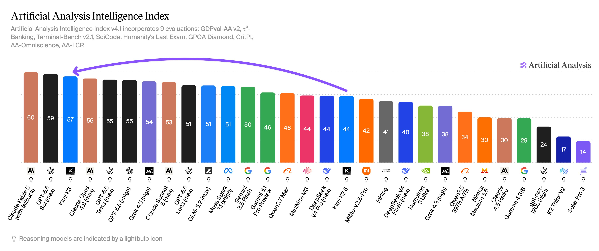
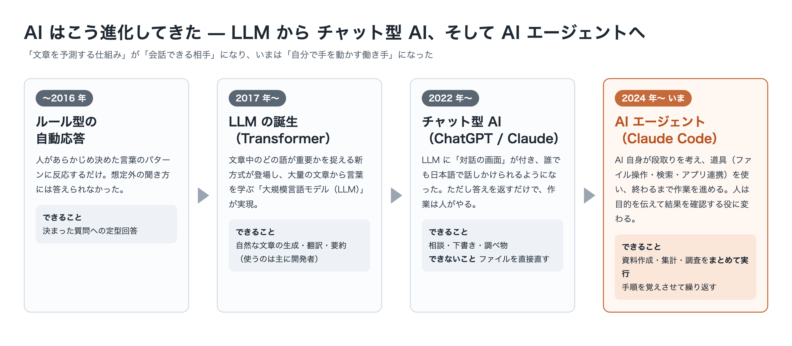
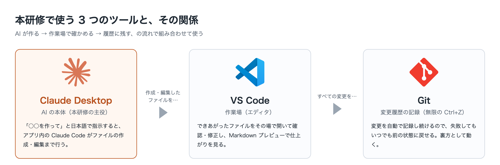
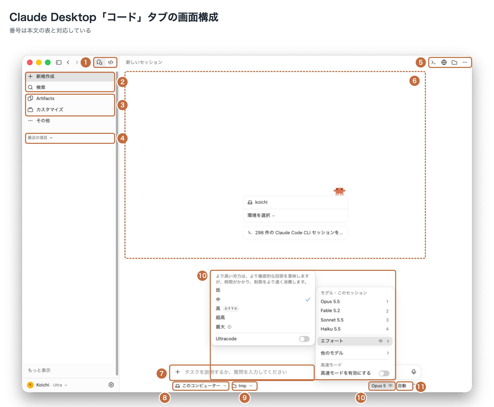
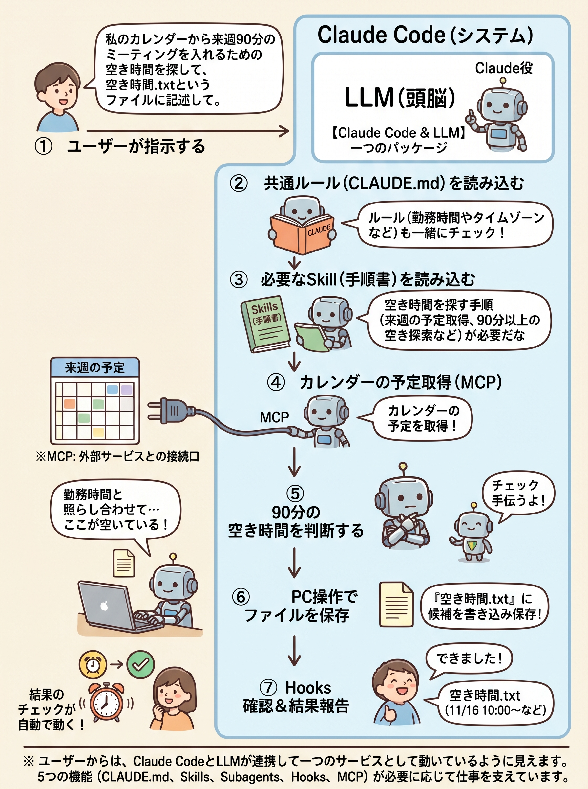
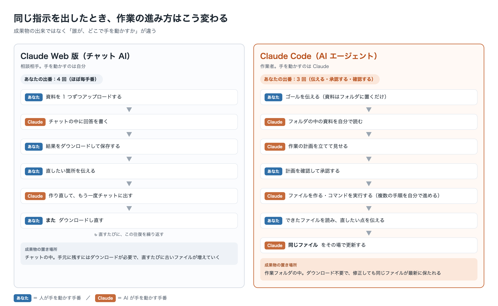
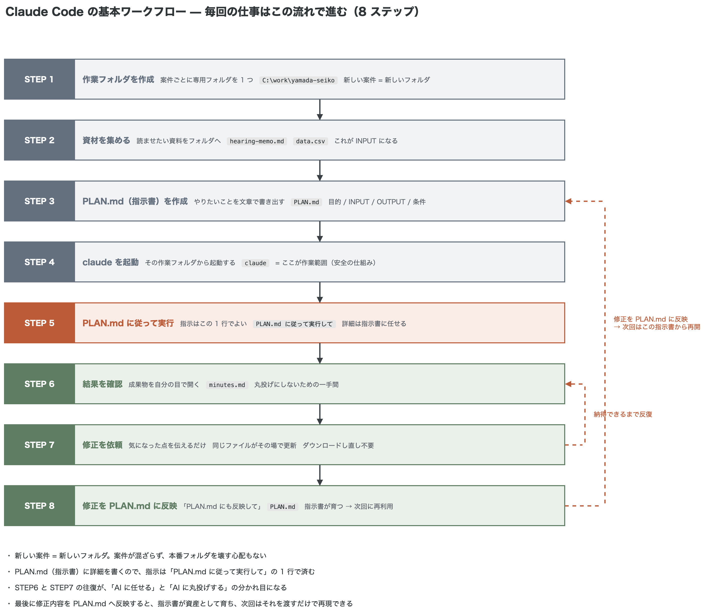
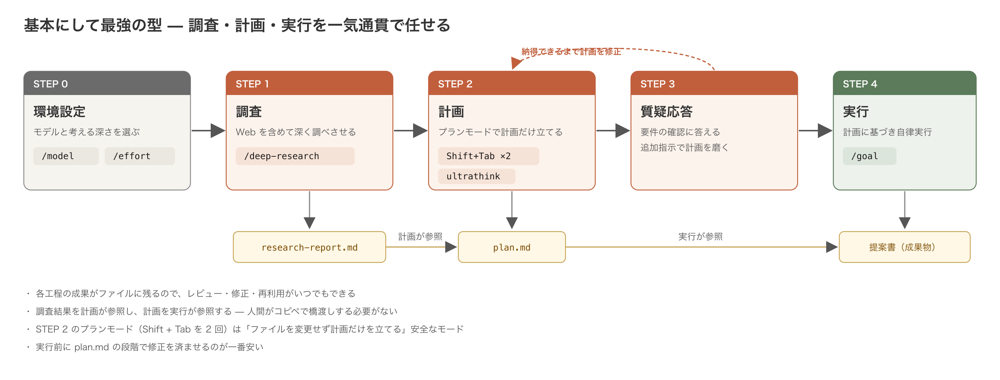

<!-- _class: lead -->
<!-- _paginate: false -->
<!-- _footer: '' -->

# 超実践：最短で<br>AI 業務ハッカーになる

Claude Code 編・Windows 版　／　株式会社エイチ

---

# 本日のご説明内容

| # | 内容 |
|---|---|
| 0 | **はじめに** — この研修が目指すもの |
| 1 | **座学** — Claude と Claude Code を知る |
| 2 | **セットアップ** — 自分の PC で Claude Code を動かす |
| 3 | **実践** — 基本でありながら最強の効果が出る動かし方 |
| 4 | **自分仕様に整える** — CLAUDE.md と安全の仕組み |
| 5 | **スキル** — ノウハウ・手順書を覚えさせる |
| 6 | **MCP** — 外部サービスにつなぐ |
| 7 | **重要な拡張機能** — Claude in Chrome と Playwright |
| 8 | **スキルの作り方** — 自分の業務用スキルを作る |
| 9 | **まとめ** — 仕組みの使い分けと次のステップ |

ゴールは「**条件を渡すだけで一連の業務が片づく自作エージェント**」を手に入れること。

---

<!-- _class: dense -->

# 研修の概要

ハンズオン形式で、**手を動かしながら**身につける構成。

| 項目 | 内容 |
|---|---|
| 形式 | ハンズオン形式（講義 3 : 実習 7） |
| 所要時間 | 1 回 6 時間、全 4 回 |
| 定員 | 各回 最大 4 名程度（少人数制） |
| 対象者 | Windows ユーザー／ドキュメント作成・通常業務を行うビジネスユーザー |

**前提条件**

| 項目 | 内容 |
|---|---|
| PC | Windows 10 以降（管理者権限あり） |
| 契約 | Claude の有料プラン（本研修は Team プランの Premium 席） |
| その他 | インターネット接続環境 |

---

<!-- _class: chapter -->

# <span class="no">0</span>はじめに

この研修が目指すもの

---

# 研修の目的

**プロが使う最先端の道具を、エンジニアでない人が使いこなす。**

- Claude は**プロの開発者が最も支持している**ツール
- しかし、決して難しいツールではない
- 自然言語（日本語）で指示を出すだけで AI が作業を遂行する
- **コーディング経験は不要**

エンジニアと同じ道具を、エンジニアでなくても使える — それが Claude Code の魅力。

---

# どこまで業務効率化できるのか

**アシスタントゼロで、クライアント 60 社を一人で回している税理士の事例がある。**

- 記帳・書類作成・顧客対応などを Claude Code でなるべく自動化
- 通常なら数名のスタッフが必要な業務量を**一人でこなしている**
- 現時点での業務効率化の到達点であり、本研修が目指すゴールの先にある姿

<p class="note">出典：refs/AI税理士.pdf（元資料 §0-4）</p>

---

<!-- _class: dense -->

# 目指すべき姿

目指すのは単発の作業を速くすることではなく、**一連の業務を自動でこなす AI エージェントを自分で作る**こと。

| 自動化したい業務 | 手作業だと | 自作 AI エージェントに任せると |
|---|---|---|
| ① 契約書の作成 | 案件ごとにテンプレを探し、条項を手で差し替える | 条件（相手・金額・期間）を渡すだけで自動作成 |
| ② 契約情報の登録 | 契約書を見ながら Salesforce に手入力 | 契約書を読み取り Salesforce へ自動登録 |
| ③ 日程調整 | 候補日をカレンダーと 1 つずつ突き合わせる | 専用カレンダーから空き枠を自動抽出 |
| ④ 稼働実績の報告 | カレンダーやメモから集計し、報告書に清書 | カレンダーから稼働を把握して報告書を自動作成 |
| ⑤ 社内週次資料 | 毎週フォーマットに沿って作成し、手で見直す | 自動作成、または作成済み資料を自動添削 |

**「条件を渡す → エージェントが一連の業務を片づける」を自分の手で組み立てる** — これが最初のゴール。

---

<!-- _class: dense -->

# 向いている作業（1）— 資料・調査・文書

万能な 1 ツールは存在しない。**用途ごとに最適な道具を選べる状態**を作っておく。

**スライド資料作成（Marp → PDF）**

| ツール | 向き | ひとこと |
|---|---|---|
| Claude Code | ◎ | 構成設計から PDF 出力まで一括。中身が Markdown なので何度でも直させられる |
| Gamma | ○ | 見栄えは高速生成。細かい編集や社内フォーマット準拠は弱い |
| Copilot（PowerPoint） | ○ | Office 環境に強いが自由度は限定的 |

**調査・リサーチ／文書作成**

| ツール | 向き | ひとこと |
|---|---|---|
| Perplexity / Genspark | ◎ | 出典付き Web 検索・自動リサーチに特化。最新情報の一次調査が速い |
| Claude Code（調査） | ○ | 社内データや複数ソースを横断でき正確性が高い |
| Claude Code（文書） | ◎ | 走り書きメモから複数フォーマットを同時生成。長文の正確な整形に強い |

---

<!-- _class: dense -->

# 向いている作業（2）— 分析・自動化

**データ分析・集計レポート**

| ツール | 向き | ひとこと |
|---|---|---|
| Claude Code | ◎ | CSV／Excel を渡して集計→グラフ→考察→レポートまで一気通貫 |
| ChatGPT（データ分析） | ◎ | アップロードした表の分析・可視化が得意 |
| Copilot（Excel） | ○ | 関数・ピボットに強いが Office 依存 |

**定型業務の自動化・連携**

| ツール | 向き | ひとこと |
|---|---|---|
| Claude Code | ◎ | スキル・MCP・スケジュール実行で複数業務を連結し、丸ごと自動化 |
| Codex CLI | ○ | 同種の CLI エージェント。業務自動化より開発寄り |
| Zapier／Make | ○ | アプリ連携は豊富だが、AI の判断を伴う複雑な処理は苦手 |

Claude Code の強みは**複数ソースを横断し、繰り返しを自動化し、正確に処理する**点にある。

---

<!-- _class: chapter -->

# <span class="no">1</span>座学

Claude と Claude Code を知る

---

<!-- _class: dense -->

# 3 大 AI サービスの全体像

3 社とも CLI を提供しているが、**Claude Code が最も早く実用化され、支持も最も高い**。

| | ChatGPT | Gemini | Claude |
|---|---|---|---|
| 提供会社 | OpenAI | Google | Anthropic |
| 代表モデル | GPT-6 シリーズ | Gemini 3 シリーズ | Fable 5.2 / Opus 5.5 / Sonnet 5.5 / Haiku 5.5 |
| Web チャット | ChatGPT | Gemini | Claude（claude.ai） |
| デスクトップ | ChatGPT Desktop | Web・モバイル中心 | Claude Desktop |
| AI エージェント | Codex / ChatGPT Atlas | Antigravity | Claude Code |
| CLI ツール | Codex CLI | Gemini CLI | **Claude Code** |

**CLI（Command Line Interface）** とは、ターミナルから AI を操作するツールのこと。

---

<!-- _class: dense -->

# 3 大 AI アシスタントの比較

容量そのものの差はほぼない。違いが出るのは**どれだけ正確に理解し推論できるか**。

| | ChatGPT | Gemini | Claude |
|---|---|---|---|
| 得意分野 | 幅広い汎用タスク・プラグイン連携 | Google サービス統合・検索連動 | **長文理解・正確な推論・コーディング** |
| ユーザー規模 | 最も早く普及し圧倒的 | Google 製品に統合し急拡大 | ダウンロード・売上ともに急成長 |
| コンテキスト | 1M トークン規模 | 1M トークン規模 | 1M トークン規模 |
| 特徴 | 最も早く普及した先駆者 | 検索・Workspace と一体化 | 安全性と正確性を重視した設計 |

- **コンテキストウィンドウ** = AI が 1 回の会話で読み込める情報量の上限（1M は PDF 約 2,500 ページ分）
- 普段の調べ物は ChatGPT、**業務の自動化は Claude** という使い分けもよい

---

# Claude が注目されている 4 つの理由

| # | 理由 | 要点 |
|---|---|---|
| 1 | アプリ DL 数 1 位 | 2026 年 3 月に米 App Store で一時 ChatGPT を抜き無料 1 位。DAU は 1,000 万人規模 |
| 2 | 売上成長率 | ARR は 2026 年 7 月末時点で 650 億ドル（1 年で約 7 倍） |
| 3 | 安全基準を譲らない | 大口顧客（政府）の圧力にも公表した利用制限を曲げなかった |
| 4 | 最上位モデル層の登場 | Opus を上回る **Mythos クラス**（Fable 5.2 / Mythos 5.2） |

<p class="note">数値は作成時点のもの。最新は Anthropic 公式ニュースで確認（元資料 §1-1）</p>

---

# 理由 3：安全基準を譲らない一貫性

**大口顧客の圧力を前にしても、公表している利用制限を曲げなかった。**

- 2026 年 2 月、米国防省が「自律型致死兵器の運用」「米国民への大規模監視」への利用制限の撤廃を要求
- Anthropic はこれを**拒否**。国防省は「サプライチェーンリスク」に指定し軍事契約を取り消した
- この一貫性が「安全性の約束が口約束ではない」という評価につながっている

アプリダウンロードの急増も、この一件への支持が背景にあると報じられた。

---

<!-- _class: dense -->

# 理由 4：最上位モデル層「Mythos クラス」

**Fable 5.2 と Mythos 5.2 は同じ基盤モデルで、違いは安全対策と提供範囲。**

| モデル | 提供範囲 |
|---|---|
| **Claude Fable 5.2** | サイバー・生物分野の安全対策を備え、**全ユーザーに一般提供** |
| **Claude Mythos 5.2** | 安全対策を緩め、**審査を通った組織だけ**が利用できる |
| Opus 5.5 / Sonnet 5.5 / Haiku 5.5 | 日常業務向けに下位層が揃い、用途に応じて使い分け |

- 前世代（5.1）より**出力が最大 30% 高速**、API 料金は**値下げ**（入力 $10 → $8 / 出力 $50 → $40）
- コーディング評価 **FrontierSWE v2 で 69.9%**（Opus 5.5 は 62.3%、GPT-6 Astra 65.5%、Gemini 4 Carbon 61.2%）
- 読み込みは **1M トークン**、1 回の出力は最大 128K トークン。任意の **fast mode** で最大 2.5 倍速

**多くの作業は Opus 5.5 から始める**のがよい（Anthropic 公式の案内）。Fable は「ここは確実に当てたい」場面で。

---

# ベンチマークでの位置づけ

第三者評価機関による総合知能指数では、Claude の最上位モデルが**首位クラス**に位置する。



<p class="note">作成時点のスナップショット。順位は頻繁に入れ替わる。出典：Artificial Analysis（artificialanalysis.ai）</p>

---

# AI はこう進化してきた

**Claude Code は「答えをくれる相手」ではなく「作業をやってくれる相手」。**



- **2017 年：LLM の誕生** — 大量の文章から言葉のつながりを学び、自然な文章を書けるように
- **2022 年：チャット型 AI** — 誰でも日本語で話しかけられる。ただし AI は**答えを返すだけ**
- **2024 年〜：AI エージェント** — AI 自身が段取りを考え、**道具を使って**作業が終わるまで進める

---

# 開発者が選ぶ AI コーディングツール No.1

リリースから短期間で、**最も使われている AI コーディングツール**の地位を確立した。

- **SWE-bench Verified**（ソフトウェア工学のベンチマーク）で全 AI ツール中トップクラス
- JetBrains 開発者調査（2026 年 5〜7 月・15,000 人超）— **Claude Code 39%**（米国 47%）／Copilot 21%／Cursor 12%
- Pragmatic Engineer 調査（2026 年 3 月・906 人）— **Claude Code 46%** vs Cursor 19% vs Copilot 9%

「プロが最も使いたい道具」だが、操作は**日本語で指示を出すだけ**。

---

# Anthropic という会社

**「AI の安全性を最優先にする企業が必要だ」という信念から創業された。**

- 創業者は OpenAI で研究部門 VP を務めた Dario Amodei と、安全性・ポリシー部門を担当した Daniela Amodei
- **Constitutional AI（憲法 AI）** — 「AI がどう振る舞うべきか」の原則を組み込み、有害な出力を減らしつつ有用性を犠牲にしない
- **安全性へのコミットメント** — 能力向上と安全性を対立させず両立させる
- **透明性** — モデルの限界や弱点を隠さず公開する

AI 業界で規制反対が多い中、Anthropic は一貫して**適切な規制は必要**という立場を取っている。

---

<!-- _class: dense -->

# セキュリティ：学習利用はプランで決まる

ここは誤解が多い。**「学習に使われるか」は契約しているプランで決まる。**

| プラン | 学習利用 | 対応 |
|---|---|---|
| **商用（Team / Enterprise / API）** | **デフォルトで使われない** | 商用利用規約で定められている。**本研修は Team プラン** |
| 個人向け（Free / Pro / Max） | デフォルトで使われる | 設定の「Claude の改善に協力」を**オフにしてオプトアウト** |

**オプトアウトの手順（個人プランの場合）**

1. claude.ai にログイン → 画面左下のアカウント名 → **設定（Settings）**
2. **プライバシー（Privacy）** → 「**Claude の改善に協力**」のトグルを**オフ**
3. トグルが灰色になれば完了（claude.ai/settings/data-privacy-controls を直接開いてもよい）

オフにしても会話データは 30 日間保持される（オンのままだと最長 5 年）。**すでに学習に使われた分は取り消せない。**

---

<!-- _class: dense -->

# 3 大 AI のセキュリティ比較

| 項目 | Claude | ChatGPT | Gemini |
|---|---|---|---|
| データの学習利用 | **商用プランはしない**（個人は要オプトアウト） | オプトアウトが必要 | 無料版は利用、有料版は除外 |
| ローカル実行 | **PC 上で動作**（Claude Code） | Codex CLI は PC 上 | Gemini CLI は PC 上 |
| 権限制御 | ファイル・コマンド単位で**設定ファイルに明記できる** | 実行前の承認とサンドボックス | 実行前の承認とサンドボックス |
| 危険操作のブロック | deny リストで個別指定可能 | サンドボックスの範囲設定 | サンドボックスの範囲設定 |

**クライアントに聞かれたら、この 3 点を伝える**

1. 商用プラン（Team / Enterprise）なら入力データはデフォルトで学習に使われない
2. ファイルは PC 上で処理され、クラウドにアップロードされない
3. 読み取り・実行の権限を細かく制御でき、ルールをチームで共有できる

---

<!-- _class: dense -->

# 料金プランと利用条件

Claude Code を使うには**有料サブスクリプションが必須**。無料プランでは利用できない。

| プラン | 月額（月払い / 年払い） | Claude Code | 主な用途 |
|---|---|---|---|
| Free | $0 | 利用不可 | Web 版の基本的なチャットのみ |
| Pro | $20 / $17 | 利用可能 | 個人利用・軽めの業務活用 |
| Max (5x) | $100 | 利用可能（大容量） | ヘビーユーザー・長時間の自動化 |
| Max (20x) | $200 | 利用可能（最大容量） | 大規模・並列実行 |
| Team（Standard 席） | $25 / $20 | **利用不可** | チームでの Web チャット利用 |
| **Team（Premium 席）** | **$125 / $100** | **利用可能** | **本研修で使用** |
| Enterprise | 要問合せ | 利用可能 | 組織導入・SSO・監査ログ |

**Claude Code を使うには Premium 席が必要。** 1 タスクで AI への問い合わせが数十〜数百回発生するため、無料プランでは支えきれない。

---

# 定額プラン以外の使い方 — API

| 契約形態 | 料金の考え方 | 向いている使い方 |
|---|---|---|
| サブスクリプション | 月額定額。利用量に上限あり | 個人・チームの日常業務（**本研修はこちら**） |
| API（従量課金） | 使ったトークン量に応じて課金。上限なし | 社内システムへの組み込み・大量の自動処理 |

- **API** とは、プログラムから Claude の頭脳を直接呼び出す仕組み
- 「毎晩 1,000 件のレポートを自動生成」のような規模になると、API の従量課金を組み合わせる場面が出てくる
- 今は「定額のほかに、使った分だけ払う選択肢がある」ことだけ押さえればよい

---

<!-- _class: dense -->

# 2 大 AI コーディングエージェントの比較

市場をリードするのは **Claude Code（Anthropic）** と **Codex（OpenAI）** の 2 強。

| 観点 | Claude Code | Codex |
|---|---|---|
| 位置づけ | ターミナル発のコーディングエージェント | ChatGPT に統合されたエージェント |
| 得意な性格 | **突破力** — 複数ファイル横断・設計・難所を一気通貫 | **正確性** — 慎重に手堅く進め破綻しにくい |
| 進め方 | 手元で対話しながら舵を切る | クラウド／背景に任せ PR で受け取る |
| 画面操作 | 拡張（Claude in Chrome）で対応 | **Codex が優位**（アプリ／ブラウザを自分で操作） |
| 拡張性 | サブエージェント・スキル・MCP で深く作り込める | プラグイン・MCP、ChatGPT 資産と連携 |
| 安全の仕組み | 作業フォルダ外は触らない＋実行前確認＋Git | コマンドを既定でサンドボックス実行 |

<p class="note">更新が速い領域。数値や対応状況は商談前に公式で最新を確認する（元資料 §1-3）</p>

---

# 本研修で Claude Code を選ぶ理由

**ゴール（自作エージェントで業務を自動化する）に照らすと、次の点で優位。**

- **新機能がいちばん早く載る「先行優位」** — モデルを作る Anthropic 自身がモデルと一体で開発。新機能はまず Claude Code に実装される。**MCP も Anthropic が公開した業界標準**
- **難所を押し切る「突破力」** — 仕様が曖昧な課題や大きな改修を、対話しながら一気に形にできる
- **深く作り込める拡張性** — サブエージェント・ワークフロー・スキル・MCP が揃う
- **初心者でも事故りにくい安全設計** — フォルダ外は触らない＋実行前確認＋Git で巻き戻せる
- **追加契約なしで使える** — Team プランにそのまま含まれる

Codex が優位な領域（画面操作）は、必要に応じて**二刀流**で補えばよい。

---

# Claude の 4 つのインターフェース

自由度と手軽さはトレードオフ。**本研修は「デスクトップ（Claude Code）」を使う。**

<div class="flow">
<div class="box">★ Claude Code（CLI）<span class="sm">AI が自律的に作業。ファイル操作・コマンド実行・Git 管理。自由度が最も高い</span></div>
<div class="ar">▲ 自由度・できることの幅</div>
<div class="box human">● デスクトップ（Claude Code）<span class="sm">アプリ内で Claude Code を実行。ターミナル不要。本研修で使用</span></div>
<div class="ar">▲</div>
<div class="box">■ デスクトップ（チャット）<span class="sm">チャット＋ローカルフォルダ操作・コネクタ・定期実行（旧 Cowork を統合）</span></div>
<div class="ar">▲</div>
<div class="box todo">▼ Web 版<span class="sm">ブラウザだけで利用可能。チャット形式の質問応答</span></div>
</div>

<div class="legend"><span class="c3">■ 本研修で使う</span><span class="c1">■ 慣れたら移行</span><span class="c2">□ 手軽さ重視</span></div>

---

<!-- _class: dense -->

# 4 つのインターフェースの違い

| 比較項目 | Web 版 | デスクトップ（チャット） | デスクトップ（Claude Code） | Claude Code（CLI） |
|---|---|---|---|---|
| 利用方法 | ブラウザで claude.ai | 専用アプリのチャット画面 | アプリ内で Claude Code を起動 | ターミナルで `claude` |
| 基本動作 | 1 問 1 答 | チャット + 呼出 | 指示 → 完成物を受取 | 複数ステップを自律遂行 |
| ファイル操作 | アップ／ダウンのみ | 指定フォルダの読み書き | ローカルの読み書き | ローカルの読み書き |
| コマンド実行 | 不可 | 限定的（サンドボックス） | 可能 | あらゆるコマンド |
| Git 連携 | 不可 | 不可 | コミット・PR まで | コミット・PR まで自動 |
| 並列実行 | 不可 | 不可 | 複数セッション同時 | 複数セッション同時 |
| 向く用途 | 質問・相談・添削 | 日常活用・資料作成 | ターミナルを使わない自動化 | 開発・自動化・業務フロー |

**外部ツール連携（MCP）はどのインターフェースでも使える**（コネクタで数クリック）。

---

# AI モデルと AI エージェントの違い

**Fable や Sonnet は「頭脳」、Claude Code はその頭脳に「手足」を与えたもの。**

| | AI モデル（Fable / Sonnet 等） | AI エージェント（Claude Code） |
|---|---|---|
| 役割 | 質問に答える・文章を生成する「頭脳」 | 頭脳を使って実際に作業を遂行する「作業者」 |
| できること | テキストの入出力のみ | ファイル操作・コマンド実行・Git 管理まで |
| たとえ | 何でも知っている相談役 | 指示どおりに手を動かすアシスタント |

モデルは「賢いけれど手が動かせない」存在、Claude Code は「その賢さで実際に仕事をこなす」存在。

---

# チャット AI とエージェント型 AI

| 比較項目 | 従来のチャット AI | Claude Code |
|---|---|---|
| 動作モデル | 質問に回答する | **AI が作業者として動く** |
| ファイル操作 | 不可 | ローカルファイルの読み書き可能 |
| コマンド実行 | 不可 | ターミナルコマンドを実行可能 |
| 開発ツール連携 | 不可 | Git・VS Code 等と統合 |
| 作業の自律性 | 1 問 1 答 | 複数ステップを自動で遂行 |

**なぜ最も強力なのか** — ①ファイルを直接操作できる ②コマンドを実行できる ③Git でやり直しがきく ④複数作業を同時に走らせられる ⑤スキルとして再利用できる

---

# デスクトップと CLI の使い分け

本研修で使うのは**デスクトップ（Claude Code）**。画面があり扱いやすいため。

| 比較 | デスクトップ（Claude Code） | Claude Code（CLI） |
|---|---|---|
| 操作方法 | GUI（デスクトップアプリ） | CUI（ターミナル） |
| 動作速度 | やや遅い（UI のオーバーヘッド） | **速い**（直接実行） |
| 学習コスト | 低い | やや高い |
| ファイル操作・コマンド・Git | 可能 | 可能 |
| 並列実行 | 可能 | 可能 |

まずは GUI から始め、**慣れてきたら CLI に移る**のがよい。

---

<!-- _class: chapter -->

# <span class="no">2</span>セットアップ

自分の PC で Claude Code を動かす

---

# 利用する 3 つのツール

**AI が作る → 作業場で確かめる → 履歴に残す。この流れで組み合わせて使う。**



- **Claude Desktop** — AI の本体。チャットで相談＋アプリ内の Claude Code がファイルを作成・編集（**本研修の主役**）
- **VS Code** — 作業場。編集・Markdown プレビュー・ターミナルを 1 画面に統合
- **Git** — 変更履歴の記録。すべての変更を保存する「**無限の Ctrl+Z**」

---

# 3 つのツールの関係

<div class="flow">
<div class="box">Claude Desktop（AI の本体）<span class="sm">チャットで相談 ＋ アプリ内の Claude Code がファイルを作成・編集</span></div>
<div class="ar">▼　作成・編集したファイルは…</div>
<div class="box">VS Code（作業場）<span class="sm">エディタで編集し、Markdown プレビューで結果をその場で確認</span></div>
<div class="ar">▼　すべての変更は…</div>
<div class="box">Git（無限の Ctrl+Z）<span class="sm">変更履歴を記録 → 失敗してもいつでも元に戻せる</span></div>
</div>

Git 同梱の Git Bash は Claude Code が裏で使うだけで、**自分で開いて操作する場面はない**。

---

<!-- _class: dense -->

# 前提の確認 — 研修前に 5 つ準備する

| 準備するもの | 役割 | 確認方法 |
|---|---|---|
| **1. Claude Desktop** | デスクトップ版 Claude アプリ | 起動でき、Team プランのアカウントでサインイン済み |
| **2. Git for Windows** | Claude Code が内部で使う Git Bash を提供 | `git --version` でバージョンが表示される |
| **3. Claude Code とライセンス** | 本研修の主役（有料プランの席が必要） | `claude --version` が表示され、ログインできる |
| **4. VS Code** | 文書・スライドを編集・プレビューする作業場 | 起動でき、日本語表示になっている |
| **5. GitHub アカウント** | 変更履歴の保存・共有 | github.com にサインインできる |

**Claude アカウントの有効化**（研修前に各自）

1. 管理者からの招待メール「You've been invited to join … on Claude」を開く
2. 「**Accept Invite**」→ 業務用メールアドレスでサインイン
3. 画面左下に**組織名**が表示されていれば Team プランとして正しく設定済み

<p class="note">インストール手順は元資料「付録 H：Windows セットアップ手順」を参照</p>

---

# Markdown — 本研修の標準フォーマット

**テキストに簡単な記号を付けて見出しや箇条書きを表現する軽量な文書形式（`.md`）。**

- **AI と相性がいい** — 中身は記号付きのテキストなので、Claude が生成・修正しやすい
- **専用ソフトが不要** — メモ帳でも VS Code でも開ける
- **PDF・Word・HTML へ変換しやすい** — 用途別に使い分けられる
- **差分が見やすい** — 修正前と修正後の違いが行単位で分かる
- **再利用しやすい** — 同じ Markdown から PDF・社内 Wiki・メール本文へ展開できる

**基本サイクル** — Claude Code に文書を作らせる → 左パネルでファイルをクリック → `Ctrl + Shift + V` で確認

---

<!-- _class: dense -->

# VS Code で Markdown・Marp を扱う

**入れておく拡張機能は 2 つ**（拡張機能パネルで検索 → インストール）。

| 拡張機能 | 検索キーワード | 何ができるようになる |
|---|---|---|
| **Markdown Preview Enhanced** | `Markdown Preview Enhanced` | プレビュー強化。目次表示・図表描画・PDF 書き出し |
| **Marp for VS Code** | `Marp` | **Marp 形式**の Markdown をスライドとしてプレビュー・PDF 書き出し |

**Marp（マープ）とは** — Markdown からプレゼン用スライドを作る仕組み。ファイル先頭に `marp: true` と書かれた Markdown が Marp 形式。「この内容をスライドにして」と頼むとこの形式で作ってくれる。

**つまずきやすい設定**

- HTML（`<div>` など）を含むスライドが表示されない → 設定で `markdown.marp.enableHtml` にチェック
- 1 枚に詰め込みすぎを検知したい → `markdown.marp.diagnostics.slideContentOverflow` にチェック

---

# スライドは PDF で配布する

**書き出しは 3 ステップ** — ①`.md` を開く ②`Ctrl + Shift + P` → `Marp: Export Slide Deck` ③ PDF で保存

**なぜ PowerPoint ではなく PDF なのか**

- **AI が何度でも直せる** — 中身は Markdown のまま手元に残る。「3 枚目の表現を変えて」でその場で直る。pptx は圧縮された特殊形式のため AI が読み直して直せない
- **相手の環境で崩れない** — どのパソコン・スマホでも見たとおりに表示される
- **余計な準備がいらない** — PDF は VS Code の拡張機能だけで書き出せる（Edge が使われるため追加インストール不要）

---

# Claude Code の画面構成

<div class="shot">

<div class="desc">

Claude Desktop には「チャット」と「コード」の 2 画面。**Claude Code が動くのは「コード」側**。

- **1** チャット／コードの切り替え（使うのは右の `</>`）
- **2〜4** サイドバー＝会話の出し入れ（新規作成・検索・最近の項目）
- **3** Artifacts（成果物の棚）とカスタマイズ（能力を足す設定）
- **5** 表示の切り替え（ターミナル／ブラウザ／フォルダ）
- **6・7** チャット領域とプロンプト入力欄
- **8〜11** 実行環境・**作業フォルダ**・モデルと思考の深さ・権限モード

</div>
</div>

---

# 作業前に必ず確認する 4 つ

**画面最下部の 1 行（8〜11）が、事故を防ぎ品質を安定させるいちばん簡単なコツ。**

| 番号 | 項目 | 確認すること |
|---|---|---|
| 8 | 実行環境 | 本研修では「このコンピューター」のまま |
| 9 | **作業フォルダ** | Claude が触ってよいフォルダ。**案件ごとに切り替える** |
| 10 | モデル・エフォート | どのモデルで、どれくらい深く考えるか |
| 11 | 権限モード | 「自動」「プラン」など、どこまで自動で進めてよいか |

特に **9 の作業フォルダ**は、間違えるとまったく別のフォルダを触ることになるため毎回必ず確認する。

---

# エラーが出ても大丈夫

**赤いエラーが出ても慌てない。Claude Code 自身がエラーの内容を理解できる。**

<div class="flow">
<div class="box">① エラーが出たら<span class="sm">そのまま Claude Code に「どうすればいいですか？」と聞く</span></div>
<div class="ar">▼</div>
<div class="box">② 解決策が提示されたら<span class="sm">「お願いします」と返す</span></div>
<div class="ar">▼</div>
<div class="box human">Claude が原因を特定し、修正まで自動で行う</div>
</div>

エラーの内容を自分で調べたり、意味を理解したりする必要はない。

---

<!-- _class: chapter -->

# <span class="no">3</span>実践

基本でありながら最強の効果が出る動かし方

---

# Claude Code の全体構成

<div class="shot">

<div class="desc">

**頭脳である LLM と、それを動かす Claude Code 本体がひとつのパッケージ。**

| 機能 | 役割 |
|---|---|
| **CLAUDE.md** | 毎回守ってほしい共通ルールを読み込む（第4部） |
| **Skills** | 手順書を読み込む（第5部） |
| **MCP** | 外部サービスから情報を取得する（第6部） |
| **Subagents / Hooks** | 作業を分担する／節目で自動実行する |

ユーザーの指示に対して、共通ルールを読み、手順書を読み、外部から情報を取り、判断し、保存し、最後に自動チェックして返す。この一連を 5 つの機能が支えている。

</div>
</div>

---

# 同じ指示で何が変わるか



<p class="note">同じ指示を出したときの進み方。青が人の手番、オレンジが Claude の手番（元資料 §3-2）</p>

Web 版は**アップロードとダウンロードを繰り返す相談相手**、Claude Code は**フォルダの中で一緒に働く作業者**。

---

# 3 つの違い

| # | 観点 | Web 版 | Claude Code |
|---|---|---|---|
| 1 | 資料の渡し方 | 読ませたい資料を自分で 1 つずつアップロード | **作業フォルダに置くだけ**。「読んで」で Claude が開く |
| 2 | 作業の進め方 | 1 問 1 答。次に何をするかは常に人が決める | ゴールを伝えると**読む→考える→計画→作る**を Claude が進める |
| 3 | 直し方 | 直すたびに作り直し＋ダウンロードし直し | **同じファイルがその場で更新**される |

人の出番は「ゴールを伝える」「計画を承認する」「結果を確認する」の **3 つに減る**。

---

# 基本動作：毎回の仕事はこの 8 ステップ

⭐️ **本研修の土台となる章。** どんな案件でも同じ流れの繰り返し。



---

# 8 ステップ（1〜4）— 準備して起動する

| # | ステップ | やること |
|---|---|---|
| 1 | 作業フォルダを作成 | 案件ごとに専用フォルダを 1 つ（例：`C:\work\yamada-seiko`）。**新しい案件 = 新しいフォルダ** |
| 2 | 資材を集める | ヒアリングメモ・CSV・過去の提案書など読ませたいもの（INPUT）をコピー |
| 3 | **PLAN.md を作成** | やりたいことを 1 つの指示書にまとめる（次ページ） |
| 4 | 作業フォルダから起動 | **起動したフォルダが Claude の作業範囲**になる。外は勝手に触らない |

案件ごとにフォルダを分けるのは、**この安全装置を活かすため**でもある。

---

<!-- _class: dense -->

# PLAN.md（指示書）に書く 4 点

口頭でその都度指示するより、**先に指示書へ書き出す**ほうが抜け漏れが減り、やり直しも「指示書を直して再実行」で済む。

| 項目 | 内容 |
|---|---|
| **目的** | 何のために何を作るか |
| **読むファイル（INPUT）** | Claude に読ませる資材 |
| **作るもの（OUTPUT）** | 出力先・ファイル名・章立て |
| **条件** | 引用ルールなど満たすべき要件 |

```markdown
# PLAN.md（指示書）
## 目的
次回訪問用の議事録を作成する
## 読むファイル（INPUT）
- hearing-memo.md / data.csv
## 作るもの（OUTPUT）
- 出力先：このフォルダ / ファイル名：minutes.md
- 「決定事項 / 課題 / next action（担当・期限）」の 3 章立て
## 条件
- 数値は data.csv の実績をそのまま引用する
```

**PLAN.md 自体を Claude に書かせてよい** —「次回訪問用の議事録を作りたい。PLAN.md という指示書を作って」

---

# 8 ステップ（5〜8）— 実行して指示書を育てる

| # | ステップ | やること |
|---|---|---|
| 5 | プロンプトで指示 | `PLAN.md に記述した内容に従って実行してください。` の 1 行で済む |
| 6 | 結果を確認 | 生成ファイルを VS Code で開き、**自分の目で読む** |
| 7 | 修正を依頼 | 気になった点を伝えれば**同じファイルがその場で更新**される |
| 8 | **PLAN.md に反映** | 「ここまでの修正内容を PLAN.md にも反映して」と伝える |

- **「AI に任せる」と「AI に丸投げする」の違いは、ステップ 6 の確認をするかどうか**
- ステップ 8 で指示書が最新になり、次回は PLAN.md を渡すだけで同じ品質を再現できる
- 口頭指示が流れて消えるのを防ぎ、**ノウハウが指示書として積み上がる**

---

# ハンズオン：訪問前ブリーフィングメモ

**お題** — 来週ある会社を初訪問する。相手の会社概要と最近の動きを頭に入れ、当日の質問まで用意したい。Claude に調べさせ、**1 枚のメモ（`company-brief.md`）としてフォルダに残す**。

<div class="flow">
<div class="box">① 作業フォルダを作る（<code>C:\work\visit-brief</code>）</div>
<div class="ar">▼</div>
<div class="box">② 資材は「なし」— INPUT は Web そのもの</div>
<div class="ar">▼</div>
<div class="box">③ PLAN.md に「調べること」「作るもの」「条件」を書く<span class="sm">PLAN.md 自体を Claude に書かせてもよい</span></div>
<div class="ar">▼</div>
<div class="box">④⑤ 起動して「PLAN.md に従って実行してください」</div>
<div class="ar">▼</div>
<div class="box human">⑥ 出典 URL を 2〜3 本、自分でブラウザで開いて裏を取る</div>
</div>

<p class="note">詳しい手順・プロンプト全文は教材本文「3-3 ハンズオン」を参照</p>

---

# 調べ物を任せるときの 2 つの条件

**AI の調べ物には誤りが混ざる。だから PLAN.md の「条件」に必ず入れる。**

- **事実には必ず出典 URL を併記する**
- **確認できなかった項目は埋めず「公開情報では確認できず」と書く**

この 2 行があるかどうかで、成果物が「**確認できるメモ**」か「**信じるしかないメモ**」かに分かれる。

**チャット版との違い**

- 調べた結果が、その場で**フォルダの中のファイル**になる（コピペもダウンロードも不要）
- **指示書が残るので 2 社目からは 1 分**。会社名と URL を差し替えるだけで同じ構成のメモができる

---

# 最強の型：調査・計画・実行を一気通貫

⭐️ **この型さえ覚えれば戦える。** どんな案件も、まずこの流れに当てはめる。



各ステップの成果がファイルに残り、次のステップがそれを参照する。

---

# 覚えるのはこの 5 ステップだけ

| ステップ | 使うもの | やること |
|---|---|---|
| 0. 環境設定 | `/model`・`/effort` | 作業に合ったモデルと「考える深さ」を選ぶ |
| 1. 調査 | `/deep-research` | Web を含めて深く調べさせ、調査レポートを作らせる |
| 2. 計画 | プランモード + `ultrathink` | 実行計画を立てさせ、**ドキュメントに残させる** |
| 3. 質疑応答 | 対話 | 計画への質問に答え、追加指示で磨く |
| 4. 実行 | `/goal` | 完成した計画に基づいて成果物の作成まで自律実行 |

**プランモードへの切り替え** — Claude Desktop は入力欄の右の「**自動**」ボタン、CLI は **Shift + Tab を 2 回**

---

# 3 つのつまみ

**どれも「AI にどれだけ頭を使わせるか」を調整する道具。**

| つまみ | 指定の仕方 | 何が変わるか | 効き方 |
|---|---|---|---|
| どのモデルに任せるか | `/model` | AI の頭脳そのもの | 切り替えるまでずっと |
| どれだけ深く考えるか | `/effort` | 1 回の回答で使う思考の量 | 切り替えるまでずっと |
| 今回だけ深く考えさせる | プロンプトに `ultrathink` | そのやりとり 1 回分の思考の量 | **そのターンだけ** |

モデルも思考の深さも、**上げるほど週の利用枠を早く消費する**。「調査と計画で上げて、実行で戻す」のがコツ。

---

<!-- _class: dense -->

# モデルの選び方（`/model`）

| モデル | 性格 | 向いている工程 |
|---|---|---|
| **Fable 5.2** | 最上位。答えの形が決まっていない問題を、時間をかけて調べ・検証しながら解く。**遅く、消費も大きい** | 深い調査、重要な計画づくり、原因不明の問題究明 |
| **Opus 5.5** | 既定。難しい作業をひととおりこなせ、速度と枠のバランスがよい | 日常の調査・計画・実行。**迷ったらこれ** |
| **Sonnet 5.5** | 速い。やることが決まっている作業を手早く形にする | 計画が固まったあとの実行、文章の整形 |
| **Haiku 5.5** | 最も速く軽い | ファイル名の変更、短い下書き |

- Fable 5.2 は**どのプランでも最初から選ばれていることはない**。使うときは `/model` で明示的に選ぶ
- ここで選んだモデルは、**サブエージェントに任せるときにも引き継がれる**。だから調査前に上げておくと効く
- `/model opusplan` — **プランモードのときだけ Opus、通常モードは Sonnet** に自動切替

---

<!-- _class: dense -->

# 思考の深さ（`/effort`）と `ultrathink`

**初期値は `medium`。** `/effort` だけ入力するとスライダーが出る。

| レベル | 目安 |
|---|---|
| `low` | 結果を見ながら進める軽いやりとり（名前の変更、たたき台づくり） |
| `medium` | 初期値。やることがはっきりしている普段の作業 |
| `high` | 間違えたくない作業（調査、既存資料の修正） |
| `xhigh` | さらに深く考えさせたいとき（その分トークンと時間を使う） |
| `max` | 人が張り付かずに難問を解かせるとき。**遠回りになることもあり常用しない** |

**`ultrathink`** — プロンプトのどこかに書くだけで、**そのやりとりだけ**じっくり考えさせられる。`/effort` の設定は変わらない。

```
調査結果をもとに、実行計画を立ててください。 ultrathink
```

効くのは「考える価値のある 1 回」— 計画立案、方針の比較検討、原因の切り分け。**毎回付けると無駄。**

---

<!-- _class: dense -->

# シーン別の推奨

| 工程 | モデル | 思考の深さ | `ultrathink` |
|---|---|---|---|
| **調査**（`/deep-research`） | Fable 5.2（重要案件）／Opus 5.5（日常） | `high` | 不要 |
| **計画**（プランモード） | Fable 5.2 ／ Opus 5.5 | `high`〜`xhigh` | **付ける** |
| 質疑応答・計画の修正 | そのまま | そのまま | 不要 |
| **実行**（`/goal`） | Opus 5.5 ／ Sonnet 5.5 | `medium` | 不要 |
| 体裁直し・軽い修正 | Sonnet 5.5 ／ Haiku 5.5 | `low`〜`medium` | 不要 |

**調査は Fable か Opus か** — 分かれ目は「**問いの答えの形が見えているか**」。論点自体が分からない問いは Fable、探す先がはっきりしている調べ物は Opus で十分。**迷ったら Opus ＋ `high` で始め、浅いと感じたら Fable に上げる。**

**計画は最もお金と時間をかける価値がある** — 計画の良し悪しがその後の実行すべての品質を決める。**Fable 5.2 ＋ `ultrathink`** が最良。枠を節約するなら `/model opusplan`。

---

# ハンズオン：EC 進出支援を一気通貫で

**お題** — 老舗和菓子メーカー（従業員 30 名、実店舗 2 店）から「EC 販売を始めたいが何から手を付ければいいか分からない」と相談された。**市場調査から導入提案書の作成まで**を任せる。

<div class="flow">
<div class="box">ステップ 0：環境設定 — <code>/model</code> で Fable 5.2、<code>/effort</code> で high</div>
<div class="ar">▼</div>
<div class="box">ステップ 1：調査 — <code>/deep-research</code> で市場動向を調べ <code>research-report.md</code> に保存<span class="sm">数分かかるので待つ。この体験こそが deep-research の価値</span></div>
<div class="ar">▼</div>
<div class="box">ステップ 2：計画 — プランモードに切り替え、「実装はまだ行わず」＋<code>ultrathink</code> で <code>plan.md</code></div>
<div class="ar">▼</div>
<div class="box human">ステップ 3：質疑応答 — plan.md を読み、追加の章を指示して磨く</div>
<div class="ar">▼</div>
<div class="box">ステップ 4：実行 — 通常モードに戻し <code>@plan.md</code> に基づいて提案書を作成</div>
</div>

---

# なぜこの型が「最強」なのか

- **調査・計画・実行が同じ文脈でつながる** — 人間がコピペで橋渡しする必要がない
- **各工程の成果がファイルに残る** — `research-report.md` と `plan.md` が上司レビュー・クライアント説明・次回案件にそのまま使える
- **「実行前に計画を握る」が仕組みになる** — いきなり成果物を作らせて全部やり直し、がなくなる。**修正は plan.md の段階で済ませるのが一番安い**
- **どんな業務にも当てはまる** — 競合調査でも業務フロー改善でも社内規程の整備でも、型は変わらない。変わるのはプロンプトの中身だけ

慣れないうちは、**各ステップの間で必ず成果物を自分の目で読む**こと。

---

<!-- _class: dense -->

# 長く使うときの基本コマンド 5 つ

長い会話をそのまま続けると、関係ない文脈が混ざって**精度が落ち、重く・高くなる**。

| コマンド／キー | 何をする | いつ使う |
|---|---|---|
| **`/clear`** | 会話履歴をすべて消してリセット | **別のタスクに移るとき**（新しい案件 = まず `/clear`） |
| **`/compact`** | やりとりを AI が要約し、要点を保ったまま軽くする | **同じタスクを続けたいが会話が長くなったとき** |
| **`/btw 質問`** | 作業を止めずに質問する（回答は別枠・履歴に残らない） | **作業中に確認だけしたいとき** |
| **`Esc`**（1 回） | 実行中のアクションをその場で止める | 方向性が違うと気づいたとき |
| **`Esc` 2 回** | 巻き戻しメニューを開き、前のやりとりまで戻る | さっきの指示の前に戻りたいとき |

`/clear` が「**忘れてリセット**」、`/compact` は「**要点を覚えたまま圧縮**」という違い。

---

<!-- _class: chapter -->

# <span class="no">4</span>自分仕様に整える

CLAUDE.md と安全の仕組み

---

# CLAUDE.md — 毎回効く指示書

**セッション開始時に自動で読み込まれ、書いたルールは毎回のプロンプトで繰り返さなくても常に効く。**

| 種類 | 置き場所 | 効く範囲 | 何を書くか |
|---|---|---|---|
| **グローバル** | `C:\Users\〈名前〉\.claude\CLAUDE.md` | すべての案件 | 「日本語で応答」「着手前に計画」など基本ルール |
| **プロジェクト** | 作業フォルダ直下の `CLAUDE.md` | その案件だけ | クライアント名・宛名・トーン・用語集・出力先 |

- 両方置くと、**グローバルの共通ルールにプロジェクトのルールが上乗せ**される
- プロジェクト用は作業フォルダで `/init` を実行すると雛形が自動生成される

---

# 書き方のコツ

- **短く保ち、容赦なく刈り込む** — 長すぎると全部を守りきれない（目安は 100 行前後。Claude Code 作者の CLAUDE.md も約 100 行）
- **箇条書きで、1 項目に 1 ルール** — 長い文章より短い箇条書きのほうが確実に効く
- **具体的に書く** — 「きれいに」より「見出しは 3 階層まで」
- **肯定形で書く** — 「〜しない」より「〜する」
- **絶対に守ってほしいことは強調する** — 行頭に `IMPORTANT` や `YOU MUST` を付ける
- **毎回効かせたいことだけ書く** — 一度きりの指示はプロンプトに書く

---

<!-- _class: dense -->

# そのまま使えるサンプル（抜粋）

AI 研究者 **Andrej Karpathy** の指針を、非エンジニアの業務向けにかみ砕いたもの。中心にあるのは「**思い込みで進めず、まず確認する**」。

```markdown
# 基本ルール
- 日本語で応答する。専門用語には簡単な補足を添える
- 変更を実行する前に、何をするかを日本語で説明する

# 1. 作る前に考える（勝手に決めない）
- 指示が曖昧なときは、思い込みで進めず、まず質問して確認する
- 解釈が複数ありうるときは、選択肢を並べて確認を取る

# 2. シンプルに作る
- 依頼されたことだけを、最小限の形で実現する
- 頼まれていない機能・装飾・将来用の作り込みを勝手に足さない

# 4. ゴールを決めてから動く
- 着手前に「何ができれば完成か」を一言で定義する
- 大きな作業はプランモードで計画を見せてから実行する

# 安全性
- IMPORTANT: 取り返しのつかない操作は実行前に必ず確認する
```

「1. 作る前に考える」を入れておくと、**荒い指示でも勝手に突っ走らず要件をヒアリングしてくれる**。

---

# CLAUDE.md の育て方

Claude Code 作者 **Boris Cherny 氏（Anthropic）** が勧める運用術。

- **ミスのたびに 1 行足す** — 氏の最も有名な習慣。修正指示の最後に「このミスを繰り返さないよう CLAUDE.md を更新して」と添えると、Claude 自身が適切なルールを書いてくれる
- **プロンプトのように調整し続ける** — 一度書いて終わりにせず、効き目を見ながら直す
- **短く保ち、容赦なく刈り込む** — 矛盾が出たり長くなりすぎたら整理し直す
- **チームで 1 つを共有して育てる** — 変更履歴に残して共有する
- **大きくなったら分割する** — フォルダごとの CLAUDE.md やスキルに分ける

<p class="note">出典：Boris Cherny 氏の Claude Code tips（X）、Anthropic — Claude Code Best Practices</p>

---

# 安全の仕組みは 3 つある

**「AI が PC のファイルを勝手に触るのは怖い」— 暴走を防ぐ仕組みが最初から入っている。**

<div class="flow">
<div class="box">① 作業フォルダの外は勝手に触らない<span class="sm">読み書きできるのは起動したフォルダとその下だけ。デスクトップや他の業務フォルダは無断で触らない</span></div>
<div class="ar">▼</div>
<div class="box">② 実行する前に必ず確認する<span class="sm">ファイル変更・コマンド実行の前に Yes / No の確認を求める（デフォルト動作）</span></div>
<div class="ar">▼</div>
<div class="box">③ Git ですべてやり直せる<span class="sm">「さっきの変更を元に戻して」と頼むだけでいつでも巻き戻せる</span></div>
</div>

**だからこそ専用の作業フォルダを作る** — 起動したフォルダの中は削除・変更される可能性がある。重要ファイルが入ったフォルダで直接起動しない。

---

# Claude Code が読み込む 3 つのファイル

| ファイル | 役割 |
|---|---|
| `settings.json` | **設定ファイル**。コマンドの許可・拒否ルールや動作モードを定義する |
| `CLAUDE.md` | **プロジェクトの指示書**。毎回読み込まれ、ルールを永続的に伝える |
| `MEMORY.md` | **記憶のインデックス**。セッションをまたいで覚えておきたいことの目次。自動管理 |

- `CLAUDE.md` は「**あなたがルールを書いて Claude に読ませる**ファイル」
- `MEMORY.md` は「**Claude が自分で書いて自分で読み返す**ノート」
- `settings.local.json` — 自分だけの個人用設定（チーム共有は `settings.json`）

---

# 実践：settings.json を Claude に作らせる

**設定ファイルは作業のテンポを決める。** 何も設定しないとファイル 1 つ作るたびに許可を求められ、「全部許可」では危ない操作まで素通りする。

<div class="flow">
<div class="box">① 公式ドキュメントの URL を渡して「最新を読んでから作って」と頼む<span class="sm">仕様が変わっても正しい書き方で作ってくれる</span></div>
<div class="ar">▼</div>
<div class="box">② 自分の状況（非エンジニア・ビジネス文書中心）と方針を伝える</div>
<div class="ar">▼</div>
<div class="box human">③ 設定内容と理由の説明を<strong>必ず自分で読む</strong>。分からない行はその場で聞く</div>
<div class="ar">▼</div>
<div class="box">④ 承認 → 書き込み → Claude Code を再起動 → <code>/permissions</code> で反映を確認</div>
</div>

<p class="note">プロンプト全文は教材本文「4-2 実践トレーニング」を参照</p>

---

<!-- _class: dense -->

# 「許可を減らす」には段階がある

安全度と手間のバランスで選ぶ。

| やり方 | 中身 | 評価 |
|---|---|---|
| `defaultMode: "auto"` | ダイアログなしで進むが、コマンド実行や外部通信の前に**指示に沿っているかの自動チェック**が入る | **おすすめ。** 安全性を保ったまま手数が減る |
| サンドボックス | コマンドを隔離環境で実行し、その分だけ確認を省略 | 環境によって使えない場合がある |
| `allow` に `Bash(*)` | すべて許可し、`deny` で危険なものだけ除外 | 速いが、判断をすべて deny リストに頼る |
| `bypassPermissions` | 一切確認しない | **使わない。** 隔離環境専用 |

- ルールは **`deny` → `ask` → `allow` の順**に判定され、**`deny` が最優先で勝つ**
- 必ず入れる安全策 — ①認証情報・機密ファイルの読み取り禁止 ②破壊的操作の禁止 ③外部に影響が及ぶ操作は確認
- 設定ファイルは**厳密な JSON**。コメントや末尾カンマ 1 つで読み込みに失敗する（壊れたら Claude に見せて直させる）

---

# 落とし穴：「次回から確認しない」

**押したコマンドが、そのまま許可ルールとして設定ファイルに保存される。**

- コマンドの中に API キーを直接書いていた場合、**キーごと保存される**
- その設定ファイルを共有すると、**外部に流出する**

対策は 4 層の防御 — ①秘密情報を含むコマンドを実行前に止める仕組み ②`settings.json` の deny・ask ③コミット前チェック ④定期監査

<p class="note">本研修の講師による解説記事（そのまま貼って使えるプロンプト付き）：note.com/khaya392/n/ndc0bac93c344</p>

---

<!-- _class: chapter -->

# <span class="no">5</span>スキル

ノウハウ・手順書を覚えさせる

---

# ここから先は「仕組み化」の話

研修 1 回目はここまで。**2 回目以降は、定型業務を仕組み化して自動化する応用**を学ぶ。

| # | 内容 | 何ができるようになるか |
|---|---|---|
| 第5部 | **スキルの使い方・探し方** | 手順を覚えさせて再利用する |
| 第6部 | **MCP** | 外部サービス（Gmail・カレンダー）につなぐ |
| 第7部 | **Claude in Chrome / Playwright** | ブラウザを AI に操作させる |
| 第8部 | **スキルの作り方** | 自分の業務用のスキルを作る |

この章の操作は **Claude Desktop（アプリ内の Claude Code）** で行う。

---

# スキル（Skills）とは

> エージェントに新しい機能と専門知識を与えるための、シンプルでオープンなフォーマット。エージェントが発見して使用できる**指示・スクリプト・リソースのフォルダ**です。

ポイントは「**フォルダ**」であること。

- 指示（`SKILL.md`）だけでなく、スクリプトやリファレンスもまとめて置ける
- エージェントが使うべきスキルを**自動で発見**し、フォルダ内の資料を適宜活用してくれる
- 一度うまくいった手順をスキルにすれば、次回からは `/スキル名` で同じ作業を再現できる

もともと Anthropic が Claude Code 向けに開発し、**オープン標準**として公開された仕組み。

---

# なぜスキルが生まれたのか

**コンテキストウィンドウ問題** — セッションの約 65% は、すでにシステムプロンプトや過去のやり取りで埋まっている。

- 残り **35%** で実際のタスクをこなさなければならない
- `CLAUDE.md` に何でも詰め込むと、さらにこの余裕が減る
- 長い指示を毎回読み込むのはトークンの無駄遣い

→ 「**必要なときに、必要な知識だけを読み込む**」仕組みが求められた。

---

# まずは入っているスキルを見てみる

**見かた** — Claude Code の入力欄に `/skills` と打つ（`/` だけでコマンドとスキルの一覧が出る）。

| スキル | 何をする |
|---|---|
| `/doctor` | Claude Code の設定を健康診断し、問題点と直し方を教える |
| `/code-review` | いまの変更内容をレビューして、気になる点を指摘する |
| `/simplify` | 作ったものを、動きを変えずに整理・簡潔にする |

**組み込みコマンドとスキルの違い** — `/clear` や `/help` は Claude Code 本体の操作。`/doctor` や `/simplify` は「こういう手順でやって」という**指示書を Claude に渡して作業させる仕組み**。

---

# ハンズオン 1：スキルで社内週次資料を作る

**お題** — 目指すべき姿⑤「**社内週次資料の自動作成**」を実現する。公式スキル `internal-comms` を入れ、今週の出来事メモから**全社員向けの週次アップデート**を自動で作る。

<div class="flow">
<div class="box">① 研修用フォルダを作り、Claude Desktop で作業フォルダとして開く</div>
<div class="ar">▼</div>
<div class="box">② <code>/plugin</code> → Marketplaces に <code>anthropics/skills</code> を登録 → <strong>example-skills</strong> をインストール</div>
<div class="ar">▼</div>
<div class="box">③ インストール先（スコープ）を選ぶ — 今回は <strong>local</strong></div>
<div class="ar">▼</div>
<div class="box">④ 「<code>internal-comms</code> をこの作業フォルダの .claude/skills 配下にコピーして」と頼む</div>
<div class="ar">▼</div>
<div class="box human">⑤ 「今週のトピック」を箇条書きで渡すだけで、社内向けの体裁に整う</div>
</div>

---

# インストール先（スコープ）の選び方

| 選択肢 | スコープ | 保存先 | 有効範囲 |
|---|---|---|---|
| **Install for you** | user | `C:\Users\〈名前〉\.claude\` | 自分のすべての作業で使える |
| Install for all collaborators | project | 作業フォルダ内の `.claude\`（共有） | このフォルダを使うチーム全員 |
| Install for you, in this repo only | local | 作業フォルダ内の `.claude\`（非共有） | 自分だけ・このフォルダだけ |

- **迷ったら user**（個人学習・検証向け）／**チームで統一したい** → project／**一時的に試す** → local
- `/plugin` で入れたスキルは**プラグインのキャッシュ領域**に展開される（自動更新が効く）
- 自分で作る・改造するスキルは `.claude\skills\〈名前〉\` に直接置く

---

# 何が起きているか — 必要な分だけ読む

<div class="flow">
<div class="box">① 「週次アップデート／社内向け」という内容から、<code>description</code> を基準にスキルが<strong>自動発火</strong></div>
<div class="ar">▼</div>
<div class="box">② <code>SKILL.md</code> 本文を読み込み</div>
<div class="ar">▼</div>
<div class="box">③ ルーティングに従い、テンプレート <code>examples/company-newsletter.md</code> <strong>だけ</strong>を読み込み</div>
<div class="ar">▼</div>
<div class="box human">④ そのテンプレートに沿って、渡した箇条書きを週次資料の体裁に整える</div>
</div>

`3p-updates.md` や `faq-answers.md` は**読み込まれない**。必要なものだけ開くので、コンテキストを圧迫しない。

---

# スラッシュコマンドとスキルの関係

スラッシュコマンドは、Claude の自動判断に任せず**こちらから直接スキルを起動する**仕組み。

| | `.claude/commands/` | `.claude/skills/` |
|---|---|---|
| `/名前` で手動呼び出し | ✅ | ✅ |
| Claude が自動判断で発動 | ✅ | ✅ |
| サポートファイル（複数ファイル） | ❌（単一ファイル） | ✅ |
| Plugin に含められる | ❌ | ✅ |

**v2.1.3 でスラッシュコマンドはスキルに統合された。** → 今後は `.claude/skills/` を使うのが推奨。

---

# スキルが発火しないとき

まず `description`（いつ使うべきか）を見直す。それでもダメなら 2 つの対処。

1. **スラッシュコマンドで強制発火** — `/internal-comms` のように直接指定する。確実だが毎回自分で打つ
2. **CLAUDE.md に発火条件を書く** — 毎回読み込まれるので自動発火しやすくなる

```markdown
## skills
- ニュースレターを作る時には skills の "internal-comms" を使ってください。
- 議事録を整形する時には skills の "meeting-notes" を使ってください。
```

→ **その場しのぎならスラッシュコマンド、恒久対応なら CLAUDE.md。**

---

# スキルの探し方

**大前提：汎用の便利スキルは「探して入れる」／自分の業務専用スキルは「作る」**

`pptx`／`docx`／`xlsx`／`pdf`／`internal-comms` のような汎用スキルは公式が用意している。一方**自分の業務のやり方（社内ルール・報告書の型・議事録の書式）を覚えさせるスキルは世の中に落ちていない**。

| # | 場所 | 中身 |
|---|---|---|
| ① | **Anthropic 公式 `skills`** | github.com/anthropics/skills — 業務で即使える「お墨付き」スキル。まずここ |
| ② | **Skills.sh** | skills.sh — 公開スキルを横断で検索・一覧できるディレクトリ |
| ③ | **Vercel Labs `skills`** | github.com/vercel-labs/skills — Web 開発寄りの実用スキル集 |

---

# 野良スキルは危険 — 入れすぎない

**スキルの正体は「Claude に渡す指示文」。** 悪意のある書き手なら「このファイルを外部に送れ」といった指示を仕込める（プロンプトインジェクション）。

記事で見つけたスキルを入れる前に、

1. **いきなり入れない**。まずリンク先のリポジトリで `SKILL.md` の中身を自分の目で読む
2. **提供元が信頼できるか**（公式か・企業か・Star や更新が不自然でないか）を確認する
3. **外部送信・ファイル削除・自動実行**をさせる指示がないか確かめる

**入れすぎない** — 入っているスキルはすべて Claude の判断材料になる。数が多いと選択の精度が落ちる。**よく使う汎用スキルを 10 個くらいに絞る**のがちょうどいい。

---

<!-- _class: chapter -->

# <span class="no">6</span>MCP

外部サービスにつなぐ

---

# MCP とは — 電源プラグの共通規格

**MCP（Model Context Protocol）** は、AI エージェントが Gmail・Drive・Slack などの外部サービスにつなぐための共通規格。Anthropic が提唱し、業界標準になりつつある。

<div class="arch">
<div class="col">
<div class="box">Claude Code</div>
<div class="box">Claude Desktop</div>
<div class="box">claude.ai（Web 版）</div>
</div>
<div class="mid">⟷<br>MCP</div>
<div class="col">
<div class="box">Google Drive</div>
<div class="box">Gmail / Google Calendar</div>
<div class="box">Slack / Notion …</div>
</div>
</div>

一度 MCP に対応したサービスは、**どのインターフェースからでも同じプラグ規格でつながる**。

---

# スキルと MCP の違い

混同しやすいが、役割はまったく違う。

| | スキル（Skills） | MCP |
|---|---|---|
| 役割 | **やり方**を教える（手順・ノウハウ） | 外部サービスに**つなぐ**（接続・取得・実行） |
| 中身 | Markdown の指示書＋テンプレート | サーバープログラム（API の窓口） |
| たとえ | **レシピ本** | **食材を仕入れる業者** |

**両方そろって初めて業務が最初から最後まで回る。**
「カレンダーの空き枠を調べて（MCP）→ 空き時間.txt にまとめる（スキルの手順）」のように組み合わせる。

---

<!-- _class: dense -->

# つなぎ方は 3 通り — なぜコネクタか

本研修ではいちばんやさしい「**claude.ai コネクタ**」を使う。

| | claude.ai コネクタ | ホスト型 MCP サーバー | CLI ツール |
|---|---|---|---|
| 形 | claude.ai 公式の**接続機能** | 自前で用意する MCP サーバー | コマンドで入れるツール |
| OAuth クライアント自作 | **不要**（Anthropic が用意済み） | 必要 | 必要 |
| 事前準備 | **ブラウザの設定だけ** | 自社の Google Cloud に認証サーバーが必要で重い | ツール導入＋認証 |
| 向いている場面 | **まず手早く試す／研修** | 全機能をきっちり／全社展開 | 個人運用 |

claude.ai でコネクタを有効にすると、**同じアカウントでログインした Claude Code からもそのまま使える**。

---

# ハンズオン：つなぎ方を Claude に聞く

**お題** — 目指すべき姿③「**日程調整（空き枠抽出）**」を実現する。Google カレンダーを MCP でつなぎ、**来週の空き枠を自動抽出**する。

**まず、このプロンプトをそのまま打つ**

```
Google カレンダーに MCP で繋ぎたいのですが、やり方を教えてください。
```

- Claude が claude.ai の「コネクタ」から有効にする手順を順番に案内してくれる
- **分からない言葉が出てきたら「〇〇って何ですか？」「この画面が出ません」と聞き返せる**
- 手順書どおりに進めるのではなく、**詰まったら AI に聞きながら進める**感覚を体験するのがねらい

---

# つながったら動作確認

```
来週（月〜金）のカレンダーを見て、平日 10:00〜18:00 のうち
60 分以上あいている空き枠をすべて一覧にして。日程調整の候補として使いたい。
```

空き枠が候補として返ってくれば成功。

**さらに「稼働実績の報告」（目指すべき姿④）につなげる**

```
今月のカレンダーから、打ち合わせに使った時間を日ごとに集計して。
```

報告書の材料集めまで自動化できる。

---

# ローカル型 MCP

ここまでの Google 連携は**クラウドへ OAuth でつなぐ「リモート型」**。もう 1 種類、自分の PC の中で動く**ローカル型**がある。

| | リモート型（Google 連携など） | ローカル型（Playwright） |
|---|---|---|
| 動く場所 | クラウド | **自分の PC** |
| 認証 | OAuth（ブラウザで許可） | 不要 |
| 追加方法 | コネクタ／URL を登録 | コマンドで起動（Node.js が必要） |

代表例が **Playwright MCP** — Claude が自分の PC のブラウザを開き、クリック・入力・画面の読み取りをする。

→ 「**Web 画面しか入り口がない（API が無い）業務システム**を画面操作で自動化したい」ときに役立つ。

---

# MCP を安全に使う

- **権限は必ず読む** — OAuth（許可）画面で「**何の権限を許可しているか**」を必ず確認する。閲覧だけでよいのに編集・削除まで許可しない
- **出どころで選ぶ** — 追加するコネクタ／MCP サーバーは、**公式・社内・信頼できるもの**だけにする
- **いつでも外せる** — 接続・解除は claude.ai の「コネクタ」画面からいつでもできる。使わないものは外しておく

---

<!-- _class: chapter -->

# <span class="no">7</span>重要な拡張機能

Claude in Chrome と Playwright

---

# Claude in Chrome とは

**Google Chrome に入れる拡張機能。AI がブラウザを見て、クリックや入力を代わりにしてくれる。**

- Web 画面しか入り口がない業務（予約サイト・申請フォーム・社内 Web システム）を人の代わりに操作させられる
- 「このページを開いて、次の内容でフォームを埋めて（送信前に止めて）」のように頼める
- Codex が優位とされる**画面操作（Computer Use）** を、Claude 側で実現する手段のひとつ

Google Workspace のようにコネクタ（MCP）がある相手は MCP で。**コネクタが無い Web 画面**に効く。

---

<!-- _class: dense -->

# インストールと使い方

**インストール**

1. Chrome ウェブストアで「Claude in Chrome」を検索
2. **発行元が Anthropic（公式）であることを必ず確認**する（似た名前の偽物が出回る）
3. 「Chrome に追加」→ パズルピースのアイコンから**ピン留め**しておく

**使い方**

1. ツールバーの Claude アイコンをクリック → 画面の横に**サイドパネル**が開く
2. 操作したいサイトを開き、やってほしいことを日本語で入力する
3. 初めてのサイトでは**サイトへのアクセス許可**を求められるので、内容を確認して承認する

**利用条件** — Chrome 専用。**有料プランが必要**（Team では既定で有効だが、管理者が制御している場合がある）。

**コツ** — いきなり全部任せず「**送信・申請・購入などの最終操作の前に必ず止めて確認させる**」と頼む。

---

# 権限管理と安全

ブラウザ操作は便利な反面、**勝手に送信・購入・削除されると困る**。歯止めがある。

- **サイトごとに許可** — アクセスできるサイトは自分で承認。「設定 → サイト権限」で確認・取り消しができる
- **重要操作は必ず確認** — 「常に許可」にしていても、**ダウンロード・機微情報の入力・認可の付与の前には必ず人間の確認**が入る
- **管理者の制御** — Team／Enterprise では管理者が許可リスト／拒否リストを設定できる
- **プロンプトインジェクションに注意** — Web ページに「AI への隠し指示」が仕込まれていることがある（例：「これまでの指示を無視して…」）。**信頼できるサイトだけで使い、重要操作の前は必ず自分の目で確認する**

---

# Playwright をインストールして使う

**AI 専用の別のブラウザ**を立ち上げて操作する（ローカル型 MCP）。自分のログイン状態を汚さずに自動化できる。

**入れ方も Claude に頼めばよい**

```
Playwright の MCP をインストールして、ブラウザを操作できるようにしてください。
うまくいかない場合は、何が足りないか教えてください。
```

**動かしてみる**

```
Playwright で https://www.anthropic.com を開いて、ページの見出しを一覧にして。
最後に画面のスクリーンショットも保存して。
```

Node.js が未導入なら案内が出るので、そのまま「Windows への入れ方を教えて」と頼んで一緒に入れる。

---

# Claude in Chrome と Playwright の使い分け

| | Claude in Chrome | Playwright |
|---|---|---|
| 操作するブラウザ | **自分の Chrome**（ログイン済み） | **AI 専用の別ブラウザ**（ログインなし） |
| 向く場面 | ログインが要る社内 Web・予約サイト | 公開サイトの調査・定型操作・スクショ取得 |
| 入れ方 | Chrome ウェブストアから拡張を追加 | プロンプトでローカル型 MCP を追加 |
| ログイン情報 | 自分のものをそのまま使う | 持たない（毎回まっさら） |

**安全のコツ（共通）** — ①利用規約を確認し短時間に大量アクセスしない ②**パスワードを教材やファイルに貼らない** ③ログインが要る社内システムは**自分の手でログインし、その後の読み取り操作だけ AI に任せる**

---

<!-- _class: chapter -->

# <span class="no">8</span>スキルの作り方

自分の業務用スキルを作る

---

# 探す → 使う → 作る

**公式スキルを探しても無いときは、自分の業務に合わせて作る。プログラミングは不要で、Markdown が書ければよい。**

**skill-creator で作る**

- 公式の **skill-creator** を入れると、スキルの作成・改善を対話的に進められる
- 入力欄で `/skill-creator` を実行すると「新しく作る／既存を改善する／テストする／説明文（トリガー）を最適化する」を選べる
- 難しい構文を覚えなくても、**質問に答えていくだけで雛形ができる**

---

# ハンズオン 2：契約書作成スキルを作る

**お題** — 目指すべき姿①「**契約書の作成**」を自分専用スキルで実現する。条件（相手・金額・期間）を渡すだけで下書きが仕上がる状態にする。

<div class="flow">
<div class="box">STEP 1：まず、普通に契約書を 1 通つくる<span class="sm">スキルのことは忘れて、いつもの会話で条件を渡す</span></div>
<div class="ar">▼</div>
<div class="box human">気になる所を会話で直す<span class="sm">「税抜・税込を併記」「抜け漏れに『要確認』の印」「専門家の確認を推奨の一文」</span></div>
<div class="ar">▼</div>
<div class="box">STEP 2：「今の契約書を作った手順を、そのままスキルにして」と頼む<span class="sm">skill-creator が会話の流れを読み取ってスキルの形にまとめ始める</span></div>
<div class="ar">▼</div>
<div class="box">STEP 3：名前・説明文（発火条件）・差し替え項目の質問に答えて仕上げる</div>
<div class="ar">▼</div>
<div class="box">STEP 4：別の条件で呼び出し、同じ体裁で作れるか確かめる</div>
</div>

---

# ここで学ぶこと

- **スキルは「先に書く」より「うまくいった作業を後からスキル化」する方が簡単** — 1 回ちゃんとやってから「今の手順をスキルにして」と頼めばよい
- **「書式＋差し替えルール」はスキルの王道** — 一度作れば、次からは条件を渡すだけで同じ品質の下書きが出る。チェックの観点も一緒に仕込める
- 出来た契約書を **MCP 経由で Salesforce に登録**すれば、目指すべき姿②「契約情報の登録」まで一気通貫にできる
- 直したい所は `/skill-creator` の「**既存スキルを改善**」で後から手を入れられる

---

<!-- _class: chapter -->

# <span class="no">9</span>まとめ

仕組みの使い分けと次のステップ

---

# 大原則：何でも CLAUDE.md に詰め込まない

CLAUDE.md は**起動時に毎回・全員・全タスクで読み込まれる**。肥大化すると、

- トークンを無駄づかいする（読まなくていい指示まで毎回読む）
- **本当に守ってほしい指示への遵守度が薄まる**（指示が多すぎて埋もれる）

→ 公式の結論は「**1 か所に集めず、使う範囲と頻度に合った置き場所に分散させる**」。CLAUDE.md は目安 200 行以内に保ち、オーナーを決めてレビューする。

<p class="note">出典：Anthropic — Steering Claude Code（skills, hooks, rules, subagents and more）</p>

---

<!-- _class: dense -->

# 仕組みの早見表

| 仕組み | いつ読まれる | コスト | 何に使う |
|---|---|---|---|
| **CLAUDE.md** | 起動時 | 高 | 構成・規約・チームの決まり |
| **ルール（Rules）** | 起動時／パス限定 | 中 | 個別の制約 |
| **スキル（Skills）** | 名前と説明は起動時、本体は呼んだ時 | 低 | **手順書** |
| **サブエージェント** | 名前と説明は起動時、本体は呼んだ時 | ほぼ 0 | 検索・解析など**隔離した別作業** |
| **フック（Hooks）** | 編集・コマンドの節目 | 低 | 危険コマンドの機械的ブロック |
| **MCP** | 接続時／呼んだ時 | 中 | 外部サービスへの**接続** |

**まず使うのは CLAUDE.md ／ スキル ／ MCP の 3 つ。** サブエージェント・ルール・フックは一歩進んだ使い方で、いまは「存在を知っておく」だけで十分。

---

# 誤用 → 正しい置き場所

| やりたいこと | ありがちな間違い | 正解 |
|---|---|---|
| 「X したら必ず Y せよ」 | CLAUDE.md に書く（お願いベース） | **フック**（機械的に毎回実行） |
| 「絶対にこれをするな」 | CLAUDE.md に書く | **フックで拒否** |
| 30 行のデプロイ手順 | CLAUDE.md に常駐 | **スキル**（呼んだ時だけ読む） |
| 特定フォルダだけの制約 | 範囲指定なしのルール | **パス限定ルール** |
| 個人の好み | プロジェクトの CLAUDE.md | **個人設定**（`C:\Users\〈名前〉\.claude\`） |

→ **「“毎回必ず”や“絶対禁止”は、お願いではなく機械的な強制で担保する」**。お願いベースの指示を AI が必ず守るとは限らない。

**Plugin** は、スキル・エージェント・フック・MCP を**まとめて配布できる形にパッケージ化**したもの。

---

# ビジネスユーザーの活用シーン

- クライアント調査・競合調査のレポート生成
- 提案書・報告書・議事録などドキュメントの整備・翻訳
- データ整理・CSV 加工・分析レポート作成
- 業務フローの棚卸し・改善提案書のドラフト作成
- セミナー・勉強会の案内文や資料の一括作成

**「手動の方が早い」と感じたときに思い出すこと**

- **再実行で効率化** — うまくいった手順は**スキル**にして次回から一瞬で再現できる。回を重ねるほど速くなる
- **並行作業できる** — AI が 10 分動いている間、自分は別の作業ができる。3 セッション並列なら合計 30 分の仕事が 10 分で終わる

---

<!-- _class: dense -->

# 学習リソース

| リソース | URL |
|---|---|
| 公式ドキュメント（日本語） | code.claude.com/docs/ja/overview |
| クイックスタート | code.claude.com/docs/ja/quickstart |
| ベストプラクティス | code.claude.com/docs/ja/best-practices |
| スキル（Skills） | code.claude.com/docs/ja/skills |
| MCP（日本語） | code.claude.com/docs/ja/mcp |
| Claude in Chrome（公式ヘルプ） | support.claude.com/en/articles/12012173 |
| Steering Claude Code（使い分け） | claude.com/blog/steering-claude-code-skills-hooks-rules-subagents-and-more |
| 公式スキル集 | github.com/anthropics/skills |
| コミュニティ（Discord） | anthropic.com/discord |

CLAUDE.md テンプレート・settings.json の詳細・Windows セットアップ手順などは、**教材本文の付録 A〜M** にまとめてある。

---

<!-- _class: lead -->
<!-- _paginate: false -->
<!-- _footer: '' -->

# ありがとうございました

株式会社エイチ
